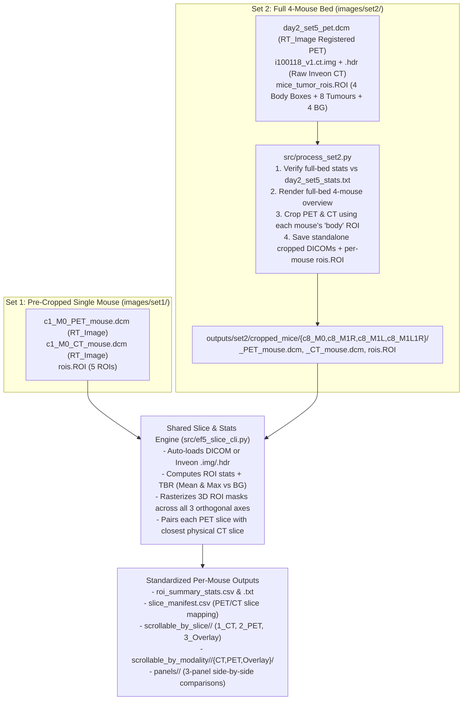

# EF5 PET/CT & RT_Image Analysis Pipeline (`ef5_rt`)

Python + Docker toolkit for loading, cropping, analyzing, and visualizing preclinical mouse subcutaneous tumour **EF5 PET/CT** datasets alongside manually drawn 3D Regions of Interest (`.ROI`) exported from Ted Graves' **RT_Image** (IDL) software ([NITRC](https://www.nitrc.org/projects/rt_image)).

---

## Repository Contents

```text
.
├── Dockerfile                  # Python 3.12-slim scientific imaging + JupyterLab image
├── docker-compose.yml          # Container service mounting workspace & exposing JupyterLab (:8888)
├── requirements.txt            # Python dependencies (pydicom, numpy, scipy, scikit-image, matplotlib, etc.)
├── src/
│   ├── rt_image_loader.py      # Unified loader for RT_Image DICOMs, raw Inveon .img/.hdr, & binary .ROI files
│   ├── ef5_slice_cli.py        # Configurable CLI & Python API for 3-axis scrollable PET/CT + ROI slices
│   ├── inspect_set1.py         # Set 1 (c1_M0) inspection, ROI statistics, and sample slice rendering
│   └── process_set2.py         # Set 2 (4-mouse bed) verification, bounding-box cropping, & per-mouse slicing
├── notebooks/
│   ├── explore_set1.ipynb      # Interactive ipywidgets 3-plane slice explorer for Set 1
│   └── run_slice_generator.ipynb # Mini-notebook showing how to configure & run ef5_slice_cli
├── agent_notes/                # Implementation plans and analysis walkthroughs for Set 1 & Set 2
└── .gitignore                  # Excludes raw images/ and generated outputs/ from version control
```

*(Note: Both `images/` and `outputs/` are excluded via `.gitignore` so large binary scans and generated slice stacks stay local while code, notebooks, and curated results remain lightweight.)*

---

## Quick Start (Docker + WSL2)

### 1. Build the Container
```bash
docker compose build
```

### 2. Run the Interactive JupyterLab Environment
```bash
docker compose up -d
```
Then open `http://localhost:8888/lab` in your browser and launch either:
- `notebooks/explore_set1.ipynb` (interactive 3-plane slice viewer with sliders)
- `notebooks/run_slice_generator.ipynb` (parameter configuration guide for the slice CLI)

### 3. Run Scripts & CLI via Docker
```bash
# Inspect Set 1 sample slices and summary stats
docker compose run --rm ef5 python -m src.inspect_set1

# Process Set 2 (crop 4 mice from full scanner bed + generate 3-axis slices for each mouse)
docker compose run --rm ef5 python -m src.process_set2

# Run the configurable CLI slice generator on any single-mouse dataset (Set 1 or cropped Set 2)
docker compose run --rm ef5 python -m src.ef5_slice_cli \
    --pet images/set1/c1_M0_PET_mouse.dcm \
    --ct images/set1/c1_M0_CT_mouse.dcm \
    --roi images/set1/rois.ROI \
    --out-dir outputs/set1_every_pet_slice \
    --step-pet-slices 1 \
    --scope roi
```

---

## Distinguishing Raw Scanner Data vs. RT_Image Binaries

The unified loader in `src/rt_image_loader.py` automatically detects and handles both **RT_Image exported binaries** and **raw Siemens Inveon scanner files** via `load_volume_auto(path)`:

| File Format | Origin | Loader Function | How It Is Handled |
| :--- | :--- | :--- | :--- |
| **`.dcm`** (e.g., `c1_M0_PET_mouse.dcm`, `c1_M0_CT_mouse.dcm`, `day2_set5_pet.dcm`) | **RT_Image Export** | `load_rt_image_dicom()` | Reads headerless Implicit VR Little Endian DICOMs (`force=True`, no 128-byte `DICM` preamble), sanitizes float-formatted `NumberOfFrames` (e.g., `"101.00000"` → `101`), converts `int16` pixels to physical units (`%IDG` or `HU`) via `RescaleSlope`/`RescaleIntercept`, and reads `ImagePositionPatient` as the 3D physical `origin` (critical for cropped single-mouse sub-volumes). |
| **`.img` + `.hdr`** (e.g., `i100118_v1.ct.img`, `i100118_F18_10min_scan_em_v5.pet.img`) | **Raw Siemens Inveon Scanner** | `load_inveon_volume()` | Parses the ASCII `.hdr` for dimensions (`x/y/z_dimension`), voxel sizes (`pixel_size_x/y/z`), `data_type` (`2` = `<i2` for CT, `4` = `<f4` for PET), and `scale_factor`; memory-maps the binary `.img` file (`mmap=True`) and reverses axis 0 (`[::-1, :, :]`) to match RT_Image's physical coordinate convention (`origin = [0, 0, 0]`). |
| **`.ROI`** (e.g., `rois.ROI`, `mice_tumor_rois.ROI`) | **RT_Image Binary Archive (`v3.10`)** | `load_rt_image_roi()` | Parses the binary RT_Image `version 3.10` format containing `freehand`, `ellipse`, and `rectangle` 3D contours. Inspects each contour's plane normal (`basis[0]`) to support ROIs drawn on any orthogonal plane (transaxial `Y`-normal tumour contours, sagittal `X`-normal background ellipses, or 80 mm `body` bounding boxes). |

> **Important Note on Raw PET vs. RT_Image PET in Set 2:**
> - **CT (`i100118_v1.ct.img`)**: Served as the unmodified fixed reference frame in RT_Image. Loading it directly via `load_inveon_volume()` matches all 12 CT rows of `day2_set5_stats.txt` to 4 decimal places.
> - **PET (`i100118_F18_10min_scan_em_v5.pet.img` vs. `day2_set5_pet.dcm`)**: `load_inveon_volume()` can read the raw `.pet.img`, but it contains uncalibrated scanner counts prior to RT_Image's rigid PET-to-CT registration and `%IDG` dose calibration. Therefore, `process_set2.py` pairs **`day2_set5_pet.dcm`** (RT_Image registered `%IDG` PET) with **`i100118_v1.ct.img`** (raw Inveon CT), matching all 28 rows of `day2_set5_stats.txt`.

---

## Current Processing Pipeline (Set 1 & Set 2)



### Summary of Set 1 vs. Set 2 Workflows
1. **Set 1 (`c1_M0`)**:
   - Inputs are already cropped to a single mouse (`PET: 101×32×41`, `CT: 388×119×152`) and exported as RT_Image DICOMs with 5 ROIs (`c1_M0_L PET ROI`, `c1_M0_R PET ROI`, `c1_M0_L CT ROI`, `c1_M0_R CT ROI`, `M0 bg ROI`).
   - Feeds directly into `src/inspect_set1.py` (fixed sample slices) or `src/ef5_slice_cli.py` (configurable slice spacing down to `--step-pet-slices 1`).
2. **Set 2 (`day2_set5`, 4 Mice: `c8_M0`, `c8_M1R`, `c8_M1L`, `c8_M1L1R`)**:
   - `src/process_set2.py` loads the full-bed registered PET (`159×128×128`), memory-maps the 291 MB raw Inveon CT (`632×480×480`), and parses all 16 ROIs from `mice_tumor_rois.ROI`.
   - Uses each mouse's 80 mm `body` rectangle ROI to crop PET and CT into single-mouse sub-volumes with updated physical `ImagePositionPatient` origins, writing standalone `<mouse>_PET_mouse.dcm`, `<mouse>_CT_mouse.dcm`, and `rois.ROI` files to `outputs/set2/cropped_mice/<mouse_id>/`.
   - Passes each cropped mouse triplet into the **exact same** `run_slice_generator()` engine (`src/ef5_slice_cli.py`) to produce identical stats tables, slice manifests, and pixel-aligned scrollable 3-axis visualizations.

---

## CLI Parameter Reference (`src/ef5_slice_cli.py`)

| Flag | Default | Description |
| :--- | :--- | :--- |
| `--pet` | *(required)* | Path to PET volume (`.dcm` or `.img`/`.hdr`) |
| `--ct` | *(required)* | Path to CT volume (`.dcm` or `.img`/`.hdr`) |
| `--roi` | *(required)* | Path to RT_Image binary `.ROI` file |
| `--out-dir` | *(required)* | Output directory for slices, panels, stats, and manifest |
| `--planes` | `transaxial coronal sagittal` | Orthogonal planes to render |
| `--step-pet-slices` | `1` | Step size in integer PET voxels (`1` = every individual PET slice + closest CT slice) |
| `--step-mm` | `None` | Optional step size in physical millimeters (overrides `--step-pet-slices`) |
| `--scope` | `roi` | `roi` (only slices intersecting ROIs ± `--margin-mm`) or `all` (entire volume) |
| `--margin-mm` | `0.0` | Extra physical margin (mm) around ROI bounding box when `--scope roi` |
| `--modes` | `CT PET Overlay Panel` | Which visualizations to export per slice |
| `--ct-clim` | `-500 800` | CT grayscale display window (HU) |
| `--pet-clim` | `0.0 2.2` | PET display window (`%IDG`; use `0.0 2.8` for high-uptake Set 2 tumours) |
| `--overlay-alpha` | `0.78` | Maximum opacity of the smooth-alpha PET layer in fused overlays |
| `--full-long-axis` | `False` | Keep full cranial-caudal Y axis in coronal/sagittal views instead of zooming to ROIs |
| `--dpi` | `120` | Output resolution (`120` DPI = `1200 × 960 px` for single frames) |

---

## Mathematical Modelling of Tumour Growth & Hypoxia Radiotherapy Response (`ef5_rt_model` branch)

The `src/modeling/` package builds on curated Stanford postdoc modelling work (`images/set4/past_work/`) and the longitudinal First EF5 RT Study voxel bundles (`outputs/first_ef5_rt_study/voxel_bundles/`) to provide two linked radiobiological simulators sharing a unified oxygen-dependent physics core (`src/modeling/physics.py`):

1. **Sub-Goal 1 — Coupled 1D Spheroid ODE/PDE Model (`src/modeling/spheroid_rt_model.py`, `src/modeling/legacy_spheroid.py`)**:
   - Ports and audits the 2013 MATLAB spheroid ODE (`my_spheroid_07/08`) and Dr. Alex Fletcher's `CodeForBobby.m` (verified against Helen Byrne's exact analytical Greenspan Eqs. 44–50).
   - Replaces ad-hoc binary rim width and volume-threshold brakes with a coupled quasi-steady spherical oxygen PDE, Alper–Howard-Flanders continuous OER + corrected LQ survival, two-stage mitotic-catastrophe clearance, and emergent inter-fraction reoxygenation across PLOS ONE single-fraction and fractionated schedules (`0 Gy`, `1×10`, `1×20`, `1×40`, `2×10`, `4×5`, `4×10 Gy`).
2. **Sub-Goal 2 — Tumour-Specific 3D Image-Initialised Voxel Model (`src/modeling/voxel_initializer.py`, `src/modeling/voxel_rt_model.py`)**:
   - Initialises a 3D isotropic (`0.5 mm`) continuum PDE model directly from pre-treatment (Day -1) CT tumour geometry and EF5 PET spatial hypoxia, anchoring a per-tumour vascular supply field $h_v(\mathbf{x})$ to preserve each tumour's measured 3D hypoxia distribution.
   - Couples a 3D quasi-steady oxygen PDE with 3D Darcy pressure-velocity tumour expansion/contraction mechanics (`-∇²P = S_vol`, `u = -∇P`, extending Helen Byrne's PCMI notes Sec. 5) and a virtual EF5 PET forward model, exporting both comparison figures and 3D RAS+ NIfTI predictions (`outputs/ef5_rt_model/voxel/nifti/`).

### Running the Modelling Pipelines & Tests
```bash
# Sub-Goal 1: 1D spheroid validation & PLOS ONE regimen sweep
docker compose run --rm ef5 python -m src.modeling.run_spheroid_study

# Sub-Goal 2: 3D CT/EF5-PET image-initialised study across the 5 longitudinal A549 mice
docker compose run --rm ef5 python -m src.modeling.run_voxel_study

# Visual comparison report generator (1D & 3D vs real data)
docker compose run --rm ef5 python -m src.modeling.generate_visual_report

# Automated physics, analytical, and 3D conservation tests
docker compose run --rm ef5 python -m unittest discover -s tests -v
```
Interactive exploration is available via JupyterLab in `notebooks/explore_ef5_rt_models.ipynb`, visual comparison reports are in `outputs/ef5_rt_model/reports/`, and planning/walkthrough notes are tracked under `agent_notes/modelling/`.

