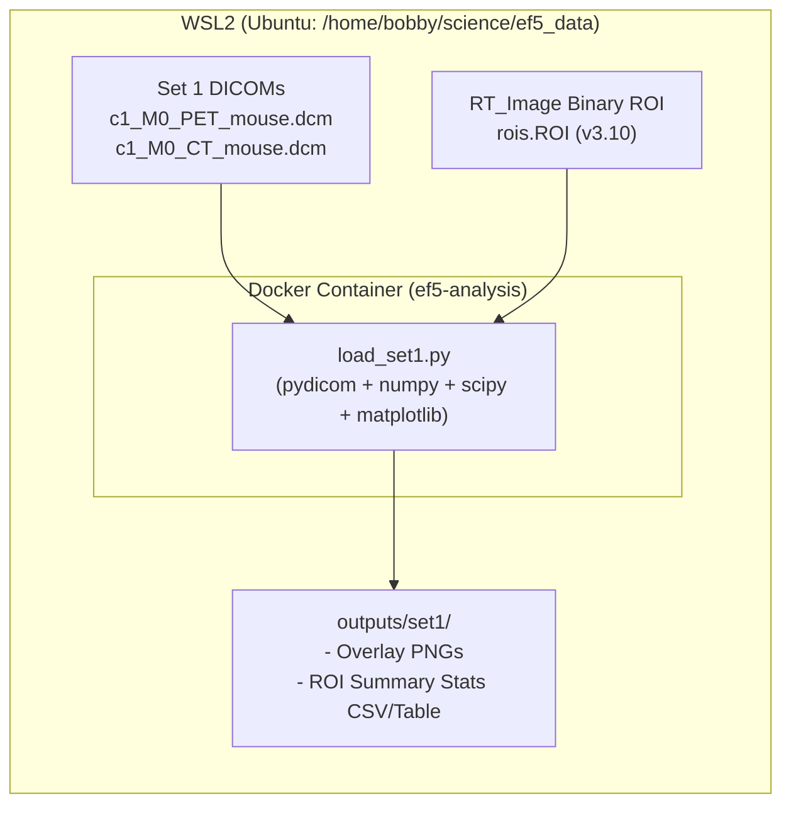

# Plan: Dockerized Python Environment & RT_Image PET/CT + ROI Loader (`set1`)

## Goal Description
We want to load, inspect, and visualize the mouse subcutaneous tumour EF5 PET/CT dataset in `images/set1` (`c1_M0_PET_mouse.dcm`, `c1_M0_CT_mouse.dcm`, and `rois.ROI`) using Python inside a reproducible Docker container running via WSL2 / Docker Desktop.

### Key Technical Findings from Initial File Inspection
During initial inspection of WSL, Docker, and the raw binary headers in `images/set1`, I confirmed:

1. **WSL2 & Docker Connectivity**:
   - Calling `wsl -d Ubuntu -- bash -c "docker ..."` works directly (`Docker version 29.9.3` is available inside your `Ubuntu` WSL distribution).
   - Your project folder sits cleanly inside the native Linux filesystem at `/home/bobby/science/ef5_data`, which means bind-mounting `/home/bobby/science/ef5_data:/workspace` inside Docker from WSL has native Linux I/O performance.

2. **RT_Image DICOM Quirks (`c1_M0_PET_mouse.dcm` & `c1_M0_CT_mouse.dcm`)**:
   - Exported from Ted Graves' **RT_Image** (IDL) at `Stanford SCi3`.
   - **No 128-byte DICOM Part 10 preamble (`DICM`)**: The files begin immediately at offset `0x0000` with tag `(0008, 0000)` encoded in **Implicit VR Little Endian**.
   - **3D Volume Storage & Quirk in `NumberOfFrames`**:
     - `c1_M0_PET_mouse.dcm` is a single-file 3D volume of shape `101 planes × 32 rows × 41 columns` (`int16` pixels, `265,024` bytes in `(7FE0,0010)`), with `PixelSpacing = [0.7764, 0.7764] mm`, `SliceThickness = 0.796 mm`, and linear rescaling to `%IDG` via `RescaleSlope = 0.0020236869` and `RescaleIntercept = 66.310150`.
     - RT_Image wrote `NumberOfFrames (0028,0008)` as a floating-point string (`"101.00000 "`), which causes `pydicom`'s default `ds.pixel_array` to fail with `ValueError` unless `NumberOfFrames` is sanitized to `"101"` before decoding (or read via `(0028,0012) Planes`).

3. **RT_Image `.ROI` Binary Format (`rois.ROI`)**:
   - The file is a binary RT_Image `version 3.10   07/09/2008` ROI archive containing **5 ROIs**:
     1. `c1_M0_L PET ROI` (freehand)
     2. `c1_M0_R PET ROI` (freehand)
     3. `M0 bg ROI` (ellipse)
     4. `c1_M0_R CT ROI` (freehand)
     5. `c1_M0_L CT ROI` (freehand)
   - Each ROI record stores its label, number of contours (`uint16`), original `.ROI` path, display color (`RGBA`), line thickness/opacity (`float32`), reference image path, and a sequence of contours where each contour stores its shape type (`"freehand"` or `"ellipse"`), vertex count (`uint32`), 3D physical coordinates `(x, y, z)` in `float64` (millimeters in DICOM patient coordinate space), and a 108-byte plane/orientation trailer.



---

## User Review Required

> [!IMPORTANT]
> **Sandbox Permission Note**: Because Antigravity's terminal sandbox blocks `wsl.exe` by default, commands that invoke `wsl -d Ubuntu -- docker ...` will request execution outside the sandbox (`BypassSandbox: true`). File creation and editing in your workspace (`Dockerfile`, `docker-compose.yml`, Python scripts) will happen directly without needing extra prompts.

## Open Questions

1. **Container Workflow Preference**: Would you prefer a simple CLI/script-oriented container (`Dockerfile` + `docker compose run --rm ef5 python ...` that saves plots/CSVs to an `outputs/` folder), or would you also like **JupyterLab** included and exposed on a local port (e.g., `http://localhost:8888`) so you can interactively explore the slices in your browser?
2. **Initial Output Goal for Set 1**: For this first step on `set1`, should our Python verification script generate:
   - Registered PET/CT orthogonal or axial slice overlays with the 5 ROI contours plotted on top (saved as PNGs), **and**
   - Quantitative ROI summary statistics (`%IDG` for PET, Hounsfield-like units for CT: min, max, mean, std, volume) similar to `day2_set5_stats.txt`?

---

## Proposed Changes

### 1. Docker Environment Setup
We will create a lightweight, reproducible Python scientific imaging environment at the workspace root (`/home/bobby/science/ef5_data`).

#### [NEW] `Dockerfile`
- Base image: `python:3.12-slim`
- Installs core scientific & medical imaging libraries via `requirements.txt`.
- Sets working directory to `/workspace`.

#### [NEW] `requirements.txt`
- `numpy`
- `scipy`
- `pydicom`
- `matplotlib`
- `pandas`
- `scikit-image` (for rasterizing 2D/3D polygon ROI contours onto the PET and CT voxel grids)
- `SimpleITK` / `nibabel` (helpful when we move to `set2` Analyze/Inveon `.img`/`.hdr` files)
- *(Optional based on your preference)* `jupyterlab`

#### [NEW] `docker-compose.yml`
- Defines an `ef5` service mounting `.` to `/workspace` inside the container so any scripts or outputs written inside the container appear immediately in `\\wsl.localhost\Ubuntu\home\bobby\science\ef5_data`.

---

### 2. Python Loader for RT_Image DICOMs & `.ROI` Files

#### [NEW] `src/rt_image_loader.py`
- **`load_rt_image_dicom(path)`**:
  - Reads headerless Implicit VR Little Endian DICOM files (`pydicom.dcmread(path, force=True)`).
  - Sets `TransferSyntaxUID = ImplicitVRLittleEndian`.
  - Sanitizes `NumberOfFrames` (e.g., `"101.00000 "` -> `101`) and extracts the 3D array `(Z, Y, X)`, applying `RescaleSlope` and `RescaleIntercept` to convert raw `int16` values into physical units (`%IDG` for PET).
  - Extracts the 3D affine / voxel-to-world coordinate grid from `ImagePositionPatient (0020,0032)`, `ImageOrientationPatient (0020,0037)`, `PixelSpacing (0028,0030)`, and `SpacingBetweenSlices (0018,0088)`.
- **`load_rt_image_roi(path)`**:
  - Parses RT_Image `version 3.10` binary `.ROI` files (`rois.ROI`), returning a structured list of ROIs with their names, colors, reference image paths, and per-slice contour vertices `(x, y, z)` in physical millimeter coordinates, plus a helper to map physical `(x, y, z)` coordinates onto PET or CT voxel indices `(k, j, i)`.

#### [NEW] `src/inspect_set1.py`
- Loads `images/set1/c1_M0_PET_mouse.dcm`, `images/set1/c1_M0_CT_mouse.dcm`, and `images/set1/rois.ROI`.
- Prints metadata (dimensions, voxel spacing, physical bounds, intensity ranges, and ROI contour counts/slice ranges).
- Computes ROI voxel statistics (points, volume in $\text{cm}^3$, min, max, mean, std) and saves fused PET/CT + ROI contour visualization plots to `outputs/set1/`.

---

## Verification Plan

### Automated Verification
1. Build the Docker image inside WSL2:
   ```bash
   wsl -d Ubuntu -- bash -c "cd /home/bobby/science/ef5_data && docker compose build"
   ```
2. Run the `set1` inspection and visualization script inside the container:
   ```bash
   wsl -d Ubuntu -- bash -c "cd /home/bobby/science/ef5_data && docker compose run --rm ef5 python src/inspect_set1.py"
   ```
3. Verify that all 3 files in `images/set1` parse without error and that the generated visualization PNGs and ROI summary table in `outputs/set1/` align with the tumour locations on the PET/CT volumes.
