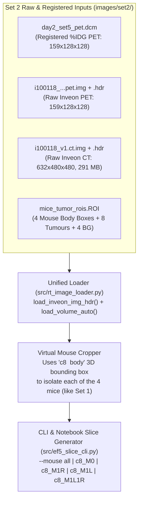

# Implementation Plan: Set 2 Multi-Mouse Inveon PET/CT & ROI Pipeline (`images/set2`)

## 1. Overview & Findings from Set 2 File Inspection
We inspected all files in `images/set2/` and verified how they relate to one another and to RT_Image's exported ground-truth table ([day2_set5_stats.txt](file:////wsl.localhost/Ubuntu/home/bobby/science/ef5_data/images/set2/day2_set5_stats.txt)):

### A. Image Volumes in `images/set2/`
1. **`day2_set5_pet.dcm` (5.2 MB) — Registered & Calibrated 4-Mouse PET Volume**:
   - Exported from RT_Image after registering the PET scan to the CT reference frame and calibrating voxel intensities to **`%IDG`**.
   - Dimensions: `159 planes × 128 rows × 128 cols` (`int16` with `RescaleSlope` & `RescaleIntercept` to `%IDG`).
   - Voxel spacing: `(dz, dy, dx) = (0.796, 0.776383, 0.776383) mm`, `Origin = [0.0, 0.0, 0.0] mm`.
   - Matches all 16 PET rows in `day2_set5_stats.txt` (`Points`, `Volume`, `Minimum`, `Maximum`, `Mean`, `Std Dev`, `Sum`) to **4 decimal places**.

2. **`i100118_F18_10min_scan_em_v5.pet.img` (10.4 MB) & `.hdr` — Raw Siemens Inveon PET**:
   - Raw 32-bit float (`<f4`) binary array of shape `(159, 128, 128)` with axial slice order reversed (`[::-1, :, :]`) relative to RT_Image's DICOM coordinate convention.
   - Contains uncalibrated scanner counts prior to the fine PET-to-CT rigid registration and `%IDG` scaling saved in `day2_set5_pet.dcm`.

3. **`i100118_v1.ct.img` (291.2 MB) & `.hdr` — Raw Siemens Inveon Full-Bed CT**:
   - Raw 16-bit signed integer (`<i2`, `data_type = 2`) binary volume of shape `632 planes × 480 rows × 480 cols`.
   - Isotropic voxel spacing from `.hdr`: `pixel_size_x = pixel_size_y = pixel_size_z = 0.206753 mm` (physical FOV: `130.67 × 99.24 × 99.24 mm`, matching the PET FOV).
   - Reversing the axial slice index (`raw_ct[::-1, :, :]`) places `i100118_v1.ct.img` in the exact physical coordinate frame (`Origin = [0.0, 0.0, 0.0] mm`) used by `mice_tumor_rois.ROI` and `day2_set5_pet.dcm`, matching all 12 CT rows of `day2_set5_stats.txt` (`Min = -1118.0`, `Max = 532.0`, `Mean = -163.2879`, etc.) to **4 decimal places**.
   - Can be loaded via `numpy.memmap` so we never need to copy the full 291 MB array into RAM unless cropping out an individual mouse.

---

### B. Multi-Mouse ROI Structure (`mice_tumor_rois.ROI`)
`mice_tumor_rois.ROI` (`version 3.10   07/09/2008`) contains **16 ROIs** covering **4 mice** scanned simultaneously in a 2×2 bed arrangement (`c8 M0`, `c8 M1R`, `c8 M1L`, `c8 M1L1R`):

| Mouse ID | Body Bounding Box ROI (`rectangle`, 80 mm slab) | Left Tumour ROI (`freehand`) | Right Tumour ROI (`freehand`) | Background ROI (`ellipse`, sagittal) |
| :--- | :--- | :--- | :--- | :--- |
| **`c8 M0`** | `c8 M0 body` (`X: [-80.5, -49.2]`, `Z: [-76.7, -45.5]`, `Y: [-79.6, -46.2]`) | `c8 M0 LHS Tumor` (6 slices) | `c8 M0 RHS Tumor` (8 slices) | `c8 M0 bg ROI` (7 slices) |
| **`c8 M1R`** | `c8 M1R body` (`X: [-45.9, -15.3]`, `Z: [-76.7, -45.5]`, `Y: [-79.2, -46.6]`) | `c8 M1R LHS tumor` (9 slices) | `c8 M1R RHS Tumor` (13 slices) | `c8 M1R bg ROI` (7 slices) |
| **`c8 M1L`** | `c8 M1L body` (`X: [-82.1, -54.4]`, `Z: [-46.9, -15.6]`, `Y: [-78.9, -46.9]`) | `c8 M1L LHS Tumor` (11 slices) | `c8 M1L RHS Tumor` (11 slices) | `c8 M1L bg ROI` (7 slices) |
| **`c8 M1L1R`** | `c8 M1L1R body` (`X: [-50.9, -22.4]`, `Z: [-45.8, -14.6]`, `Y: [-77.6, -48.2]`) | `c8 M1L1R LHS Tumor` (17 slices) | `c8 M1L1R RHS Tumor` (14 slices) | `c8 M1L1R bg ROI` (9 slices) |

---

## 2. Proposed Implementation Steps for Set 2

### Step 1: Add Siemens Inveon `.img` / `.hdr` Loader to `src/rt_image_loader.py`
- Implement **`parse_inveon_hdr(hdr_path)`** and **`load_inveon_volume(img_path, hdr_path=None, mmap=True)`**:
  - Parses key-value parameters from the ASCII `.hdr` file (`x_dimension`, `y_dimension`, `z_dimension`, `pixel_size_x`, `pixel_size_y`, `pixel_size_z`, `data_type`, `scale_factor`, `calibration_factor`, `scan_time`, `modality`).
  - Maps `data_type` (`2` -> `<i2`, `4` -> `<f4`) and memory-maps the binary `.img` file as shape `(z_dimension, y_dimension, x_dimension)`, reversing axis 0 (`[::-1, :, :]`) to match RT_Image's physical coordinate convention.
  - Returns an `RTImageVolume` object completely compatible with our existing DICOM volumes!
- Implement **`load_volume_auto(path)`** so `src/ef5_slice_cli.py` seamlessly accepts either `.dcm` or `.img`/`.hdr` paths for `--pet` and `--ct`.

### Step 2: Add Analytical Ellipse Masking & Multi-Mouse Bounding-Box Cropping
- Refine `"ellipse"` rasterization in `build_roi_3d_mask()` to use the exact analytical ellipse equation inside the slice plane so Set 2's 4 sagittal `bg ROI` voxel counts match `day2_set5_stats.txt` to the exact integer voxel count (`320, 325, 283, 447` on PET and `17726, 18347, 16033, 24406` on CT).
- Implement **`crop_volume_to_roi_box(vol, body_roi)`**:
  - Given any of the 4 mouse body ROIs (`c8 M0 body`, `c8 M1R body`, `c8 M1L body`, `c8 M1L1R body`), slices the 3D `RTImageVolume` to that mouse's 3D bounding box and updates `vol.origin` to the cropped sub-volume corner (producing a single-mouse `RTImageVolume` identical in structure to Set 1's `c1_M0`!).

### Step 3: Extend `src/ef5_slice_cli.py` for Multi-Mouse Datasets (`Set 2`)
- Add `--mouse` option to `src/ef5_slice_cli.py`:
  - `--mouse full`: Renders the full 4-mouse bed with all 16 ROIs superimposed.
  - `--mouse c8_M0` (or `c8_M1R`, `c8_M1L`, `c8_M1L1R`, or `per-mouse` to automatically loop over all 4 mice!):
    - Automatically crops the PET and CT volumes to that mouse's `body` bounding box ROI, filters the ROIs to that mouse's LHS tumour, RHS tumour, and background ROI, and generates the scrollable 3-axis slices (`CT`, `PET`, `Overlay`, `Panel`) and per-mouse statistics!

### Step 4: Verification Against `day2_set5_stats.txt` & Visual Check
- Run a verification script comparing our computed Set 2 PET + CT table against all 28 rows of [day2_set5_stats.txt](file:////wsl.localhost/Ubuntu/home/bobby/science/ef5_data/images/set2/day2_set5_stats.txt).
- Generate full-bed overview slices and per-mouse scrollable slices for all 4 mice in `outputs/set2/`.
- Add a Set 2 section / notebook showing how to inspect both the 4-mouse bed and individual cropped mice.

---

## 3. Open Questions for Review
1. **Per-Mouse vs. Full-Bed Outputs**: For Set 2, do you like the approach where the CLI can output **both** full-bed 4-mouse views and automatically cropped **per-mouse** views (using the 4 `c8 ... body` bounding box ROIs so each mouse can be scrolled through individually just like Set 1)?
2. **PET Input Choice for Set 2**: Since `day2_set5_pet.dcm` has the RT_Image PET-to-CT registration and `%IDG` calibration already applied (matching `day2_set5_stats.txt`), should we use `day2_set5_pet.dcm` + `i100118_v1.ct.img` as the primary Set 2 pair, while also supporting `i100118_F18_10min_scan_em_v5.pet.img` in the loader?
