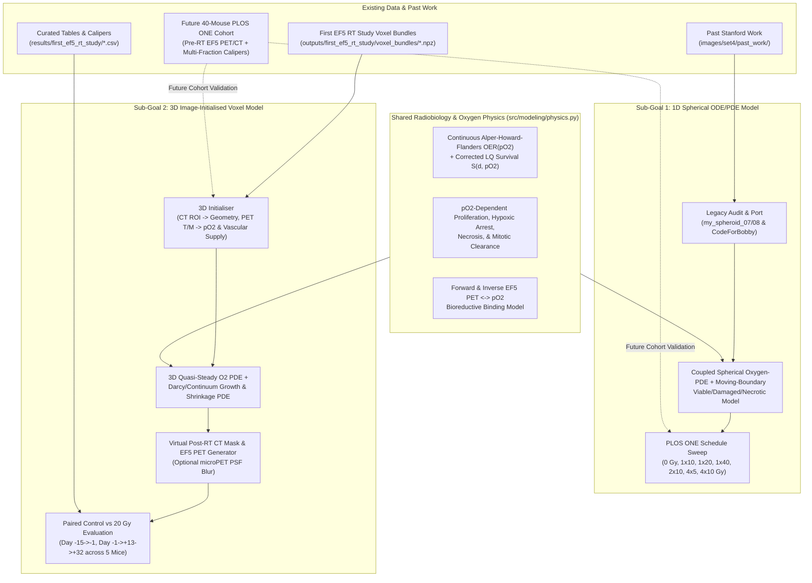

# Implementation Plan: EF5 PET/CT-Driven Tumour Growth & Hypoxia Radiotherapy Modelling (`ef5_rt_model`)

## Goal Description

This plan establishes a clean, reproducible modelling pipeline on a new Git branch `ef5_rt_model` (branched off `first_ef5_rt_study`) to bridge your postdoc mathematical oncology work (`13. Predicting RT Response`) with the curated longitudinal **First EF5 RT Study** voxel bundles (`outputs/first_ef5_rt_study/voxel_bundles/`) and prepare for downstream validation on the 40-mouse (80-tumour) PLOS ONE cohort ([Ali et al., 2015](https://journals.plos.org/plosone/article?id=10.1371/journal.pone.0139425)).

It addresses four linked objectives:
1. **Repository setup & curated archival**: Branch `ef5_rt_model` off `first_ef5_rt_study` and `rsync` only the high-value code, reports, and reference notes from `D:\Research\Stanford\Work\001. SMIS Postdoc\Projects\13. Predicting RT Response` into `images/set4/past_work/` (excluding Apple `._*`/`.DS_Store` metadata, backup duplicates, and unrelated large datasets).
2. **Sub-goal 1 — Refined Spheroid ODE/PDE Model**: Resolve the limitations of your 2013 spheroid ODE model (`08. Spheroid Model`) by integrating Dr. Alex Fletcher's continuous quasi-steady oxygen reaction-diffusion formulation (`09. Alex Spheroid Model`) with oxygen-dependent Linear-Quadratic (LQ) radiation killing, mitotic clearance, and emergent inter-fraction reoxygenation, and verify reproduction of the PLOS ONE single-fraction and fractionated trends.
3. **Sub-goal 2 — Tumour-Specific 3D Image-Initialised Voxel Model**: Build a 3D continuum PDE voxel simulator initialised directly from pre-treatment (Day -1) CT tumour geometry and EF5 PET spatial hypoxia (`outputs/first_ef5_rt_study/voxel_bundles/`), evolve it forward under `0 Gy` (Control) and `20 Gy` (RT), and evaluate how well it reproduces observed Day +13 and Day +32 tumour volumes, caliper trajectories, and spatial EF5 PET trends across the bilateral A549 mouse cohort.
4. **Cohort-Validation Readiness**: Design modular interfaces and standardised outputs (tables, 3D NIfTI/NPZ predictions, QC overlays, Jupyter notebook) so the same calibrated engine can later be run directly on the 40-mouse PLOS ONE EF5 PET/CT + multi-fraction caliper cohort.

---

## Audit of Past Work (`13. Predicting RT Response`) & Empirical Data

### 1. Summary of Past Modelling Assets & Key Findings

| Source Folder | Size | What It Contains | Key Scientific Insights & Limitations Identified |
| :--- | :---: | :--- | :--- |
| `Code/09. Alex Spheroid Model/` | 0.8 MB | `alex email.txt`, `NotesForBobby.pdf`, `CodeForBobby.m`, `pcmi_proofs.pdf` (Helen Byrne's PCMI 2005 notes) | Replaces binary rim width with a 1D spherical quasi-steady $O_2$ reaction-diffusion PDE (Greenspan/Byrne framework); implicitly defines hypoxic ($R_H$) and necrotic ($R_N$) radii via thresholds $c_H, c_N$. Untreated growth only; minor bugs in `CodeForBobby.m` (L40 & L72 assign `R_H=0` instead of `R_N=0`; L59 solves $O_2$ at `R(n)` rather than `R(n+1)`). Byrne's `pcmi_proofs.pdf` (Secs. 4–6) also gives the exact 3D Darcy-pressure continuum extension. |
| `Code/08. Spheroid Model/` | 1.7 MB | `my_spheroid_01..08.m`, `my_spheroid_odes_01..07.m`, `my_spheroid_rt_04..07.m`, `Plots.pptx` | Tracks viable ($N_v$), damaged normoxic ($N_{dn}$), and damaged hypoxic ($N_{dh}$) populations with fixed normoxic shell width $r_2 = 0.45$ and LQ radiation events. Reproduces qualitative PLOS ONE trends (`1×10`, `1×40`, `4×5`, `4×10 Gy`), **but** relies on ad-hoc heuristics (exponential proliferation brake above $V_t = 500$, manual switch to $k_{d3} = 0.05$ after final fraction, binary `OERh = 2.7` vs `1.0`, halving $r_2$ on RT) and has two MATLAB typos (`r = (3*d)/(4*pi)*N^(1/3)` misses cube-root on constant; `bh = b/OERh` instead of `b/OERh^2`). |
| `Reports/` | 11.1 MB | `report_v1.tex`, `report_v1.pdf`, `expt_vs_sim_srt.png`, `expt_vs_sim_frt.png`, `Overview of Spheroid Model v1.0.pptx` | Explicitly documents the 3 PLOS ONE hallmarks to match and the exact model flaws discussed with Alex Fletcher on 5 June 2013. |
| `Code/07. Image Based Building Blocks/` | 6.1 MB | `model_tumor_2a..2g.m`, `diffusion2Dp.m`, `reactionDiffusion2D.m`, `pushCellsIntoNextBand1.m`, `getCellsFromNextBand1.m`, `load_PET_data.m`, `ideas.txt` | 2D image-initialised voxel prototype with rim $O_2$ diffusion, sigmoidal $p\text{O}_2$-dependent proliferation, delayed clearance of RT-damaged cells $X$, vessel efficiency drop with tumour age/RT, and cityblock distance-band cell pushing/compacting. Strong conceptual blueprint, though integer cell-by-cell band loops are slow and cause grid-anisotropy in 3D. |
| `Code/05. Titz Model/` & `06. Tumor Specific pO2/` | 0.3 MB | `hypoxia_PET_to_pO2.m`, `titz_model_01.m`, `load_tumor_mask.m` | Provides Alper–Howard-Flanders OER ($m=3, K=3\text{ mmHg}$), PET-to-$p\text{O}_2$ mapping concept (Titz & Jeraj 2008), and 3D CT-mask Euclidean distance transform (`bwdist`) shell mapping. |
| `Code/02. Scheidegger/` & `04. Simple FRT Model/` | 0.35 MB | `rt_data_a549.mat`, `scheidegger_model_02.m`, `rt_model_06.m`, `reoxygenation models.pptx` | `rt_data_a549.mat` contains legacy normalized A549 growth curves for 20 Gy and 7 Gy stratified by EF5 `T/M` (`<2.0`, `2.0–2.5`, `>2.5`). |
| `Data/DCE MRI`, `Code/01. Cat Hypoxia`, `Images/`, `PDEs/` | ~220 MB | Unrelated KRas DCE MRI (168 MB), 2006 FMISO PK GUI (23 MB), duplicate Set 1 `c1_M0` scans (14 MB), generic FDM HTML/PDFs (14 MB) | Recommended to **exclude** from `rsync` (except optionally `Data/DCE MRI Subcutaneous Tumor/CT-T2-DCE.pdf`, 0.9 MB, which visually supports rim-perfusion assumptions). |

### 2. Observed Trends in the First EF5 RT Study (`results/first_ef5_rt_study/`)

Analysis of `tumour_master_wide.csv` and `caliper_growth_curves.csv` (6 A549 mice, bilateral tumours, `20 Gy` single fraction on Day 0 vs contralateral `0 Gy` Control) highlights four clear benchmarks for our 3D model:
1. **Untreated `Control_0Gy` growth & deepening hypoxia**: Across all 4 Day +32 survivors, control PET/CT volume grows **3.6×–4.2×** from Day -1 to Day +32 (`0.18–0.44 cm³ → 0.76–1.67 cm³`), while mean raw EF5 uptake increases (`0.66–1.03 → 1.16–1.78 %ID/g`).
2. **Biphasic `RT_20Gy` response (delayed clearance)**: Irradiated tumours initially continue expanding/swelling through Day +4 to Day +13 (consistent with mitotic catastrophe + delayed clearance), then arrest or regress between Day +13 and Day +32 (`c2_M1L1R_RT`: `0.14 → 0.37 → 0.24 cm³`, caliper `-45%`; `c2_M2R_RT`: `0.60 → 0.81 → 0.42 cm³`; `c2_M1R_RT`: `0.24 → 0.52 → 0.53 cm³`).
3. **Post-RT reoxygenation / reduced EF5 T/M**: By Day +13 and Day +32, `RT_20Gy` EF5 `T/M` falls below pre-RT baseline and stays lower than the paired contralateral `Control_0Gy` tumour in surviving mice (note: Day +32 muscle `%ID/g` is elevated across Set 8/9 per `data_audit_notes.md`, so validation will compare both raw `%ID/g`, `T/M`, and within-mouse `RT / Control` ratios).
4. **Pre-RT hypoxia predicts 20 Gy control**: Even in this 6-mouse cohort, the least hypoxic irradiated tumour (`c2_M1L1R_RT`, pre-RT `T/M = 1.63`) regressed strongest (caliper `0.55×` baseline at Day +39), whereas the most hypoxic (`c2_M1L_RT`, pre-RT `T/M = 3.21`) resisted regression and regrew (`1.36×` baseline at Day +39).
5. **Best full-CT longitudinal showcase**: `c2_M1R` has co-registered PET+CT at **Day -1, Day +13, and Day +32**; `c2_M0`, `c2_M1L`, `c2_M1L1R` have PET+CT at Day -1 and Day +13 (plus Day -15 early-growth baseline on `c2_M0` and `c2_M1L1R` to test pure untreated growth pre-RT!).

---

## User Review Required

> [!IMPORTANT]
> **1. Curated `rsync` Scope (~15 MB vs 240 MB)**: I propose copying `Code/02. Scheidegger`, `04. Simple FRT Model` (no `Backups/`), `05. Titz Model`, `06. Tumor Specific pO2`, `07. Image Based Building Blocks` (scripts, `ideas.txt`, and `Data/` only — no `Backups/`, `Results/`, or large `.mat` sim dumps), `08. Spheroid Model` (no `Backup/`), `09. Alex Spheroid Model`, `Reports/` (source `.tex`, `.pdf`, `.png`, `.pptx` — no LaTeX build artifacts), and `Data/DCE MRI Subcutaneous Tumor/CT-T2-DCE.pdf` into `images/set4/past_work/`, excluding all `._*`, `.DS_Store`, `Thumbs.db`, `*.asv`, and `*~` files. Please confirm if you want anything else included (e.g., `01. Cat Hypoxia` or `07/Results/`).

> [!IMPORTANT]
> **2. 3D Voxel Mechanics Choice (Continuum Darcy-Pressure PDE vs Discrete Band Push-Pull)**: For Sub-goal 2, I recommend a **3D continuum reaction-diffusion + Darcy-pressure velocity PDE** (directly generalizing Helen Byrne's PCMI notes Sections 5–6 in `09. Alex Spheroid Model` and smoothing out your 2D `pushCellsIntoNextBand` / `getCellsFromNextBand` concept from `07. Image Based Building Blocks`) on an isotropic **0.5 mm** voxel grid (~`50³` padded tumour box, running 33 simulated days in seconds in SciPy). Let me know if you prefer a discrete cellular-automaton / band-shuffling model instead, or if you'd like the continuum PDE as our primary model.

## Open Questions

> [!NOTE]
> **1. PLOS ONE 40-mouse data availability**: For Sub-goal 1 calibration, I will match the published PLOS ONE qualitative & quantitative trends (`Reports/expt_vs_sim_srt.png`, `expt_vs_sim_frt.png`, and `Code/02. Scheidegger/rt_data_a549.mat`). If you already have the PLOS ONE summary growth-curve CSV/Excel tables on `D:\` and would like them referenced now, let me know; otherwise I will keep Sub-goal 1 calibrated against the published trends and expose a clean cohort runner ready for when we ingest the 40-mouse dataset.
> **2. Git/Docker execution via WSL**: Your workspace is mounted from WSL Ubuntu (`\\wsl.localhost\Ubuntu\home\bobby\science\ef5_data`) where `git`, `rsync`, and `docker compose` live. During execution, I will invoke `wsl -d Ubuntu` to create the branch, run `rsync`, and run Python simulations/tests inside `docker compose run --rm ef5` (which will prompt once for elevated WSL execution outside the Windows sandbox).

---

## System & Modelling Architecture



---

## Proposed Changes

### Phase 0: Git Branching & Curated `rsync` Migration

#### [NEW] Git branch `ef5_rt_model` & `agent_notes/` organization
- Branch directly off `first_ef5_rt_study` inside WSL:
  ```bash
  git checkout -b ef5_rt_model
  ```
- Reorganize `agent_notes/` so plans and walkthroughs stay cleanly separated and git-tracked:
  - `agent_notes/data_curation/`: move existing Set 1 / Set 2 notes (`implementation_plan.md`, `plan_set2.md`, `walkthrough_set1.md`, `walkthrough_set2.md`).
  - `agent_notes/modelling/`: store this plan (`implementation_plan.md`) and the post-execution walkthrough (`walkthrough.md`).
- Keep `images/` and `outputs/` gitignored (already configured in `.gitignore`); track all new Python modelling code (`src/modeling/`), tests (`tests/`), notebooks (`notebooks/`), `agent_notes/modelling/`, and lightweight curated summary tables/docs (`results/ef5_rt_model/`).

#### [NEW] Curated archival in `images/set4/past_work/` (gitignored local reference)
- Run clean `rsync` from `/mnt/d/Research/Stanford/Work/001. SMIS Postdoc/Projects/13. Predicting RT Response/` into `/home/bobby/science/ef5_data/images/set4/past_work/` with explicit exclusions for Apple metadata and clutter:
  - **Exclude patterns**: `--exclude='._*' --exclude='.DS_Store' --exclude='Thumbs.db' --exclude='*.asv' --exclude='*~' --exclude='Backup/' --exclude='Backups/' --exclude='*.aux' --exclude='*.log' --exclude='*.synctex.gz' --exclude='*.xcf'`
  - **Included folders/files** (~15 MB total):
    - `Code/09. Alex Spheroid Model/` (all 4 files)
    - `Code/08. Spheroid Model/` (active `.m` + `Plots.pptx`)
    - `Code/07. Image Based Building Blocks/` (`.m` scripts, `ideas.txt`, `Data/C1_M0_*.mat`; excluding `Results/` and `M2*.mat` sim dumps)
    - `Code/06. Tumor Specific pO2/` (`load_tumor_mask.m`)
    - `Code/05. Titz Model/` (`.m`, `.txt`, `.pdf`)
    - `Code/04. Simple FRT Model/` (top-level `.m`, `reoxygenation models.pptx`)
    - `Code/02. Scheidegger/` (`.m`, `rt_data*.mat`)
    - `Reports/` (`report_v1.tex`, `report_v1.pdf`, `expt_vs_sim_*.png`, `spheroid.png`, `Overview of Spheroid Model v1.0.pptx`)
    - `Data/DCE MRI Subcutaneous Tumor/CT-T2-DCE.pdf` (single reference PDF supporting rim perfusion)
- Write a concise manifest `images/set4/past_work/ARCHIVE_MANIFEST.md` documenting what was copied and what was intentionally omitted.

---

### Phase 1: Shared Radiobiology Core & Sub-Goal 1 (Refined Spheroid ODE/PDE Model)

All modelling code will live in a clean Python package `src/modeling/`.

#### [NEW] `src/modeling/__init__.py` & `src/modeling/physics.py`
Shared, unit-consistent biophysics (`mm`, `days`, `mmHg`, `Gy`) used by **both** the 1D spheroid and 3D voxel models:
- **Continuous Oxygen Enhancement Ratio (Alper–Howard-Flanders)**:
  $$\text{OER}(p) = \frac{m\,p + K_{\text{OER}}}{p + K_{\text{OER}}}, \qquad \text{OMF}(p) = \frac{\text{OER}(p)}{m} \in \left[\frac{1}{m}, 1\right]$$
  with default $m = 2.8$, $K_{\text{OER}} = 3.0\text{ mmHg}$.
- **Corrected Linear-Quadratic (LQ) Survival**:
  $$S(d, p) = \exp\!\left(-\alpha\,\text{OMF}(p)\,d - \beta\,[\text{OMF}(p)\,d]^2\right)$$
  with A549-plausible defaults ($\alpha \approx 0.25\text{–}0.30\text{ Gy}^{-1}$, $\alpha/\beta \approx 10\text{ Gy}$, tunable).
- **Smooth $p\text{O}_2$-Dependent Cellular Kinetics**:
  - Proliferation rate: smooth Michaelis-Menten / Hill switch $k_p(p) = k_{p,\max}\,\frac{p^n}{p^n + p_H^n}$ (cells proliferate in normoxic rim $p > p_H$, arrest in hypoxia $p_N < p \le p_H$).
  - Hypoxia-induced necrosis rate: $k_{\text{nec}}(p) = k_{\text{nec},\max}\,\frac{p_N^n}{p^n + p_N^n}$ (cells enter necrosis below $p_N$).
  - Oxygen-dependent clearance of RT-damaged cells: $k_{\text{clear}}(p) = k_{\text{cl},0} + k_{\text{cl},1}\,\frac{p}{p + p_H}$ (damaged cells near perfused rim lyse/clear faster than deep hypoxic damaged cells, with a delayed onset / mitotic-catastrophe transit compartment or lag $\tau_{\text{lag}}$ to capture the transient post-RT swelling seen in both calipers and Day +13 scans).
- **Bioreductive EF5 PET Forward & Inverse Mapping**:
  - Forward (model $\to$ virtual EF5 `T/M`):
    $$\text{TM}_{\text{pred}}(\mathbf{x}) = \text{TM}_{\min} + (\text{TM}_{\max} - \text{TM}_{\min})\,V(\mathbf{x})\,\frac{K_{\text{EF5}}}{p(\mathbf{x}) + K_{\text{EF5}}}$$
    where $\text{TM}_{\min} \approx 1.0$ (muscle background), $K_{\text{EF5}} \approx 2\text{–}5\text{ mmHg}$ (typical 2-nitroimidazole binding $K_m$), and multiplying by viable cell density $V(\mathbf{x})$ ensures **viable hypoxic cells bind EF5 strongly while necrotic cores do not**.
  - Inverse (pre-RT EF5 `T/M` $\to$ initial $p\text{O}_2$ map): regularized monotone inversion clamped to $[p_{\min}, p_{\max}]$, with an explicit option to distinguish viable hypoxia from central low-EF5 necrosis via CT distance-to-rim inspection.

#### [NEW] `src/modeling/legacy_spheroid.py`
- Clean Python ports of:
  1. Your 2013 `my_spheroid_odes_07` / `my_spheroid_rt_07` (both faithful reproduction mode and bug-fixed mode showing the impact of fixing `r` and `bh = b/OERh^2`).
  2. Alex Fletcher's `CodeForBobby.m` (untreated quasi-steady oxygen PDE + spherical radius ODE, fixing the `R_N` typo and `R(n+1)` evaluation, verified against Helen Byrne's exact analytical Greenspan Eqs. 47–50 in `pcmi_proofs.pdf`).

#### [NEW] `src/modeling/spheroid_rt_model.py`
The **second-generation coupled 1D radially-symmetric spheroid RT model** fulfilling Alex Fletcher's suggestions:
- Discretized on normalized radial coordinate $\xi = r / R(t) \in [0, 1]$ ($N_r \approx 100$ finite-volume shells).
- **State variables**: outer radius $R(t)$ (mm) and shell-averaged volume fractions of viable cells $\phi_v(\xi, t)$, RT-damaged cells (optionally split into early mitotic-swelling $\phi_{d1}$ and clearing $\phi_{d2}$ compartments) $\phi_d(\xi, t)$, and necrotic debris $\phi_n(\xi, t) = 1 - \phi_v - \phi_d$.
- **Quasi-steady spherical $O_2$ PDE** solved at every time step via sparse Newton-tridiagonal finite-volume solver:
  $$\frac{D_{O_2}}{R(t)^2}\frac{1}{\xi^2}\frac{\partial}{\partial \xi}\!\left(\xi^2\frac{\partial p}{\partial \xi}\right) + h_v(R, t)\,(p_{\max} - p) - \gamma_0(\phi_v + q_d \phi_d)\frac{p}{p + K_m} = 0$$
  with $\partial_\xi p(0) = 0$, $p(1) = p_{\text{bdry}}(t)$.
- **Volume & moving-boundary ODE** (exact Byrne/Greenspan mass conservation):
  $$\frac{dR}{dt} = R \int_0^1 S_{\text{net}}(\xi, t)\,\xi^2\,d\xi$$
  with conservative upwind radial advection $v(\xi) - \xi \dot{R}$ updating $\phi_v, \phi_d, \phi_n$ so local volume fractions remain strictly in $[0, 1]$ and sum to $1$.
- **Mechanistic EF5+ vs EF5− stratification**: Controlled purely by physically meaningful baseline parameters (e.g., lower boundary/vascular oxygen supply $p_{\text{bdry}}$ or lower perfusion $h_v$ for EF5+ tumours vs well-perfused EF5− tumours) — **no binary `OERh = 1` hack and no ad-hoc $V_t$ proliferation brake**.
- **Emergent radiobiology**:
  - Killing normoxic viable cells reduces $\phi_v$ (and $O_2$ consumption if $q_d < 1$) $\implies$ $p(\xi, t)$ rises inward $\implies$ **automatic inter-fraction reoxygenation** collapses EF5+/EF5− differences across 2–4 fractions.
  - Slow clearance of necrotic core $\phi_n$ ($k_n \ll k_{\text{clear}}$) naturally produces the **~65–75% residual volume plateau** at high single-fraction doses (`1 × 40 Gy`).

#### [NEW] `src/modeling/run_spheroid_study.py`
CLI driver that:
1. Reproduces and compares Legacy 2013 vs Alex Untreated Growth vs Refined Coupled Spheroid RT Model.
2. Runs the full PLOS ONE regimen grid (`Control`, `1×10 Gy`, `1×20 Gy`, `1×40 Gy`, `2×10 Gy`, `4×5 Gy`, `4×10 Gy`) for EF5+ (hypoxic) and EF5− (normoxic) tumours, plus a dose-vs-fraction sensitivity heatmap.
3. Also compares the 1D spheroid `1×20 Gy` & `0 Gy` predictions directly against the First EF5 RT Study A549 caliper & imaging trajectories (`results/first_ef5_rt_study/caliper_growth_curves.csv`).
4. Saves publication-style comparison plots and CSV metrics to `outputs/ef5_rt_model/spheroid/` and `results/ef5_rt_model/`.

---

### Phase 2: Sub-Goal 2 — Tumour-Specific 3D Image-Initialised Voxel Model

#### [NEW] `src/modeling/voxel_initializer.py`
Loads any tumour from `outputs/first_ef5_rt_study/voxel_bundles/<mouse_id>/<mouse_id>_<timepoint>.npz` (and structured generically so future PLOS ONE `.npz`/NIfTI scans plug right in):
1. **Extract tumour crop & resample to isotropic simulation grid** (default `dx = 0.5 mm`, configurable down to `0.34 mm` or up to `0.75 mm` for fast parameter sweeps), padded by `>= 8 mm` on every face so growing control tumours never touch domain boundaries.
2. **Geometry initialisation**: Uses native `0.17 mm` CT ROI mask (`mask_rt_ct` / `mask_ctrl_ct`) downsampled smoothly to the `0.5 mm` grid for crisp 3D tumour boundaries (falling back seamlessly to `mask_*_pet` for PET-only scans such as `c2_M2R` Day -1).
3. **Spatial hypoxia initialisation**: Resamples `pet_tm` (and `pet_idg`) onto the same `0.5 mm` grid, applies the inverse EF5 $\to p\text{O}_2$ curve inside the tumour mask, and inspects radial EF5 profiles (using 3D Euclidean distance transform `scipy.ndimage.distance_transform_edt`) to flag any potential EF5-cold central necrotic core vs EF5-bright hypoxic core.
4. **Tumour-specific vascular supply anchoring**: Solves a regularized 1-step inverse problem for the smooth per-voxel effective perfusion/supply map $h_v(\mathbf{x})$ (supported strongly near the tumour boundary and modulated by pre-RT PET oxygenation) such that solving the 3D quasi-steady $O_2$ PDE at $t = 0$ reproduces the measured spatial $p\text{O}_2$ distribution $p_0(\mathbf{x})$ inside the tumour. This preserves each tumour's true 3D asymmetric hypoxia landscape while allowing physically consistent $O_2$ evolution as the tumour grows, shrinks, or reoxygenates post-RT.

#### [NEW] `src/modeling/voxel_rt_model.py`
The **3D voxel continuum PDE simulator** on the padded `dx = 0.5 mm` grid (`~48³` to `56³` voxels):
- **Fields**: Viable density $V(\mathbf{x}, t)$, RT-damaged (swelling/clearing) density $D_1(\mathbf{x}, t), D_2(\mathbf{x}, t)$, necrotic density $N(\mathbf{x}, t)$, total tumour occupancy $\Phi = V + D_1 + D_2 + N \in [0, 1]$, and local oxygen $p(\mathbf{x}, t)$.
- **Step 1 — 3D Quasi-Steady Oxygen PDE** (solved with `scipy.sparse.linalg.cg` + Jacobi preconditioner, warm-started from previous timestep for ~10× speedup):
  $$D_{O_2}\nabla^2 p + h_v(\mathbf{x}, t)\,(p_{\max} - p) - \gamma_0\,(V + q_d D_1 + q_{d2} D_2)\frac{p}{p + K_m} = 0$$
  with Dirichlet $p = p_{\max}$ outside the tumour ($\Phi < 0.05$) and smooth boundary/vascular supply $h_v$ advected/updated with the moving tumour rim.
- **Step 2 — Instantaneous Radiation Events** (at scheduled fraction times $t_f$, e.g. $t = 0$ for `20 Gy`):
  - Per-voxel Alper–Howard-Flanders LQ survival $S(d, p(\mathbf{x}))$:
    $$V^+(\mathbf{x}) = S(d, p)\,V^-(\mathbf{x}), \qquad D_1^+(\mathbf{x}) = D_1^-(\mathbf{x}) + (1 - S(d, p))\,V^-(\mathbf{x})$$
  - Optional dose-dependent vascular damage factor attenuating $h_v$ after high single-fraction doses.
- **Step 3 — Local Cellular Reactions** (shared `physics.py` kinetics):
  - Proliferation of $V$ driven by $k_p(p)$, hypoxia-induced necrosis $V \to N$ when $p < p_N$, mitotic-catastrophe progression $D_1 \to D_2$ (with transient swelling/persistence), and $p\text{O}_2$-dependent clearance of $D_2$ (with small fibrotic/necrotic fraction $\eta_{\text{fib}}$ entering $N$).
- **Step 4 — 3D Tumour Expansion & Contraction Mechanics (Darcy Pressure-Velocity Field, Byrne Sec. 5)**:
  - Compute local net volume creation/loss rate $S_{\text{vol}}(\mathbf{x}) = \partial_t (V + D_1 + D_2 + N)_{\text{react}}$.
  - Solve 3D elliptic pressure equation on the active tumour + margin domain:
    $$-\mu \nabla^2 P = S_{\text{vol}}(\mathbf{x}), \qquad P = 0 \text{ outside tumour}$$
  - Compute cell velocity $\mathbf{u} = -\mu \nabla P$ (points **outward** when proliferation dominates, **inward** when post-RT clearance dominates!).
  - Advect $(V, D_1, D_2, N)$ conservatively using first-order upwind / flux-limited finite volumes with CFL-adaptive substeps (plus tiny isotropic regularizing diffusion $D_{\text{reg}}$ to preserve smooth interfaces and prevent density overshoot above $\Phi = 1$).
  - **Why this works so cleanly**: It is the exact 3D continuum generalization of both Alex Fletcher/Helen Byrne's moving-boundary model and your 2D `pushCellsIntoNextBand` / `getCellsFromNextBand` algorithms—naturally expanding asymmetric CT shapes during control growth and compacting them inward during post-RT regression!
- **Step 5 — Virtual Imaging Forward Readout**:
  - At evaluation days (Day +13, Day +32, or any caliper day):
    - Extract simulated tumour ROI mask ($\Phi \ge 0.5$), volume (`cm³`), major/equivalent diameter (`mm`), and 3D hypoxic fraction ($p < p_H$).
    - Generate simulated 3D EF5 PET `T/M` map via `physics.py` forward binding + optional `1.5 mm` FWHM Gaussian microPET R4 PSF blur.

#### [NEW] `src/modeling/run_voxel_study.py`
End-to-end CLI runner for the First EF5 RT Study:
1. **Early-Growth Calibration Test (Pre-RT, Untreated)**: Initialize on **Day -15** (`c2_M0` RT & Ctrl, `c2_M1L1R` Ctrl) and simulate 14 days forward to **Day -1** to check pure untreated 3D growth and emergent hypoxia development.
2. **Primary Paired Bilateral RT vs Control Study (Day -1 $\to$ Day +13 $\to$ Day +32)**:
   - Initialize **all 10 tumours across the 5 longitudinal mice** (`c2_M1R`, `c2_M0`, `c2_M1L`, `c2_M1L1R`, `c2_M2R`) from Day -1 `.npz` bundles using **one shared biological parameter set**.
   - Run `Control_0Gy` with $D = 0\text{ Gy}$ and `RT_20Gy` with $D = 20\text{ Gy}$ at Day 0 for 33 days (and optionally to Day +39 for final caliper points).
   - Compare simulated vs observed:
     - Tumour volume trajectories (`Day -1, +13, +32` PET/CT volumes + relative caliper diameters),
     - Mean / p95 / max EF5 `T/M` and within-mouse `RT / Control` EF5 ratios,
     - Cross-mouse ranking of 20 Gy response vs pre-RT EF5 hypoxia (`c2_M1L1R_RT` vs `c2_M2R_RT` vs `c2_M1R_RT` vs `c2_M1L_RT`),
     - Side-by-side 2D mid-tumour transaxial & coronal visual comparisons of Observed vs Simulated tumour outline & EF5 hypoxia maps at Day -1, Day +13, and Day +32!
3. **3D Outputs**: Save comparison CSVs (`results/ef5_rt_model/voxel_study_comparison.csv`), QC visual montages (`outputs/ef5_rt_model/voxel/figures/`), and simulated 3D NIfTI volumes (`outputs/ef5_rt_model/voxel/nifti/`) so you can inspect simulated 3D growth/hypoxia directly in 3D Slicer alongside the real PET/CT NIfTIs!

---

### Phase 3: Interactive Exploration, Documentation & Cohort Interface

#### [NEW] `notebooks/explore_ef5_rt_models.ipynb`
Interactive JupyterLab notebook allowing parameter exploration for both:
- Sub-goal 1 (1D spheroid PLOS ONE single & fractionated dose curves + radial $p\text{O}_2$ / reoxygenation animations), and
- Sub-goal 2 (3D mouse tumour slice viewer comparing real vs simulated Day -1 / +13 / +32 EF5 PET & CT masks).

#### [NEW] `tests/test_modeling.py`
Automated unit and physics verification tests (details below).

#### [MODIFY] `README.md`
Add a concise section documenting the `ef5_rt_model` branch, the `src/modeling/` package, and CLI commands to reproduce both the 1D spheroid and 3D image-initialised voxel studies.

---

## Verification Plan

### Automated Tests (`pytest`)
Run inside the Docker container (`docker compose run --rm ef5 pytest -v tests/test_modeling.py`):
1. **Physics & Radiobiology Sanity (`test_physics`)**:
   - Verify Alper–Howard-Flanders $\text{OER}(p) \to 1$ as $p \to 0$ and $\text{OER}(p) \to m$ as $p \to \infty$; verify hypoxic survival strictly exceeds normoxic survival for all $d > 0$.
   - Verify EF5 forward $\leftrightarrow$ inverse mapping round-trips accurately on viable hypoxic tissue and predicts low EF5 signal in purely necrotic voxels ($V = 0$).
2. **1D Spheroid Analytical & Conservation Tests (`test_spheroid`)**:
   - Verify our 1D spherical $O_2$ solver matches Helen Byrne's exact analytical Greenspan solutions (`pcmi_proofs.pdf` Eqs. 44, 47–50) to $< 10^{-3}$ relative error on uniform/piecewise-constant consumption.
   - Verify total volume fraction $\phi_v + \phi_d + \phi_n = 1$ everywhere to machine precision, non-negativity of all populations, and exact agreement of all 3 PLOS ONE qualitative criteria:
     - `1 × 10 Gy`: final normalized volume `EF5+ > EF5−` (radioresistance separation),
     - `1 × 40 Gy`: `EF5+` and `EF5−` converge and shrink below baseline (`< 0.85×`) without collapsing to zero (necrotic core floor),
     - `4 × 5 Gy` / `4 × 10 Gy`: `EF5+` vs `EF5−` gap shrinks substantially relative to single-fraction `1 × 10 Gy` (emergent reoxygenation) while overall shrinkage is less than equitotal single-fraction dose.
3. **3D Voxel Solver & Image Initialisation Tests (`test_voxel_model`)**:
   - Verify 3D initialisation on `c2_M1R_day-1_2010-12-02.npz` preserves CT tumour volume within `±5%` and reproduces initial EF5 `T/M` spatial correlation $r > 0.90$ at $t = 0$.
   - Verify **spherical symmetry consistency**: initializing the 3D voxel model on a synthetic sphere matches the 1D spherical model's qualitative growth, hypoxia, and post-RT contraction behaviour!
   - Verify numerical stability (no `NaN`/`Inf`, $\Phi \in [0, 1]$, mass conservation in advection step) across a 33-day simulation.

### Manual & Scientific Visual Verification
1. Inspect `images/set4/past_work/` via `find` to confirm **zero** `._*` or `.DS_Store` files were created.
2. Visually inspect generated Sub-goal 1 plots (`outputs/ef5_rt_model/spheroid/`) side-by-side against `Reports/expt_vs_sim_srt.png` and `Reports/expt_vs_sim_frt.png`.
3. Visually inspect Sub-goal 2 per-mouse longitudinal 3D slice montages (`c2_M1R`, `c2_M0`, `c2_M1L`, `c2_M1L1R`, `c2_M2R`) comparing observed vs simulated tumour masks, volume trajectories, and EF5 hypoxia distributions at Day -1, Day +13, and Day +32.
4. Load one simulated 3D NIfTI (`c2_M1R_RT`) alongside the real Day +13/+32 NIfTIs to verify coordinate alignment and realistic 3D morphology.
