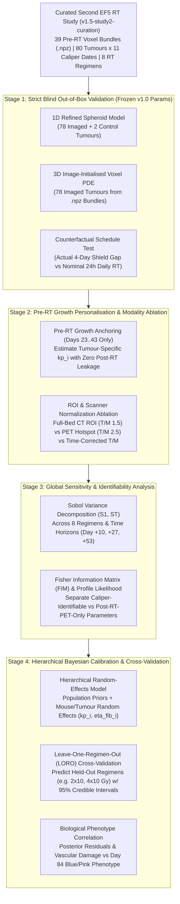

# Second EF5 RT Study (40-Mouse / 80-Tumour PLOS ONE Cohort) — Model Validation, Sensitivity & Hierarchical Bayesian Inference Plan

**Branch:** `study2_validation` (branched from `second_ef5_rt_study` at tag `v1.5-study2-curation`)  
**Dataset:** `outputs/second_ef5_rt_study/` & `results/second_ef5_rt_study/` (40 mice, 80 bilateral A549 subcutaneous tumours across 8 single-dose and fractionated regimens; 39 mice / 78 tumours with pre-RT Inveon EF5 PET/CT voxel bundles; 11 longitudinal caliper measurement dates from Day 23 to Day 99 post-implantation).

---

## 1. Strategic Assessment: Global Sensitivity Analysis & Hierarchical Bayesian Calibration on Study 2

Now that the full 40-mouse / 80-tumour dataset is curated, how do the two advanced methodologies proposed in Part 4.1 of our original [technical_report.md](../../outputs/ef5_rt_model/reports/technical_report.md) — **Global Sensitivity / Identifiability Analysis** and **Hierarchical Bayesian Calibration** — hold up against the real data structure?

### 1.1 Why Study 2 Unlocks What Study 1 Could Not
In **Study 1** (`first_ef5_rt_study`), we had only **5 longitudinal mice** (10 tumours) and a **single radiation regimen** (`1 × 20 Gy` vs. `0 Gy` contralateral control). With only one non-zero dose level ($20\text{ Gy}$), it was mathematically impossible to independently identify:
- The Linear-Quadratic $\alpha$ vs. $\beta$ split ($\alpha/\beta$ ratio),
- The high-dose vascular injury threshold $D_{50,\text{vasc}}$ (`15.5 Gy`), which requires comparing sub-threshold doses (`5–10 Gy/fx`) against ablative doses (`20–40 Gy/fx`),
- Inter-fraction reoxygenation vs. direct single-dose cell kill across iso-total-dose schedules (`1×10` vs. `2×5 Gy`, and `1×20` vs. `2×10` vs. `4×5 Gy`).

By contrast, **Study 2** provides **80 tumours across 8 distinct regimens** (`0 Gy`, `1×10`, `1×20`, `1×40`, `2×5`, `2×10`, `4×5`, `4×10 Gy`), **4 pre-RT caliper timepoints** (`Days 23, 30, 35, 43`), and **7 post-RT caliper timepoints** (`Days 49, 56, 64, 73, 79, 84, 99`), plus natural variation in baseline hypoxia (`T/M` spanning `1.04` to `3.00` in full-bed CT ROIs and up to `4.29` in PET-hotspot sub-ROIs) and an unplanned **4-day inter-fraction gap** (`2011-06-03` to `2011-06-07`) between Fraction 1 and Fraction 2.

### 1.2 The Key Observability Caveat (Joint Study 1 + Study 2 Identifiability)
While Study 2 has 8× more tumours and rich dose/fractionation diversity, it **did not acquire post-RT EF5 PET/CT scans** (only pre-RT EF5 PET/CT + longitudinal calipers).
- **What Study 2 *can* tightly constrain:** Growth kinetics ($k_{p,\max}, V_{\text{stress}}$), radiosensitivity ($\alpha, \beta$), oxygen enhancement / hypoxia resistance ($K_{\text{OER}}, m$), high-dose endothelial vascular shutdown ($D_{50,\text{vasc}}, \Delta_{\max}$), senescent/necrotic clearance ($k_{D_1\to D_2}, k_{\text{cl},\text{O}_2}$), and the persistent fibrotic floor ($\eta_{\text{fib}}$ at `1×40 Gy` and `4×10 Gy`).
- **What Study 2 *cannot* identify alone:** Internal post-RT metabolic oxygen demand of doomed/lysing cells ($q_{D_1}, q_{D_2}$) and the EF5 binding weight of senescent cells ($w_{D_1}$), which govern *post-RT virtual EF5 PET uptake* at Day +13 and Day +32 without strongly shifting macroscopic volume $V(t)$ in single-dose cohorts.
- **Solution:** Use **Global Sensitivity & Identifiability Analysis (Stage 3)** to formally prove this partition, and freeze the post-RT PET metabolic parameters ($q_{D_1}, q_{D_2}, w_{D_1}, K_{\text{EF5}}$) to their **Study 1 posterior/calibrated priors** during **Hierarchical Bayesian Calibration (Stage 4)**.

---

## 2. Four-Stage Validation & Inference Roadmap

---

### Stage 1: Strict Blind ("Out-of-Box") Validation with Frozen Study 1 Parameters
**Objective:** Test how well `RadiobiologyParams` (`v1.0-study1-model`) predicts the 80-tumour Second Study trajectories with **zero retuning**.

1. **Exact Calendar Schedule Integration:**
   - Anchor each tumour at its pre-RT baseline (`Day 43 / 2011-05-31` caliper + `Day 44–45 / 2011-06-01..02` EF5 PET/CT).
   - Deliver RT pulses at the exact experimental dates from `mouse_id_mapping.csv`:
     - Single-dose groups (`1×10`, `1×20`, `1×40 Gy`): **2011-06-02** (`t = 0` relative to RT start).
     - Fractionated groups (`2×5`, `2×10`, `4×5`, `4×10 Gy`): Fraction #1 on **2011-06-03**, followed by the **4-day missing-lead-shield gap**, then Fraction #2 on **2011-06-07** (`+4.0 days`), Fraction #3 on **2011-06-08** (`+5.0 days`), and Fraction #4 on **2011-06-09** (`+6.0 days`).
2. **Dual-Scale Model Execution (All 78 Imaged Tumours + 2 Unimaged Controls):**
   - **1D Refined Spheroid (`SpheroidRTModel`):** Initialise radius $R_0 = (3 V_0 / 4\pi)^{1/3}$ from pre-RT volume and calibrate initial radial vascular supply $h_{v,0}$ so the spheroid's volume-averaged virtual EF5 `T/M` matches the tumour's measured pre-RT `T/M`.
   - **3D Voxel Continuum (`VoxelRTModel`):** Initialise directly from each mouse's `outputs/second_ef5_rt_study/voxel_bundles/<mouse_id>/<mouse_id>_pre_rt.npz` (`mask_lhs_pet`/`mask_lhs_ct` and `mask_rhs_pet`/`mask_rhs_ct`), solving the 3D anchored vascular field $h_{v,0}(\mathbf{x})$ and running forward for 55 days (`2011-06-01` to `2011-07-26`).
3. **Counterfactual Missing-Shield Experiment:**
   - Run the fractionated cohorts under both **(a) Actual Schedule (with the 4-day weekend gap)** and **(b) Nominal Schedule (consecutive 24h spacing)** to quantify how much inter-fraction proliferation vs. reoxygenation occurred during the 4-day delay.
4. **Primary Validation Endpoints:**
   - Trajectory accuracy: RMSE, MAE, and $R^2$ on relative volume $V(t)/V_0$ and $\log_2(V(t)/V_0)$ across both the **PLOS ONE window** (`Days 43 → 73`, +27d post-RT) and the **full 11-point window** (`Days 23 → 99`, +53d post-RT).
   - Clinical endpoint prediction:
     - **Time-to-Doubling (`TT2x`) & Time-to-Tripling (`TT3x`)** concordance (Harrell's C-index and scatter $r$).
     - **Post-RT Specific Growth Rate (`SGR`)** correlation across oxygenated (`T/M ≤ 1.5`) vs. hypoxic (`T/M > 1.5`) strata.
     - **PLOS ONE Responder (`R`) vs. Non-Responder (`NR`) Classification:** ROC-AUC, sensitivity, and specificity.

---

### Stage 2: Pre-RT Growth Personalisation & Imaging/Caliper Modality Ablation
**Objective:** Isolate how much prediction error comes from inter-tumour baseline growth heterogeneity vs. imaging/caliper measurement conventions, without leaking any post-RT data.

1. **Strictly Pre-RT Growth Rate Anchoring (`Days 23, 30, 35, 43`):**
   - Fit each individual tumour's pre-treatment proliferation rate $k_{p,\max,i}$ (with solid-stress scale $V_{\text{stress}}$ fixed) solely to its **4 pre-RT caliper timepoints** (`2011-05-11` to `2011-05-31`).
   - Compare post-RT forecast accuracy of **(i) Population-fixed $k_{p,\max} = 0.130\text{ day}^{-1}$** vs. **(ii) Pre-RT personalised $k_{p,\max,i}$**.
2. **ROI Definition & Scanner Normalization Ablation:**
   - Compare model initialisation using:
     - **Full-Bed CT/Combo ROI `T/M`** (the PLOS ONE standard, threshold `T/M = 1.5` / `1.75`),
     - **PET-Hotspot Sub-ROI `T/M`** (the Technical Report standard, threshold `T/M = 2.5`),
     - **Scan-Time-Corrected `T/M`** (adjusting for the post-injection uptake drift documented in Technical Report Slide 15).
3. **Caliper Formula Sensitivity:**
   - Benchmark normalized trajectory predictions against both the 3-axis ellipsoid volume (`π/6·X·Y·Z`, used in PLOS ONE) and the modified ellipsoid (`π/6·L·W²`).

---

### Stage 3: Global Sensitivity & Identifiability Analysis (Sobol + FIM / Profile Likelihood)
**Objective:** Rigorously determine which biophysical parameters in `RadiobiologyParams` drive model variance across different dose regimens and time horizons, and identify collinear parameter pairs before Bayesian inference.

1. **Sobol Global Variance Decomposition:**
   - Sample $N \times (2D + 2)$ parameter vectors across the $D = 12$ core parameters:
     $$\theta = \big(\alpha,\, \beta,\, k_{p,\max},\, k_{p,\text{hyp}},\, V_{\text{stress}},\, K_{\text{OER}},\, m,\, k_{D_1\to D_2},\, k_{\text{cl},\text{O}_2},\, \eta_{\text{fib}},\, D_{50,\text{vasc}},\, r_{\text{rec}}\big)$$
   - Compute First-Order ($S_i$) and Total-Order ($S_{T,i}$) Sobol sensitivity indices across three canonical readouts:
     1. **Early Post-RT Regression/Swelling (`Day +10 / 2011-06-13`)**,
     2. **PLOS ONE Primary Endpoint (`Day +27 / 2011-06-30` relative volume & `SGR`)**,
     3. **Late Relapse vs. Fibrotic Floor (`Day +53 / 2011-07-26` at `1×40 Gy` & `4×10 Gy`)**,
     4. **Hypoxic vs. Oxygenated Differential (`ΔV/V0` between `T/M = 2.4` and `T/M = 1.2` in `1×10`, `2×10`, `4×5 Gy`)**.
2. **Local Fisher Information Matrix (FIM) & Profile Likelihood Identifiability:**
   - Compute the Jacobian sensitivity matrix $J = \partial \mathbf{y} / \partial \boldsymbol{\theta}$ across the 80-tumour dataset and inspect the eigenvalue spectrum and collinearity indices of $\text{FIM} = J^\top \Sigma_\epsilon^{-1} J$.
   - Construct 1D Profile Likelihood curves and 2D contour slices for key mechanistic pairs (e.g., $(\alpha, \beta)$, $(K_{\text{OER}}, m)$, $(k_{p,\max}, V_{\text{stress}})$, and $(D_{50,\text{vasc}}, \eta_{\text{fib}})$) to select the maximally identifiable parameter subset $\boldsymbol{\theta}_{\text{id}}$ for Stage 4.

---

### Stage 4: Hierarchical Bayesian Calibration & Leave-One-Regimen-Out (LORO) Cross-Validation
**Objective:** Quantify population parameter uncertainty and inter-tumour biological variability while testing out-of-sample generalisation to unseen radiation regimens.

1. **Hierarchical Model Structure:**
   - **Population Level (Fixed Effects / Hyperparameters):**Identifiable radiobiological parameters $\boldsymbol{\theta}_{\text{pop}} = (\alpha, \beta, K_{\text{OER}}, D_{50,\text{vasc}}, k_{\text{cl},\text{O}_2}, \eta_{\text{fib}})$ with informative physiological priors centered on Study 1 (`v1.0-study1-model`).
   - **Mouse / Tumour Level (Random Effects):**
     - Tumour-specific intrinsic growth rate $k_{p,\max,i} \sim \mathcal{N}(\mu_{kp}, \sigma_{kp}^2)$ constrained jointly by pre-RT (`Days 23–43`) and post-RT growth,
     - Optional mouse-level shared frailty / random effect $\delta_{\text{mouse}[i]}$ to test whether bilateral tumours (`LHS` and `RHS` on the same mouse) share host vascular/growth correlations,
     - Observation noise model $\log V_{\text{obs}}(t_{ij}) \sim \mathcal{N}\!\big(\log V_{\text{sim}}(t_{ij}; \boldsymbol{\theta}_i),\, \sigma_{\text{cal}}^2\big)$ capturing multiplicative caliper measurement error.
2. **Leave-One-Regimen-Out (LORO) Cross-Validation:**
   - Hold out each irradiated regimen in turn (e.g., hold out `2×10 Gy`, or `4×5 Gy`, or `4×10 Gy`, or `1×20 Gy`), fit the hierarchical posterior on the remaining 7 regimens, and generate **out-of-sample posterior predictive trajectories with 50% and 95% credible bands** for the held-out regimen.
   - Fast 1D Spheroid PDE + Surrogate/Variational or Ensemble MCMC (Affine-Invariant Ensemble Sampler / Hamiltonian Monte Carlo / Laplace-Metropolis approximation) ensures full hierarchical cross-validation runs deterministically in minutes inside Docker, with top posterior modes pushed through the full 3D Voxel PDE simulator.
3. **Biological Phenotype Discovery (`Blue` vs. `Pink` Vascular Notes at Day 84):**
   - Test whether the model's predicted post-RT vascular shutdown $f_{\text{vasc}}(t)$, necrotic core fraction, or individual random-effect residuals correlate with Khalila's independent **2011-07-20** visual observations of **"blue"** (heavily vascularised/congested) vs. **"pink"** vs. **"scab"** tumours.

---

## 3. Planned Code & Output Structure on `study2_validation`

- **Code Modules (`src/modeling/`):**
  - `src/modeling/run_study2_validation.py` — Stage 1 & Stage 2 blind and pre-RT-anchored 1D + 3D validation across all 80 tumours, counterfactual 4-day shield-gap test, and PLOS ONE clinical endpoint evaluation (`TT2x`, `TT3x`, `SGR`, Responder ROC-AUC).
  - `src/modeling/sensitivity_identifiability.py` — Stage 3 Sobol global sensitivity indices, Fisher Information Matrix eigenvalue/collinearity spectrum, and Profile Likelihood identifiability curves.
  - `src/modeling/hierarchical_bayesian.py` — Stage 4 Hierarchical Bayesian calibration, Leave-One-Regimen-Out (LORO) posterior predictive cross-validation, and bilateral mouse random-effects analysis.
  - `src/modeling/generate_study2_report.py` — Publication-quality multi-panel validation figures and comprehensive technical report generator.
- **Tracked Outputs & Reports:**
  - `results/study2_validation/` — CSV tables of per-tumour predictions, LORO cross-validation metrics, Sobol indices, FIM identifiability rankings, and posterior parameter summaries.
  - `outputs/study2_validation/` — Multi-panel trajectory overlays across all 8 regimens, 3D multi-slice spatial predictions, Sobol tornado/heatmap plots, profile likelihood contours, and posterior credible interval fan charts.
- **Automated Tests (`tests/test_study2_validation.py`):**
  - Unit and regression tests verifying Study 2 `.npz` bundle loading, exact 4-day gap schedule builder, Sobol/FIM matrix properties, and hierarchical likelihood evaluation.
