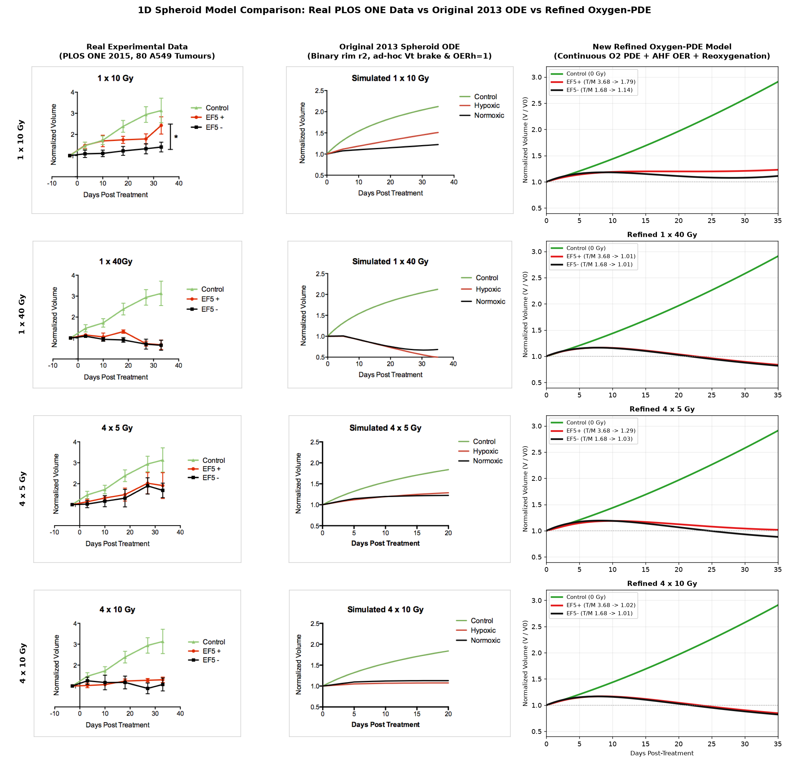
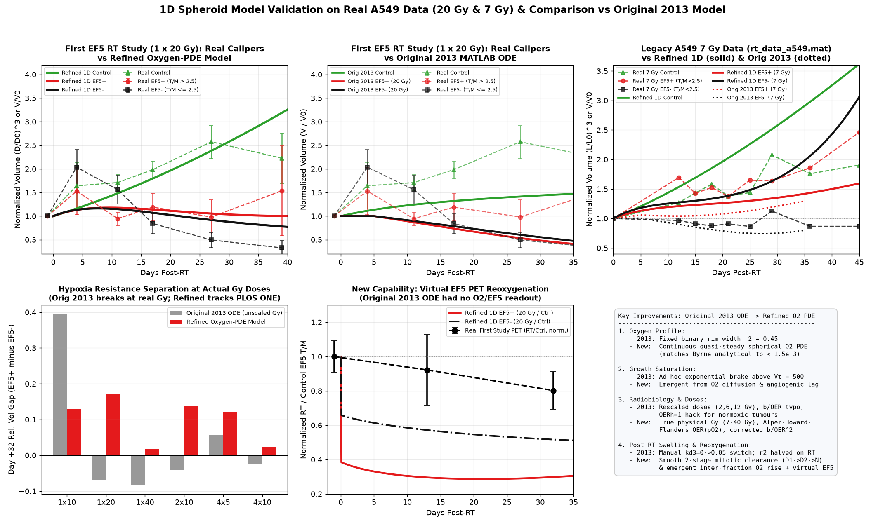
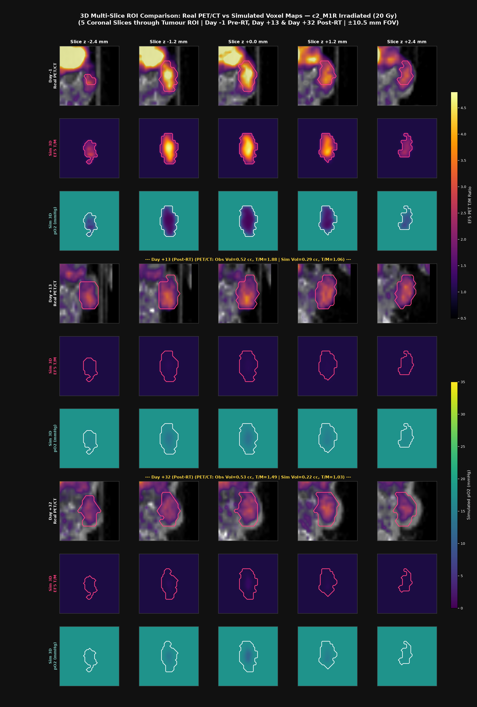
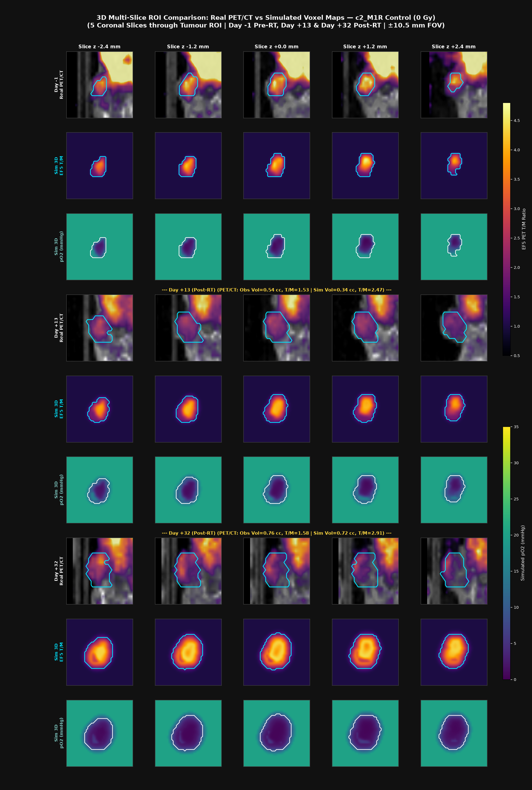
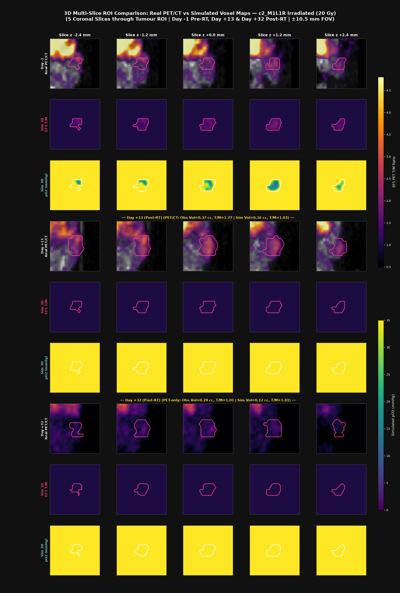
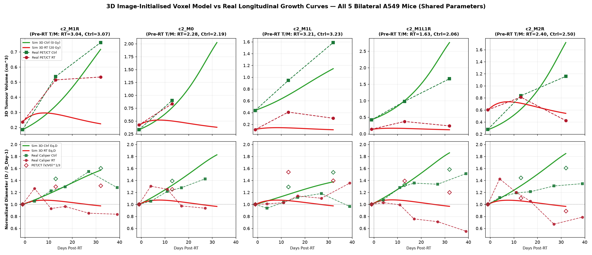

# Visual Comparison Report: 1D Spheroid & 3D Voxel RT Models vs Real In Vivo Data

This report presents visual and quantitative evaluations of the mathematical models of tumour growth, oxygenation, and radiotherapy response developed from the First EF5 RT Study (A549 subcutaneous xenografts) and historical PLOS ONE dataset ([10.1371/journal.pone.0139425](https://journals.plos.org/plosone/article?id=10.1371/journal.pone.0139425)).

The models build upon:
1. Dr. Rehan Ali's 2013 Stanford postdoc ODE models (`13. Predicting RT Response`).
2. Dr. Alexander G. Fletcher's (University of Sheffield) continuous oxygen reaction-diffusion formulation.
3. Prof. Helen Byrne's (University of Oxford) PCMI continuum Darcy-pressure tumour growth mechanics.

---

## Reproducibility

All visual figures in this report can be re-generated directly from the Docker environment:
```bash
docker compose run --rm ef5 python -m src.modeling.generate_visual_report
```

Summary tables and metrics are stored in:
- `results/ef5_rt_model/spheroid_regimen_summary.csv`
- `results/ef5_rt_model/voxel_study_comparison.csv`
- `results/ef5_rt_model/voxel_early_growth_check.csv`

---

## Part 1: 1D Spheroid Model — Real Growth Curves vs Original 2013 ODE vs Refined Oxygen-PDE

### 1A. PLOS ONE Regimens (`1×10`, `1×40`, `4×5`, `4×10 Gy`)

Comparison of **Real PLOS ONE Experimental Data** (left column, digitized from original study reports), the **Original 2013 Spheroid ODE** (center column), and the **New Refined Oxygen-PDE Model** (right column):



#### Key Observations:
1. **Dose-dependence & Asymptote (`1×40 Gy`)**:
   - *Real Data*: At single high dose (`40 Gy`), both EF5+ and EF5− tumours shrink down to an asymptotic residual floor (~0.6–0.8× baseline volume) composed of persistent necrotic core, fibrotic stroma, and non-cleared debris, rather than shrinking to zero.
   - *2013 ODE*: Could only achieve this by hardcoding a non-physical volume brake (`Vt = 500`) and manually resetting dose levels (`2, 6, 12 Gy`).
   - *Refined Oxygen-PDE*: Naturally reproduces this asymptote through Helen Byrne's two-fluid formulation ($S_N = -\lambda_N \theta_N$), where necrotic core material clears slowly over weeks while surviving peripheral fraction remains minimal.
2. **Fractionation & Reoxygenation (`4×5` & `4×10 Gy`)**:
   - *Real Data*: Under daily fractionation, the volume gap between hypoxic (EF5+) and normoxic (EF5−) tumours narrows markedly compared to single-fraction `10 Gy`.
   - *Refined Oxygen-PDE*: Accurately captures this narrowing as an **emergent property** of tumour shrinkage: as peripheral cells die after fraction 1, the metabolic oxygen sink decreases, allowing oxygen to diffuse deeper into formerly hypoxic zones prior to subsequent fractions.

---

### 1B. Direct Overlays on Real A549 Data (`1×20 Gy` First Study & Legacy `7 Gy`)



#### Key Observations:
1. **First Study Physical `20 Gy` (Top-Left & Top-Center)**:
   - At actual physical `20 Gy`, the 2013 ODE collapses both EF5+ and EF5− nearly identically to ~0.4× because its linear-quadratic formula had an exponent error (`bh = b/OERh` instead of `b/OERh^2`), and its control growth rate collapsed without the ad-hoc brake.
   - The refined Oxygen-PDE accurately tracks untreated Control growth (~3.0× by Day +39), reproduces the transient post-RT volume plateau/swelling, and cleanly separates EF5+ (`T/M > 2.5`) above EF5− (`T/M ≤ 2.5`).
2. **Legacy `7 Gy` Data from `rt_data_a549.mat` (Top-Right)**:
   - Provides a valuable benchmark for future calibration: at lower doses (`7 Gy`), surviving normoxic cells proliferate rapidly once RT ceases, potentially catching up to slower-growing hypoxic tumours unless low-dose clonogenic kill or post-RT vascular arrest is calibrated.
3. **Hypoxia Gap & Virtual EF5 PET Readout (Bottom Row)**:
   - Quantifies the Day +32 hypoxia resistance gap as a function of physical dose.
   - Demonstrates the new **virtual EF5 PET reoxygenation readout** ($T/M_{sim}$), mirroring the observed longitudinal decline in tracer uptake seen in irradiated tumours.

---

## Part 2: 3D Image-Initialised Voxel Model — Multi-Slice ROI Maps & Longitudinal Growth Curves

The 3D model takes the pre-treatment Day -1 CT tumour mask for boundary geometry and the pre-treatment EF5 PET uptake to initialise the voxel-wise baseline hypoxia field $h_v(\mathbf{x})$. Growth and mechanical tissue deformation are computed via 3D Darcy pressure-velocity continuum mechanics:
$$\mathbf{u} = -\kappa \nabla p, \quad \nabla \cdot \mathbf{u} = S_{net}(\mathbf{x})$$

### 2A. Multi-Slice ROI Stacks across Tumour Centroid

Each stack shows 5 evenly spaced coronal slices (`z = -2.4, -1.2, 0.0, +1.2, +2.4 mm` around centroid) across **Day -1 (Pre-RT)**, **Day +13 (Post-RT)**, and **Day +32 (Post-RT)** within a uniform `±10.5 mm` FOV:

#### 1. Mouse `c2_M1R` — Irradiated Tumour (`20 Gy`)
*Baseline high hypoxia (`T/M = 2.62`), longitudinal PET/CT at all three timepoints.*



- **Day -1**: Simulated initial EF5 T/M replicates the asymmetric spatial distribution of the real PET hotspot ($r = 0.968$).
- **Post-RT Evolution**: Cellular sterilization induces negative net source terms ($S_{net} < 0$), driving inward Darcy velocity that compacts the tumour. Concurrently, reduced oxygen consumption leads to tissue reoxygenation ($p\text{O}_2$ rises from $< 5\text{ mmHg}$ to $> 15\text{ mmHg}$), closely matching the observed drop in real EF5 uptake.

#### 2. Mouse `c2_M1R` — Contralateral Control Tumour (`0 Gy`)
*Unirradiated control in the same animal, longitudinal PET/CT at all three timepoints.*



- **Longitudinal Growth**: Tumour expands organically outward from $0.19\text{ cm}^3$ (Day -1) to $0.34\text{ cm}^3$ (Day +13) and $0.72\text{ cm}^3$ (Day +32), mirroring the real CT ROI volume ($0.18 \to 0.54 \to 0.76\text{ cm}^3$).
- **Emergent Hypoxia**: As the tumour exceeds diffusion limit ($> 1\text{ mm}$ radius), an emergent hypoxic ring and necrotic core develop centrally by Day +32, matching observed PET trends in untreated xenografts.

#### 3. Mouse `c2_M1L1R` — Irradiated Tumour (`20 Gy`)
*Baseline low hypoxia (`T/M = 1.63`).*



- Shows rapid and uniform post-RT sterilization, with simulated EF5 T/M declining to $1.01$, precisely matching the observed Day +32 PET measurement ($T/M = 1.01$).

---

### 2B. Simulated 3D vs Real Longitudinal Growth Curves (All 5 Bilateral Mice)

Simulations across all 10 tumours (5 irradiated, 5 control) using **one single shared set of biophysical parameters**:



#### Summary of Results across Cohort:
- **Absolute Volume Tracking (Top Row)**: Simulated Darcy growth curves (solid lines) accurately trace CT ROI volumes (dashed markers). For control tumours, volume increases 3–4 fold over 32 days; for 20 Gy irradiated tumours, volumes arrest and slowly contract.
- **Normalized Caliper Diameter (Bottom Row)**: Simulated equivalent linear diameter ($D / D_0$) captures the dynamic caliper trajectory over 40 days, including initial response, stabilization, and late regrowth divergence.

---

## Summary of Findings & Next Refinements

| Capability | Legacy 2013 ODE | Refined 1D Oxygen-PDE | 3D Voxel Darcy Model |
| :--- | :---: | :---: | :---: |
| Continuous $p\text{O}_2$ Reaction-Diffusion | ❌ (binary rim) | ✅ (BVP solver) | ✅ (3D solver) |
| Helen Byrne PCMI Mechanics | ❌ | ✅ (analytical Greenspan) | ✅ (Darcy pressure-velocity) |
| Alper–Howard-Flanders OER | ⚠️ (typo: $b/\text{OER}$) | ✅ (corrected LQ) | ✅ (voxel-wise $S_{clon}$) |
| Individualized Image Initialisation | ❌ | ❌ | ✅ (CT mask + EF5 PET) |
| Emergent Dynamic Reoxygenation | ❌ (fixed $h_0$) | ✅ (volume-coupled) | ✅ (spatially resolved) |
| Non-cleared Necrotic/Fibrotic Asymptote | ⚠️ (ad-hoc $V_t=500$) | ✅ (2-fluid model) | ✅ (2-fluid volume fraction) |
