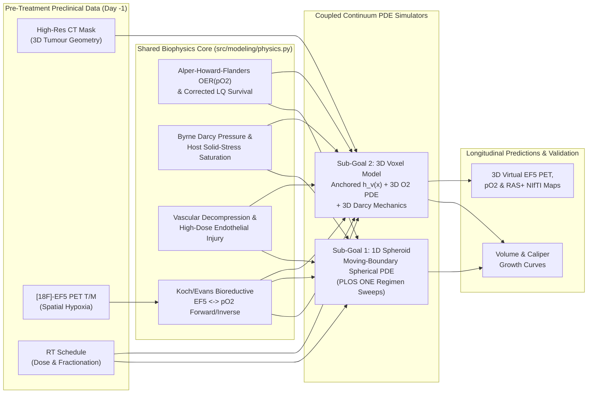
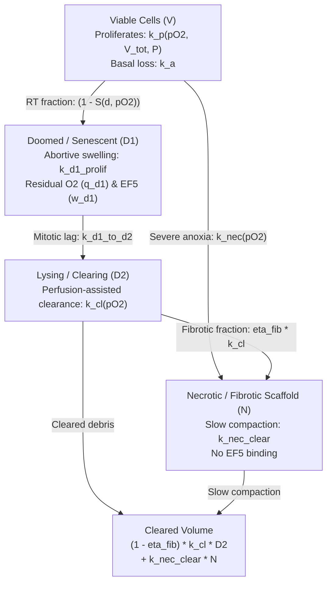
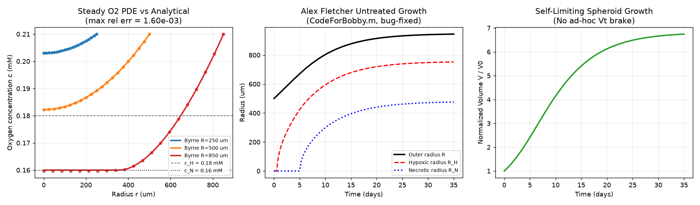
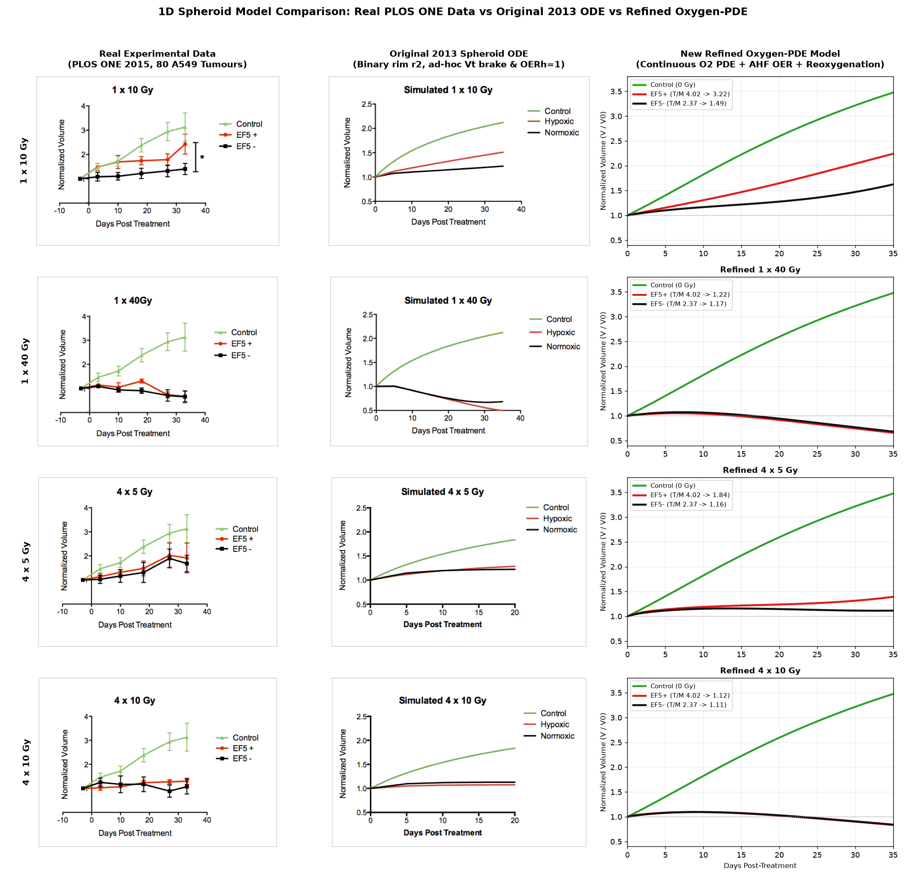
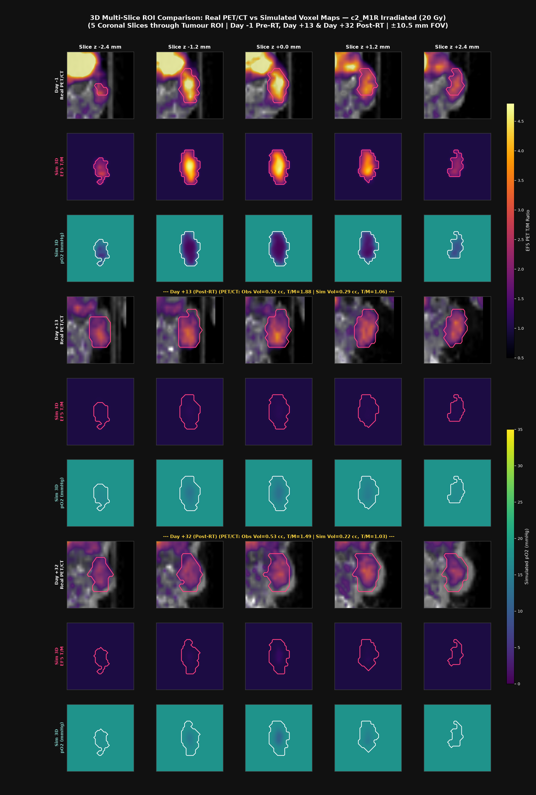
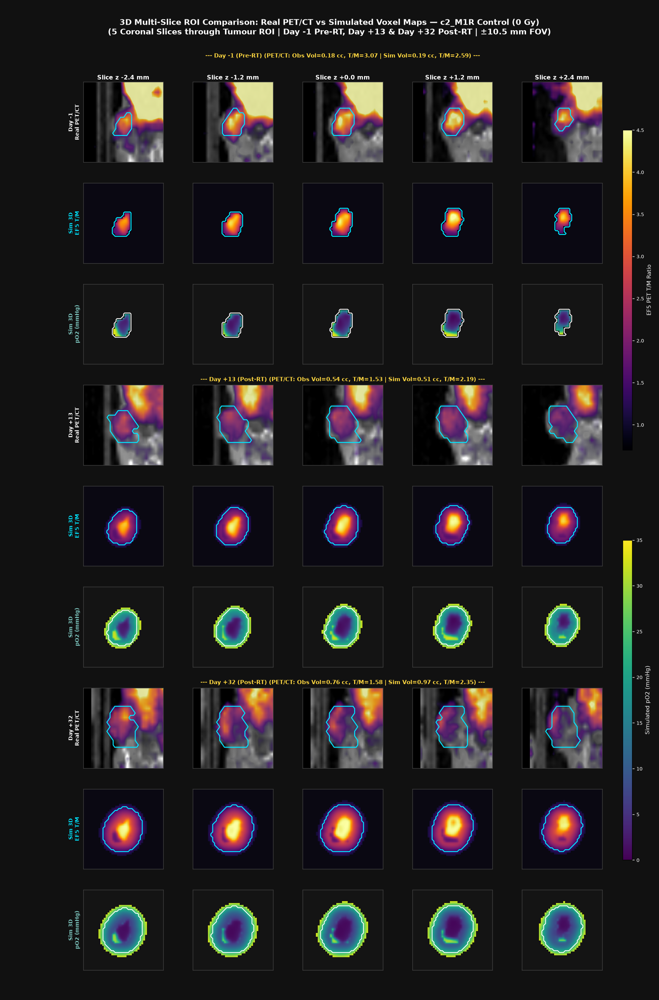
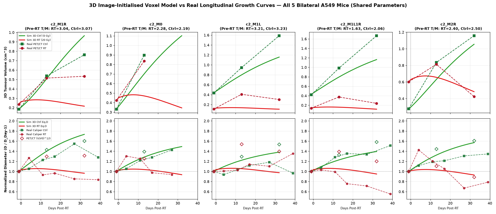
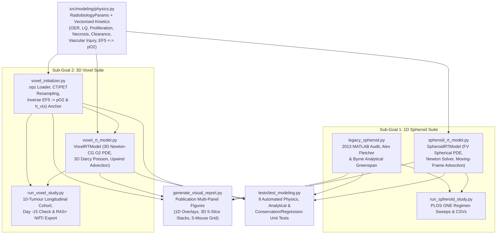
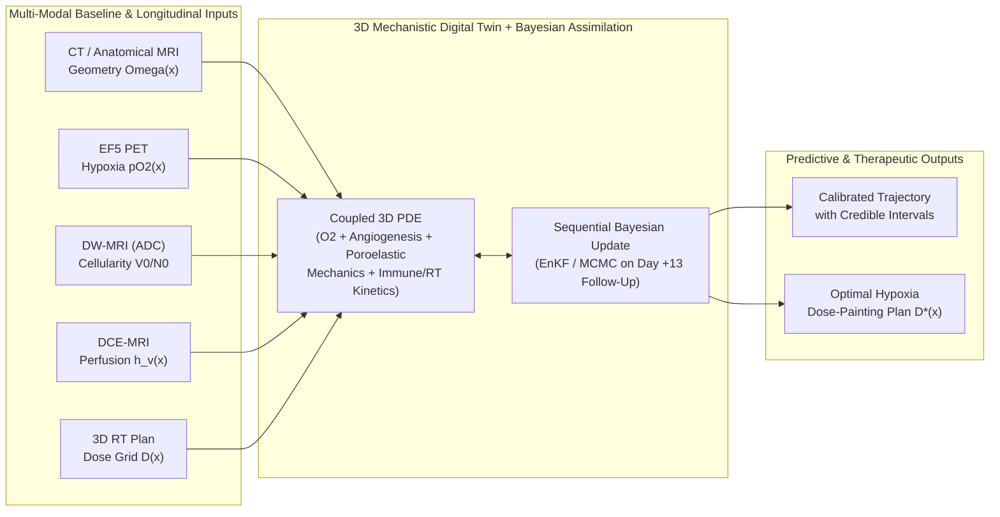

# Technical Report: Mechanistic 1D Spheroid and 3D Image-Initialised Voxel Modelling of Tumour Growth, Hypoxia, and Radiotherapy Response

**Repository:** `ef5_rt` (branch `ef5_rt_model`)  
**Codebase:** `src/modeling/` | **Verification:** `tests/test_modeling.py` (`8/8` passing) | **Visual Companion:** [visual_comparison_report.md](visual_comparison_report.md)

---

## Part 1: Executive Summary (Abstract)

### Aims
Tumour hypoxia is a major determinant of resistance to ionising radiation, yet its impact depends strongly on fractionation schedule, dynamic post-treatment reoxygenation, and intra-tumoural spatial heterogeneity. Building on longitudinal preclinical **[¹⁸F]-EF5 PET/CT** imaging and caliper measurements of bilateral subcutaneous A549 human lung adenocarcinoma xenografts (*First EF5 RT Study*) together with a published multi-regimen cohort ([Ali et al., *PLOS ONE* 2015](https://doi.org/10.1371/journal.pone.0139425)), this work develops a unified, mechanistically grounded modelling hierarchy with two linked aims:

1. **Sub-Goal 1 (1D Continuum Spheroid Model):** Refine historical compartmental spheroid ODEs by coupling a continuous quasi-steady spherical oxygen reaction–diffusion PDE to moving-boundary mass balance, continuous oxygen-dependent radiobiology, and mechanical growth saturation—eliminating ad-hoc empirical switches while reproducing single-fraction and fractionated radiotherapy trends across physical doses (`0` to `40 Gy`).
2. **Sub-Goal 2 (3D Image-Initialised Voxel Model):** Generalise the exact same biophysics to arbitrary 3D tumour geometries initialised directly from individual pre-treatment **CT** tumour masks and **[¹⁸F]-EF5 PET** tumour-to-muscle (`T/M`) hypoxia maps, propagating longitudinal tumour expansion, post-RT compaction, and spatially resolved virtual EF5 PET forward in time.

### Methods
Both simulators share a single radiobiological physics core (`src/modeling/physics.py`) expressed in consistent physical units (`mm`, `days`, `mmHg`, `Gy`). Oxygen transport is governed by a nonlinear quasi-steady reaction–diffusion PDE with Michaelis–Menten cellular consumption and distributed microvascular exchange. Cell survival at radiation events follows the corrected Linear–Quadratic (LQ) formalism modulated by the continuous Alper–Howard-Flanders Oxygen Enhancement Ratio ($\text{OER}(p\text{O}_2)$). Tumour tissue is decomposed into four volume-filling compartments—viable cells ($V$), early pre-mitotic/senescent doomed cells ($D_1$), lysing/clearing cells ($D_2$), and slowly compacting necrotic/fibrotic scaffold ($N$)—driven by oxygen-regulated proliferation/necrosis, Helen Byrne Darcy-pressure and host solid-stress saturation, solid-stress vascular decompression, thresholded high-dose endothelial injury ($\ge 15\text{--}20\text{ Gy}$), and Koch/Evans bioreductive EF5 binding kinetics. In 1D, mass conservation yields a moving-boundary spherical radius ODE with conservative radial advection; in 3D, per-tumour vascular supply $h_v(\mathbf{x})$ is anchored by inverting the oxygen PDE on Day `-1` PET/CT data, and tissue deformation is driven by 3D Darcy pressure–velocity mechanics ($-\nabla^2 P = S_{\text{vol}}$, $\mathbf{u} = -\nabla P$).

### Key Results
* **Analytical Verification:** The 1D spherical oxygen solver matches Helen Byrne's exact analytical Greenspan steady-state solution across radii $250\text{--}850\,\mu\text{m}$ to $< 2 \times 10^{-3}$ relative error.
* **1D Multi-Regimen Radiobiology (PLOS ONE & A549 Trends):** Using one shared parameter set at true physical doses, untreated controls exhibit concave-down growth saturation (`2.07×` at Day `+13` $\to$ `3.32×` at Day `+32`). Single-fraction `1×10 Gy` produces a large, sustained hypoxia resistance gap (`EF5+`: `2.12×` vs `EF5−`: `1.53×`, gap `+0.59×`), whereas daily fractionation (`4×5 Gy`, `4×10 Gy`) collapses the EF5+/− gap (`+0.23×` and `-0.01×`) through emergent inter-fraction reoxygenation, and ablative `1×40 Gy` converges both phenotypes onto a persistent `~0.71–0.73×` necrotic/fibrotic floor.
* **3D Tumour-Specific Longitudinal Cohort (10 Bilateral Tumours across 5 Mice):** Anchored Day `-1` virtual EF5 PET correlates strongly with measured 3D pre-RT PET ($r = 0.84\text{--}0.97$). Without per-mouse retuning, the 3D Darcy model reproduces rapid early untreated growth (`Day -15 → Day -1`: simulated `3.25–3.61×` vs observed `3.42–5.21×`), late concave-down control deceleration across all 5 mice, post-RT growth arrest/compaction, and realistic longitudinal EF5 PET retention/reoxygenation (`c2_M1R` irradiated `T/M`: `2.65 → 1.46 → 1.33` vs observed `3.04 → 1.88 → 1.49`, including Day `+32` central hypoxic hotspot re-emergence).

---

## Part 2: Mathematical Formulation & Literature Foundation

### 2.0 How This Work Builds on Prior Literature in Mathematical Oncology

This modelling hierarchy bridges **four distinct research lineages** that are frequently treated separately in the mathematical oncology and radiation physics literature:

1. **Diffusion-Limited Continuum Tumour Growth (Greenspan–Byrne–Grimes lineage):** Classical avascular spheroid theory began with Greenspan [6], who coupled nutrient diffusion to moving-boundary mass balance, and was generalised by Byrne, Chaplain, and colleagues [7–9] into multiphase continuum PDEs driven by Darcy's law ($-\nabla^2 P = S_{\text{vol}}, \mathbf{u} = -\nabla P$), alongside quantitative Krogh oxygen-consumption analyses in spheroids by Grimes et al. [18]. Our Sub-Goal 1 1D model directly adopts Byrne's reaction–diffusion–advection formalism (and validates our solver numerically against Byrne's exact analytical Greenspan profiles), while Sub-Goal 2 carries that exact Darcy continuum mechanics into arbitrary 3D CT-derived tumour geometries.
2. **Continuous-Oxygen Radiobiology & Tumour Composition Dynamics (Alper–Wouters–Lewin–Song lineage):** Traditional clinical LQ modelling [4] often treats hypoxia as a static binary hypoxic fraction, despite Wouters & Brown [3] proving that cells at *intermediate* oxygen tensions ($0.5\text{--}10\text{ mmHg}$) govern fractionated radiotherapy response, and Lewin et al. [5] demonstrating how evolving dead/necrotic composition drives post-RT reoxygenation and volume trajectories. At high ablative doses ($\ge 15\text{--}20\text{ Gy}$), Garcia-Barros et al. [11] and Park/Song et al. [12] further showed that acute endothelial/microvascular injury modifies tumour response beyond pure clonogenic LQ kill, while Jain et al. [10] established how growth-induced solid stress compresses microvessels. Our unified physics core integrates all of these mechanisms seamlessly into one parameter set—capturing both classic fractionated reoxygenation (`4×5`, `4×10 Gy`) and high single-dose vascular collapse (`1×20`, `1×40 Gy`).
3. **Hypoxia-PET-to-$p\text{O}_2$ Biophysical Translation (Koch–Toma-Dasu lineage):** Koch [13] quantified the inverse Michaelis–Menten-like relationship between intracellular 2-nitroimidazole (EF5) binding and local $p\text{O}_2$, and Toma-Dasu et al. [17] pioneered converting static pre-treatment hypoxia PET (FMISO) into spatial $p\text{O}_2$ maps for radiotherapy dose prescription. Here, we extend that static mapping into a **bidirectional dynamic operator**: pre-treatment EF5 PET initialises the 3D PDE by inverting for each tumour's latent microvascular supply field $h_v(\mathbf{x})$, and the forward PDE continuously predicts **longitudinal post-RT virtual EF5 PET maps** testable directly against follow-up scans.
4. **Image-Driven Patient/Animal-Specific 3D PDE Forecasting (Swanson/Rockne–Yankeelov/Hormuth lineage):** Seminal work by Rockne et al. [16], Yankeelov et al. [14], and Hormuth et al. [15] established the paradigm of personalising 3D reaction–diffusion–mechanics PDEs from clinical/preclinical MRI to forecast individual treatment trajectories. Our Sub-Goal 2 framework brings that image-personalised 3D PDE paradigm directly to **longitudinal hypoxia [¹⁸F]-EF5 PET/CT** [1], demonstrating that anchoring a single shared biophysical model on Day `-1` CT geometry and EF5 PET reproduces paired bilateral growth, compaction, and spatial hypoxia evolution across a preclinical cohort.

---

### 2.1 Unified Radiobiological & Oxygen-Transport Biophysics

Both the 1D and 3D models treat tumour tissue as a saturated continuum composed of four local volume fractions summing to total tumour occupancy $\Phi(\mathbf{x}, t) \in [0, 1]$ (with $\Phi \equiv 1$ inside the moving 1D spheroid boundary and $\Phi(\mathbf{x}, t) \in [0, 1]$ on the fixed 3D voxel grid):

$$\Phi(\mathbf{x}, t) = V(\mathbf{x}, t) + D_1(\mathbf{x}, t) + D_2(\mathbf{x}, t) + N(\mathbf{x}, t)$$

where:
* $V$: clonogenically viable, proliferating tumour cells;
* $D_1$: early radiation-damaged, pre-mitotic / senescent doomed cells (reflecting p53-wildtype A549 prolonged radiation-induced arrest before lysis);
* $D_2$: late lysing/clearing radiation-damaged cells;
* $N$: necrotic core and persistent post-RT fibrotic/stromal scaffold.

#### Continuous Oxygen-Dependent Radiosensitivity (Alper–Howard-Flanders OER + Corrected LQ)
Rather than partitioning cells into a binary normoxic rim and anoxic core—which neglects the critical intermediate oxygen range ($0.5\text{--}10\text{ mmHg}$) shown by Wouters & Brown [3] to dominate fractionated response—radiosensitivity varies smoothly with local oxygen partial pressure $p(\mathbf{x}, t)$ (`mmHg`) via the Alper–Howard-Flanders relation [2]:

$$\text{OER}(p) = \frac{m\,p + K_{\text{OER}}}{p + K_{\text{OER}}} \in [1, m], \qquad \text{OMF}(p) = \frac{\text{OER}(p)}{m} \in \left[\frac{1}{m}, 1\right]$$

where $m = 3.0$ is the maximal anoxic-to-normoxic dose-modifying ratio and $K_{\text{OER}} = 3.5\text{ mmHg}$ is the half-maximal radiosensitisation tension. Applying $\text{OMF}(p)$ as a strict dose-modifying factor ($d_{\text{eff}} = d \cdot \text{OMF}(p)$) inside the Linear–Quadratic (LQ) model [4] gives local clonogenic surviving fraction at each fraction of physical dose $d$ (`Gy`):

$$S(d, p) = \exp\!\left(-\alpha\,d_{\text{eff}} - \beta\,d_{\text{eff}}^2\right) = \exp\!\left(-\alpha\,\text{OMF}(p)\,d - \beta\,\text{OMF}(p)^2\,d^2\right)$$

Note that the quadratic term scales with $\text{OMF}(p)^2$ (i.e., $1/\text{OER}_{\text{rel}}^2$), correcting a common implementation error in legacy models where $\beta$ was scaled linearly by $1/\text{OER}$. At each instantaneous fraction time $t_f$, viable cells are transferred into the doomed compartment without instantaneous volume loss:

$$V(\mathbf{x}, t_f^+) = S(d, p)\,V(\mathbf{x}, t_f^-), \qquad D_1(\mathbf{x}, t_f^+) = D_1(\mathbf{x}, t_f^-) + \big(1 - S(d, p)\big)\,V(\mathbf{x}, t_f^-)$$

#### Oxygen-Regulated Kinetics & Mechanical Growth Saturation
Cellular proliferation, hypoxic necrosis, and perfusion-assisted clearance follow smooth Hill kinetics:

$$k_p(p, V_{\text{tot}}, P) = \frac{k_{p,\text{hyp}} + (k_{p,\max} - k_{p,\text{hyp}})\dfrac{p^{n_p}}{p^{n_p} + p_{\text{hyp}}^{n_p}}}{1 + \left(\dfrac{V_{\text{tot}}}{V_{\text{stress}}}\right)^{n_s} + \dfrac{\max(P, 0)}{P_{\text{crit}}}}$$

$$k_{\text{nec}}(p) = k_{\text{nec},\max}\frac{p_{\text{nec}}^{n_n}}{p^{n_n} + p_{\text{nec}}^{n_n}}, \qquad k_{\text{cl}}(p) = k_{\text{cl},\min} + k_{\text{cl},\text{O}_2}\frac{p}{p + p_{\text{hyp}}}$$

Two biological features are critical here:
1. **Separation of glycolytic proliferation from radiobiological hypoxia:** Viable tumour cells continue proliferating via HIF-1$\alpha$-driven glycolysis down to $p_{\text{hyp}} = 0.60\text{ mmHg}$ (with necrosis onset below $p_{\text{nec}} = 0.45\text{ mmHg}$), whereas radiobiological OER protection ($K_{\text{OER}} = 3.5\text{ mmHg}$) and EF5 binding ($K_{\text{EF5}} = 5.5\text{ mmHg}$) operate strongly across moderate viable hypoxia ($1\text{--}8\text{ mmHg}$). This prevents untreated hypoxic (`EF5+`) tumours from growing artificially slower than normoxic (`EF5−`) tumours.
2. **Mechanical/Darcy concave-down growth saturation:** Extending Helen Byrne's continuum mechanics framework [7–9] and solid-stress tumour mechanics [10], positive internal Darcy pressure $P(\mathbf{x}, t)$ and macroscopic host subcutaneous crowding $(V_{\text{tot}} / V_{\text{stress}})^{n_s}$ inhibit mitosis in expanding tumours—producing natural Gompertzian/concave-down growth deceleration without discontinuous volume-threshold brakes—while leaving shrinking post-RT tumours ($P \le 0$, small $V_{\text{tot}}$) unbraked for regrowth.

#### Local Compartment Reactions & High-Dose Endothelial Injury
Single-fraction doses $\ge 15\text{--}20\text{ Gy}$ induce acute microvascular endothelial apoptosis and vascular collapse [11, 12], whereas standard `5–10 Gy` fractions largely spare tumour endothelium. We model this via a steep Hill injury fraction applied to a dynamic microvascular patency factor $f_{\text{vasc}}(t) \in [0.15, 1]$:

$$\Delta_{\text{vasc}}(d) = \Delta_{\max}\frac{d^{h_v}}{d^{h_v} + D_{50,\text{vasc}}^{h_v}}, \qquad f_{\text{vasc}}(t_f^+) = \max\!\big(0.15,\, f_{\text{vasc}}(t_f^-)(1 - \Delta_{\text{vasc}}(d))\big)$$

followed by slow microvascular recovery $\dot{f}_{\text{vasc}} = r_{\text{rec}}(1 - f_{\text{vasc}})$. Acute vascular collapse also boosts necrotic/stromal compaction by $\Delta k_{\text{lysis}} = k_{\text{boost}}(1 - f_{\text{vasc}})$, defining effective clearance rates $k_{\text{cl}}^{\text{eff}} = k_{\text{cl}} + 0.5\,\Delta k_{\text{lysis}}$ and $k_{\text{nec,cl}}^{\text{eff}} = k_{\text{nec,cl}} + \Delta k_{\text{lysis}}$. The local volume-creation reaction rates $R_i$ (`day⁻¹`) are:

$$\begin{aligned}
R_V &= \big(k_p(p, V_{\text{tot}}, P) - k_a - k_{\text{nec}}(p)\big) V \\
R_{D_1} &= (k_{D_1,\text{prolif}} - k_{D_1 \to D_2})\, D_1 \\
R_{D_2} &= k_{D_1 \to D_2}\, D_1 - k_{\text{cl}}^{\text{eff}}(p)\, D_2 \\
R_N &= k_{\text{nec}}(p)\, V + \eta_{\text{fib}}\, k_{\text{cl}}^{\text{eff}}(p)\, D_2 - k_{\text{nec,cl}}^{\text{eff}}\, N
\end{aligned}$$

Summing all four yields the net local volumetric source/sink driving tissue velocity:

$$S_{\text{vol}}(\mathbf{x}, t) = R_V + R_{D_1} + R_{D_2} + R_N$$

#### Bioreductive [¹⁸F]-EF5 PET Forward & Inverse Mapping
Following Koch's characterisation of 2-nitroimidazole bioreductive binding [13], intracellular EF5 retention requires both enzymatic reduction by metabolically active cells ($V_{\text{act}} = \text{clip}(V + w_{D_1} D_1, 0, 1)$) and low local oxygen competing against nitroreductase back-oxidation:

$$\text{TM}(\mathbf{x}, t) = \text{TM}_{\min} + (\text{TM}_{\max} - \text{TM}_{\min})\,V_{\text{act}}(\mathbf{x}, t)\,\frac{K_{\text{EF5}}}{p(\mathbf{x}, t) + K_{\text{EF5}}}$$

Necrotic regions ($V_{\text{act}} = 0$) cannot reduce EF5 and revert to muscle background $\text{TM}_{\min} = 1.0$. For pre-treatment 3D initialisation, this relation is inverted analytically with smooth clamping to $[p_{\min}, p_{\max}]$:

$$p_0(\mathbf{x}) = K_{\text{EF5}}\,\frac{1 - b(\mathbf{x})}{b(\mathbf{x})}, \qquad b(\mathbf{x}) = \text{clip}\!\left(\frac{\text{TM}_0(\mathbf{x}) - \text{TM}_{\min}}{(\text{TM}_{\max} - \text{TM}_{\min})\,V_{\text{act},0}(\mathbf{x})},\; b_{\min},\; b_{\max}\right)$$

---

### 2.2 Sub-Goal 1: 1D Radially-Symmetric Coupled Spheroid Model

Building directly on Greenspan's diffusion-limited tumour growth theory [6] and Helen Byrne's avascular-to-vascular continuum lecture notes [7–9] (originally introduced into this project via Dr. Alexander G. Fletcher's `CodeForBobby.m`), the 1D model evolves a radially symmetric sphere of radius $R(t)$ on the normalised coordinate $\xi = r / R(t) \in [0, 1]$.

#### Quasi-Steady Spherical Oxygen PDE
Because oxygen diffusion equilibrates on a timescale of minutes whereas tumour growth and clearance evolve over days, $p(\xi, t)$ satisfies the quasi-steady nonlinear boundary-value problem:

$$\frac{D_{\text{O}_2}}{R(t)^2}\,\frac{1}{\xi^2}\frac{\partial}{\partial \xi}\!\left(\xi^2 \frac{\partial p}{\partial \xi}\right) + h_v^{\text{eff}}(\xi, t)\,\big(p_{\text{bdry}}^{\text{eff}}(t) - p\big) - \gamma_{\text{eff}}(\xi, t)\,\frac{p}{p + K_m} = 0$$

subject to $\partial_\xi p(0) = 0$ and $p(1) = p_{\text{bdry}}^{\text{eff}}(t) = p_{\text{host}}(0.35 + 0.65\,f_{\text{vasc}}(t))$, with metabolic sink $\gamma_{\text{eff}} = \gamma_s \gamma_0 (V + q_{D_1} D_1 + q_{D_2} D_2)$ and effective vascular exchange:

$$h_v^{\text{eff}}(\xi, t) = h_0(\xi)\,\underbrace{\frac{1}{1 + V_{\text{tot}}(t) / V_{\text{vasc},1/2}}}_{\text{angiogenic lag}}\,\underbrace{f_{\text{vasc}}(t)}_{\text{endothelial integrity}}\,\underbrace{\frac{1}{1 + 3.0\,\max(P(\xi), 0) / P_{\text{crit}}}}_{\text{Byrne/Jain vascular patency}}$$

The third factor captures **solid-stress vascular compression and post-RT decompression** [10]: in actively growing tumours ($P > 0$), interstitial pressure compresses microvessels; when fractionated RT (`5–10 Gy`) halts net proliferation, $P$ drops to $\le 0$ while $f_{\text{vasc}} \approx 1$, mechanically decompressing capillaries and synergising with reduced $\gamma_{\text{eff}}$ to drive rapid inter-fraction reoxygenation [5].

#### Moving-Boundary Kinematics, Radial Advection & 1D Darcy Pressure
Local incompressibility $\frac{1}{r^2}\partial_r(r^2 u) = S_{\text{vol}}(r, t)$ with $u(0) = 0$ integrates exactly to give the local radial cell velocity $u(\xi)$ and the outer boundary growth rate $\dot{R} = u(R)$:

$$\xi^2 \frac{u(\xi)}{R} = \int_0^\xi S_{\text{vol}}(s)\,s^2\,ds, \qquad \frac{\dot{R}}{R} = \int_0^1 S_{\text{vol}}(s)\,s^2\,ds, \qquad \frac{\dot{V}_{\text{tot}}}{V_{\text{tot}}} = 3\frac{\dot{R}}{R}$$

Transforming each compartment conservation law $\partial_t \phi_k + \frac{1}{r^2}\partial_r(r^2 u \phi_k) = R_k$ into the moving frame $\xi = r / R(t)$ yields:

$$\frac{\partial \phi_k}{\partial t} + \frac{1}{\xi^2}\frac{\partial}{\partial \xi}\!\Big(\underbrace{\xi^2 \frac{u(\xi) - \xi \dot{R}}{R}}_{F_{\text{face}}(\xi)}\,\phi_k\Big) = R_k - 3\frac{\dot{R}}{R}\phi_k$$

Note that the relative face flux $F_{\text{face}}(\xi) = \int_0^\xi S_{\text{vol}} s^2 ds - \xi^3 \int_0^1 S_{\text{vol}} s^2 ds$ vanishes identically at both $\xi = 0$ and $\xi = 1$, guaranteeing exact closed-domain conservation ($\sum_k \phi_k \equiv 1$). Simultaneously, the spherical Darcy pressure equation $-\frac{1}{R^2 \xi^2}\partial_\xi(\xi^2 \partial_\xi P) = S_{\text{vol}}(\xi)$ with $P'(0) = 0, P(1) = 0$ admits the exact closed-form double integral:

$$P(\xi) = R(t)^2 \int_\xi^1 \frac{1}{\eta^2}\left(\int_0^\eta S_{\text{vol}}(s)\,s^2\,ds\right) d\eta$$

---

### 2.3 Sub-Goal 2: How the 3D Image-Initialised Model Builds on the 1D Model

The 3D continuum voxel model extends every 1D spherical equation directly onto an arbitrary 3D Cartesian tumour domain $\Omega(t) \subset \mathbb{R}^3$ discretised on an isotropic `0.5 mm` grid, without modifying the underlying cellular biophysics:

| Model Component | 1D Spheroid Model (`spheroid_rt_model.py`) | 3D Voxel Continuum Model (`voxel_rt_model.py`) |
| :--- | :--- | :--- |
| **Geometry** | Symmetric sphere $r \in [0, R(t)]$, moving coordinate $\xi = r/R(t)$ | Fixed isotropic `0.5 mm` 3D grid; arbitrary tumour shape $\Omega(t) = \{\mathbf{x}: \Phi(\mathbf{x}, t) \ge \Phi_{\text{act}}\}$ initialised from Day `-1` CT mask |
| **Spatial Hypoxia Init** | Prescribed radial vascular profile $h_0(\xi)$ + 12-day pre-RT equilibration | Analytical inversion of Day `-1` EF5 PET $\to p_0(\mathbf{x})$, then PDE inversion for tumour-specific 3D vascular field $h_v(\mathbf{x})$ |
| **Oxygen PDE** | $\frac{D_{\text{O}_2}}{R^2 \xi^2}\partial_\xi(\xi^2 \partial_\xi p) + h_v(p_{\text{bdry}} - p) - \gamma_{\text{eff}}\frac{p}{p+K_m} = 0$ | $D_{\text{O}_2}\nabla^2 p + h_v(\mathbf{x}, t)(p_{\text{bdry}}^{\text{eff}} - p) - \gamma_{\text{eff}}(\mathbf{x}, t)\frac{p}{p+K_m} = 0$ on $\Omega(t)$, $p = p_{\text{bdry}}^{\text{eff}}$ outside |
| **Mechanics & Motion** | Exact radial integral $u(\xi)$, closed-form $P(\xi)$, boundary ODE $\dot{R} = u(R)$ | 3D Darcy Poisson PDE $-\nabla^2 P = S_{\text{vol}}$ on $\Omega(t)$ ($P = 0$ outside), velocity $\mathbf{u} = -\nabla P$ (Byrne [7, 8] Sec. 5) |
| **Transport** | Conservative 1D upwind in moving $\xi$-frame | Conservative 3D upwind finite-volume advection $\partial_t \phi_k + \nabla \cdot (\mathbf{u}\phi_k) = R_k$ + packing projection $\Phi \le 1$ |
| **Radiobiology & EF5** | Identical `physics.py` (`RadiobiologyParams`) | Identical `physics.py` (`RadiobiologyParams`) + 3D Gaussian microPET PSF blur (`FWHM = 0.6 mm`) |

#### Tumour-Specific Vascular Anchoring from Pre-Treatment EF5 PET
Every mouse shares the same physiological host subcutaneous peritumoural boundary oxygen $p_{\text{bdry}} = 35.0\text{ mmHg}$, so inter-tumour and intra-tumour hypoxia differences arise strictly from each tumour's internal microvascular architecture. Given the smoothed Day `-1` initial oxygen field $p_0(\mathbf{x})$ inverted from EF5 PET and viable fraction $V_0(\mathbf{x})$, the initial 3D vascular supply field $h_{v,0}(\mathbf{x})$ is solved directly from the steady-state oxygen PDE:

$$h_{v,0}(\mathbf{x}) = \text{clip}\!\left(\frac{\gamma_0 V_0(\mathbf{x})\,\dfrac{p_0(\mathbf{x})}{p_0(\mathbf{x}) + K_m} - D_{\text{O}_2}\nabla^2 p_0(\mathbf{x})}{\max\!\big(p_{\text{bdry}} - p_0(\mathbf{x}),\, 1.5\big)},\; 0,\; 4.0\right)$$

Solving the forward 3D oxygen PDE with $h_{v,0}(\mathbf{x})$ at $t = 0$ recovers each tumour's measured 3D asymmetric hypoxic hotspots with high spatial fidelity ($r = 0.84\text{--}0.97$ across all 10 tumours). As untreated tumours expand outward into host stroma, newly invaded rim voxels recruit host angiogenesis ($h_{\text{rim}}\,\exp(-d_{\text{rim}} / 1.35\text{ mm})$ modulated once by mild macroscopic angiogenic lag), while non-growing irradiated cores retain their measured pre-RT vascularity modulated solely by $f_{\text{vasc}}(t)$—preventing artificial post-RT revascularisation of irradiated hypoxic hotspots.

#### 3D Darcy Pressure–Velocity Mechanics
Generalising the 1D radial velocity integral to arbitrary asymmetric 3D shapes, cellular proliferation ($S_{\text{vol}} > 0$) builds internal Darcy pressure $P > 0$ that drives outward expansion ($\mathbf{u} = -\nabla P$), while post-RT cell clearance ($S_{\text{vol}} < 0$) creates negative pressure $P < 0$ that drives inward tissue compaction:

$$-\nabla^2 P(\mathbf{x}, t) = S_{\text{vol}}(\mathbf{x}, t) \quad \text{in } \Omega(t), \qquad P = 0 \quad \text{on } \partial\Omega(t), \qquad \mathbf{u} = -\nabla P$$

$$\frac{\partial \phi_k}{\partial t} + \nabla \cdot (\mathbf{u}\,\phi_k) = R_k(\boldsymbol{\phi}, p, P), \qquad k \in \{V, D_1, D_2, N\}$$

---

### 2.4 Shared Biophysical Parameters (`RadiobiologyParams`, v2)

| Symbol | Code Field | Value | Units | Physical Meaning |
| :--- | :--- | :---: | :--- | :--- |
| $p_{\text{host}}$ | `p_host_bdry` | `35.0` | `mmHg` | Shared host subcutaneous peritumoural $p\text{O}_2$ |
| $p_{\text{hyp}}, p_{\text{nec}}$ | `p_hyp`, `p_nec` | `0.60`, `0.45` | `mmHg` | Half-max glycolytic proliferation & anoxia necrosis thresholds |
| $k_{p,\max}, k_{p,\text{hyp}}$ | `kp_max`, `kp_hyp_floor` | `0.130`, `0.055` | `day⁻¹` | Normoxic & viable-hypoxic proliferation rates |
| $V_{\text{stress}}, n_s$ | `v_stress_cm3`, `hill_stress` | `0.55`, `2.0` | `cm³`, `–` | Host elastic crowding saturation scale & exponent |
| $P_{\text{crit}}$ | `p_darcy_crit` | `0.65` | `mm²/day` | Critical Darcy pressure for stress-inhibited mitosis & vessel compression |
| $k_a, k_{\text{nec},\max}$ | `ka_basal`, `k_nec_max` | `0.010`, `0.085` | `day⁻¹` | Basal apoptosis & severe-anoxia necrosis conversion rate |
| $k_{D_1,\text{prolif}}, k_{D_1 \to D_2}$ | `k_d1_prolif`, `k_d1_to_d2` | `0.022`, `0.075` | `day⁻¹` | Abortive swelling & ~13.3-day p53-WT senescence transit lag |
| $k_{\text{cl},\min}, k_{\text{cl},\text{O}_2}$ | `k_clear_min`, `k_clear_o2` | `0.012`, `0.052` | `day⁻¹` | Baseline & perfusion-assisted lysis clearance rates of $D_2$ |
| $\eta_{\text{fib}}, k_{\text{nec,cl}}$ | `eta_fibrotic`, `k_nec_clear` | `0.60`, `0.008` | `–`, `day⁻¹` | Persistent fibrotic scaffold fraction & slow core compaction |
| $D_{\text{O}_2}, \gamma_0, K_m$ | `D_o2`, `gamma_0`, `K_m_o2` | `0.010`, `6.0`, `2.0` | `mm²/u`, `mmHg/u`, `mmHg` | Krogh-scale O₂ transport ($L_{\text{O}_2} \approx 0.24\text{ mm}$) & Michaelis–Menten uptake |
| $q_{D_1}, q_{D_2}$ | `q_d1`, `q_d2` | `0.14`, `0.08` | `–` | Relative O₂ demand of doomed $D_1$ & lysing/inflammatory $D_2$ |
| $\alpha, \beta$ | `alpha`, `beta` | `0.185`, `0.018` | `Gy⁻¹`, `Gy⁻²` | Normoxic *in vivo* A549 LQ radiosensitivity ($\alpha/\beta = 10.3\text{ Gy}$) |
| $m, K_{\text{OER}}$ | `oer_max`, `K_oer` | `3.0`, `3.5` | `–`, `mmHg` | Alper–Howard-Flanders maximal OER & half-sensitisation $p\text{O}_2$ |
| $D_{50,\text{vasc}}, h_v, \Delta_{\max}$ | `vasc_damage_*` | `15.5`, `5.0`, `0.82` | `Gy`, `–`, `–` | High-dose endothelial injury threshold, Hill steepness & max drop |
| $r_{\text{rec}}, k_{\text{boost}}$ | `vasc_recovery_rate`, `high_dose_lysis_boost` | `0.012`, `0.068` | `day⁻¹` | Post-RT microvascular recovery & collapse-driven compaction boost |
| $\text{TM}_{\min}, \text{TM}_{\max}, K_{\text{EF5}}, w_{D_1}$ | `tm_*`, `K_ef5`, `ef5_d1_weight` | `1.0`, `5.5`, `5.5`, `0.82` | `–`, `–`, `mmHg`, `–` | Koch/Evans bioreductive EF5 PET binding & senescent $D_1$ weight |

---

### 2.5 Checked Literature References

1. **Ali R, Apte S, Vilalta M, Subbarayan M, Miao Z, Chin FT, Graves EE (2015).** *¹⁸F-EF5 PET Is Predictive of Response to Fractionated Radiotherapy in Preclinical Tumor Models.* **PLOS ONE**, 10(10): e0139425. DOI: [10.1371/journal.pone.0139425](https://doi.org/10.1371/journal.pone.0139425)
2. **Alper T, Howard-Flanders P (1956).** *Role of oxygen in modifying the radiosensitivity of E. coli B.* **Nature**, 178(4540): 978–979. DOI: [10.1038/178978a0](https://doi.org/10.1038/178978a0)
3. **Wouters BG, Brown JM (1997).** *Cells at intermediate oxygen levels can be more important than the "hypoxic fraction" in determining tumor response to fractionated radiotherapy.* **Radiation Research**, 147(5): 541–550. DOI: [10.2307/3579620](https://doi.org/10.2307/3579620)
4. **Fowler JF (1989).** *The linear-quadratic formula and progress in fractionated radiotherapy.* **British Journal of Radiology**, 62(740): 679–694. DOI: [10.1259/0007-1285-62-740-679](https://doi.org/10.1259/0007-1285-62-740-679)
5. **Lewin TD, Maini PK, Moros EG, Enderling H, Byrne HM (2018).** *The Evolution of Tumour Composition During Fractionated Radiotherapy: Implications for Outcome.* **Bulletin of Mathematical Biology**, 80(5): 1207–1235. DOI: [10.1007/s11538-018-0391-9](https://doi.org/10.1007/s11538-018-0391-9)
6. **Greenspan HP (1972).** *Models for the growth of a solid tumor by diffusion.* **Studies in Applied Mathematics**, 51(4): 317–340. DOI: [10.1002/sapm1972514317](https://doi.org/10.1002/sapm1972514317)
7. **Byrne HM, Chaplain MAJ (1996).** *Growth of necrotic tumors in the presence and absence of inhibitors.* **Mathematical Biosciences**, 135(2): 187–216. DOI: [10.1016/0025-5564(96)00023-5](https://doi.org/10.1016/0025-5564(96)00023-5)
8. **Byrne HM (2009).** *Mathematical modelling of solid tumour growth: from avascular to vascular, via angiogenesis.* In: Lewis MA, Chaplain MAJ, Keener JP, Maini PK (eds.), **IAS/Park City Mathematics Series, Vol. 14: Mathematical Biology**, American Mathematical Society (AMS).
9. **Byrne HM (2010).** *Dissecting cancer through mathematics: from the cell to the animal model.* **Nature Reviews Cancer**, 10(3): 221–230. DOI: [10.1038/nrc2808](https://doi.org/10.1038/nrc2808)
10. **Jain RK, Martin JD, Stylianopoulos T (2014).** *The Role of Mechanical Forces in Tumor Growth and Therapy.* **Annual Review of Biomedical Engineering**, 16: 321–346. DOI: [10.1146/annurev-bioeng-071813-105259](https://doi.org/10.1146/annurev-bioeng-071813-105259)
11. **Garcia-Barros M, Paris F, Cordon-Cardo C, Lyden D, Rafii S, Haimovitz-Friedman A, Fuks Z, Kolesnick R (2003).** *Tumor Response to Radiotherapy Regulated by Endothelial Cell Apoptosis.* **Science**, 300(5622): 1155–1159. DOI: [10.1126/science.1082504](https://doi.org/10.1126/science.1082504)
12. **Park HJ, Griffin RJ, Hui S, Levitt SH, Song CW (2012).** *Radiation-Induced Vascular Damage in Tumors: Implications of Vascular Damage in Ablative Hypofractionated Radiotherapy (SBRT and SRS).* **Radiation Research**, 177(3): 311–327. DOI: [10.1667/RR2773.1](https://doi.org/10.1667/RR2773.1)
13. **Koch CJ (2002).** *Measurement of absolute oxygen levels in cells and tissues using oxygen sensors and 2-nitroimidazole EF5.* **Methods in Enzymology**, 352: 3–31. DOI: [10.1016/S0076-6879(02)52003-6](https://doi.org/10.1016/S0076-6879(02)52003-6)
14. **Yankeelov TE, Atuegwu N, Hormuth D, Weis JA, Barnes SL, Miga MI, Rericha EC, Quaranta V (2013).** *Clinically relevant modeling of tumor growth and treatment response.* **Science Translational Medicine**, 5(187): 187ps9. DOI: [10.1126/scitranslmed.3005686](https://doi.org/10.1126/scitranslmed.3005686)
15. **Hormuth DA II, Al Feghali KA, Elliott AM, Yankeelov TE, Chung C (2021).** *Image-based personalization of computational models for predicting response of high-grade glioma to chemoradiation.* **Scientific Reports**, 11: 8520. DOI: [10.1038/s41598-021-87887-4](https://doi.org/10.1038/s41598-021-87887-4)
16. **Rockne R, Rockhill JK, Mrugala M, Spence AM, Kalet I, Hendrickson K, Lai A, Cloughesy T, Alvord EC Jr, Swanson KR (2010).** *Predicting the efficacy of radiotherapy in individual glioblastoma patients in vivo: a mathematical modeling approach.* **Physics in Medicine and Biology**, 55(12): 3271–3285. DOI: [10.1088/0031-9155/55/12/001](https://doi.org/10.1088/0031-9155/55/12/001)
17. **Toma-Dasu I, Uhrdin J, Antonovic L, Dasu A, Nuyts S, Dirix P, Haustermans K, Brahme A (2012).** *Dose prescription and treatment planning based on FMISO-PET hypoxia.* **Acta Oncologica**, 51(2): 222–230. DOI: [10.3109/0284186X.2011.599815](https://doi.org/10.3109/0284186X.2011.599815)
18. **Grimes DR, Kelly CJ, Bloch K, Partridge M (2014).** *A method for estimating the oxygen consumption rate in multicellular tumour spheroids.* **Journal of the Royal Society Interface**, 11(96): 20131124. DOI: [10.1098/rsif.2013.1124](https://doi.org/10.1098/rsif.2013.1124)

---

## Part 3: Software Architecture & Numerical Implementation

The modelling package resides in `src/modeling/` and runs deterministically inside the repository's Docker environment (`Python 3.12`, `NumPy`, `SciPy`, `pandas`, `matplotlib`, `nibabel`).

### 3.1 Shared Core (`src/modeling/physics.py`)
* **Single Source of Truth:** All biophysical constants are encapsulated in the `RadiobiologyParams` dataclass. Every kinetic function (`oer_alper_howard_flanders`, `omf_oxygen_modifier`, `lq_surviving_fraction`, `vascular_damage_fraction`, `proliferation_rate`, `necrosis_rate`, `clearance_rate`, `o2_consumption_mm`, `po2_to_ef5_tm`, `ef5_tm_to_po2`) accepts either scalar floats (for quick checks/unit tests) or arbitrary-dimensional NumPy arrays (`1D` radial shells of length `80` or `3D` voxel grids of shape `~55×55×55`), guaranteeing bitwise consistency between 1D and 3D physics.
* **Numerical Safeguards:** Oxygen values are non-negativity clamped (`np.maximum(p_o2, 0.0)`), denominators include `+ 1e-12` guards against division by zero in anoxic voxels, and `ef5_tm_to_po2` smoothly clamps normalised binding fractions to $[b_{\min}, b_{\max}]$ before inverting so scanner noise never produces negative or infinite $p\text{O}_2$.

### 3.2 1D Spheroid Implementation (`legacy_spheroid.py`, `spheroid_rt_model.py`, `run_spheroid_study.py`)
* **Finite-Volume Spherical Oxygen Solver (`solve_oxygen_profile`):** Discretises $\xi \in [0, 1]$ into $n = 80$ concentric spherical shells with exact shell volumes $w_i = (\xi_{i+1/2}^3 - \xi_{i-1/2}^3) / 3$ (summing to $1/3$, so volume-weighted averages use $3 w_i$). Conductances across interior faces use exact area weights $\xi_{i+1/2}^2$, zero-flux symmetry at $\xi = 0$, and Dirichlet $p = p_{\text{bdry}}^{\text{eff}}$ at $\xi = 1$ (half-cell distance $\Delta\xi/2$). The resulting tridiagonal nonlinear system $F(p) = 0$ is solved to $\|F\|_\infty < 10^{-8}$ via damped Newton–Raphson with backtracking line search using `scipy.sparse.linalg.spsolve` (typically converging in 3–5 iterations warm-started from the previous step).
* **Exact 1D Darcy Pressure & Operator-Split Time Stepping (`_step`, `_advect_spherical_shells`):**
  1. Evaluates local reactions $R_i$ and net source $S_{\text{vol}}$, then computes exact spherical Darcy pressure $P(\xi)$ via cumulative outward/inward vectorised integration (`_solve_spherical_darcy_pressure`).
  2. Advances local volume fractions via $\phi_i^* = \phi_i + \Delta t (R_i - S_{\text{vol}}\phi_i)$ (preserving $\sum \phi_i^* = 1$ analytically).
  3. Computes exact dimensionless moving-frame face fluxes $F_{\text{face}}[k] = \text{cum\_int}[k] - \xi_k^3\,\text{cum\_int}[n]$ (identically zero at $\xi = 0, 1$), determines an adaptive CFL substep count $n_{\text{sub}} = \lceil 2.5\,\Delta t \max|F_{\text{face}}| / w \rceil$, applies strictly positive first-order upwind advection, and updates radius exponentially $R^{n+1} = R^n \exp(\dot{R}/R \cdot \Delta t)$.
* **Pre-RT Equilibration & Legacy Audit:** Each 1D scenario runs a 12-day pre-RT equilibration (`t_pre_eq_days = 12.0`, `dt_days = 0.1`) to build self-consistent viable/hypoxic/necrotic shells before resetting $R(0) = R_0$ (`4.2 mm`). `legacy_spheroid.py` faithfully ports both the 2013 MATLAB ODE (`preserve_legacy_typos=True/False`) and Alex Fletcher's `CodeForBobby.m` alongside Helen Byrne's closed-form analytical Greenspan equations for direct benchmarking (`run_spheroid_study.py`).

### 3.3 3D Image-Initialised Voxel Implementation (`voxel_initializer.py`, `voxel_rt_model.py`, `run_voxel_study.py`)
* **CT/EF5-PET Image Initialiser (`initialize_tumour_from_npz`):**
  1. Loads standardised `.npz` bundles generated by `src/process_first_ef5_rt_study.py`, extracting the high-resolution CT tumour mask (falling back to PET mask when CT is unavailable, e.g., `c2_M2R`) and muscle-normalised `pet_tm` volume.
  2. Handles descending physical RT_Image axes cleanly via `_make_interpolator` (`scipy.interpolate.RegularGridInterpolator`), constructing a padded isotropic `0.5 mm` 3D simulation grid (`pad_mm = 8.5 mm`, typical grid size `49×51×48` to `59×56×56`, ~130k–180k voxels) around the tumour bounding box.
  3. Anti-aliases the CT mask onto the `0.5 mm` grid to form smooth occupancy $\Phi_0(\mathbf{x}) \in [0, 1]$, assigns a mild deep-core pre-existing necrotic estimate $N_0(\mathbf{x})$ (enhanced where deep core PET is colder than the rim), inverts `pet_tm0` via `ef5_tm_to_po2` with uniform host boundary $p_{\text{bdry}} = 35.0\text{ mmHg}$, and computes the anchored vascular field $h_{v,0}(\mathbf{x})$ via a 7-point 3D finite-difference Laplacian (`_laplacian_3d`) plus mild Gaussian smoothing (`sigma = 0.5`).
* **Active-Domain Sparse 3D Elliptic Solvers (`_assemble_active_neg_laplacian`, `_solve_spd_cg`):**
  * Instead of solving PDEs across all ~150,000 padded grid voxels, `_assemble_active_neg_laplacian` extracts only the active tumour subset $\Omega = \{\Phi \ge 0.05\}$ (~1,500–12,000 voxels), assembling a compact symmetric positive-definite (SPD) sparse 7-point $-\nabla^2$ matrix with Dirichlet boundary face counts automatically folded onto the RHS.
  * Both the nonlinear 3D oxygen PDE (`solve_oxygen_3d`, warm-started Newton–CG, 3–6 iterations) and the 3D Darcy pressure Poisson equation (`solve_darcy_pressure_3d`) are solved using Jacobi-preconditioned Conjugate Gradient (`scipy.sparse.linalg.cg`, `rtol = 1e-5`). Because the active system is small and SPD, a full 33-day 3D simulation (`dt = 0.5 day`, 66 steps) runs in **3–9 seconds per tumour on a single CPU core**.
* **Conservative 3D Advection, Packing & Virtual Imaging (`_upwind_advect_3d`, `_relax_packing_overshoot`, `compute_virtual_ef5`):**
  * Staggered face velocities $(u_y, u_z, u_x) = -\nabla P$ advect $(V, D_1, D_2, N)$ using adaptive-CFL conservative 3D upwind finite volumes (`max_cfl / 0.35` substeps), guaranteeing strict positivity and exact discrete mass conservation across interior faces.
  * `_relax_packing_overshoot` conservatively redistributes any discrete packing overshoot $(\Phi - 1)_+$ into adjacent 6-connected voxels with spare capacity $(1 - \Phi)_+$ while preserving species ratios, keeping $\max \Phi \le 1.05$.
  * Newly invaded voxels ($\Phi^{n+1} \ge 0.05$ where $\Phi^n < 0.05$) inherit rim angiogenesis $h_{\text{rim}} \cdot \text{vol\_atten} \cdot \exp(-d_{\text{rim}}/1.35)$ computed via `scipy.ndimage.distance_transform_edt`; non-growing irradiated cores keep their anchored vascularity intact.
  * `compute_virtual_ef5` evaluates `po2_to_ef5_tm` and applies a `0.6 mm` FWHM 3D Gaussian microPET PSF blur. `run_voxel_study.py` executes both the untreated `Day -15 → Day -1` early-growth check and all 10 bilateral tumours (`Day -1 → Day +32`), exporting CSV summaries (`results/ef5_rt_model/`) and RAS+ NIfTI `.nii.gz` 3D fields via `nibabel`.

### 3.4 Verification & Reproducible Visualisation
`tests/test_modeling.py` enforces **8 automated tests** (`docker compose run --rm ef5 python -m unittest discover -s tests -v`):
1. Alper–Howard-Flanders OER limits ($1 \to m$) and LQ hypoxic > normoxic survival monotonicity across `2–20 Gy`.
2. Analytical round-trip inversion between `po2_to_ef5_tm` and `ef5_tm_to_po2`, plus zero EF5 binding in pure necrosis.
3. High-dose endothelial injury threshold check (`< 2%` at `5 Gy`, `< 12%` at `10 Gy`, `> 50%` at `20 Gy`, `> 75%` at `40 Gy`).
4. 1D spherical oxygen PDE agreement with Helen Byrne's exact Greenspan analytical solution to `< 2×10⁻³` across $R \in \{250, 500, 850\}\,\mu\text{m}$.
5. Self-limiting growth in Alex Fletcher's `CodeForBobby` port and finite stability of the 2013 legacy port.
6. End-to-end 1D PLOS ONE hallmarks: volume-fraction conservation ($\sum \phi_i = 1$), concave-down control deceleration, strong `1×10 Gy` EF5+/− separation (`> 0.30`), `1×40 Gy` convergence onto the necrotic/fibrotic floor, and monotonic iso-dose gap reduction (`1×20 > 2×10 > 4×5 Gy`).
7. Synthetic 3D sphere volume growth, high-dose contraction, reoxygenation, and packing bound ($\max \Phi \le 1.05$).
8. Real `c2_M1R` Day `-1` CT/EF5-PET initialisation accuracy (`< 10%` volume discrepancy, spatial correlation $r > 0.70$, consistent `p_bdry = 35 mmHg`, and realistic Day `+13` EF5 retention `> 1.30`).

---

## Part 4: Future Directions, Validation & Multi-Modal Extensions

### 4.1 Immediate Priority: 40-Mouse PLOS ONE Cohort Reconciliation & Hierarchical Bayesian Calibration
Before adding further model complexity, the next major milestone is curating and reconciling the full **40-mouse (80-tumour) PLOS ONE dataset** [1] (pre-RT EF5 PET/CT paired with longitudinal post-RT calipers across `0`, `1×10`, `1×20`, `1×40`, `2×10`, `4×5`, and `4×10 Gy`):
* **Hierarchical Parameter Inference:** Rather than relying on a single hand-calibrated point estimate of `RadiobiologyParams`, fit population-level hyperparameters $(\mu_\theta, \Sigma_\theta)$ and mouse/tumour-level random effects using Bayesian inference (e.g., Markov Chain Monte Carlo or Sequential Monte Carlo / Approximate Bayesian Computation) with leave-one-regimen-out cross-validation (e.g., calibrate on `0`, `1×10`, `1×40`, `4×5 Gy`, then predict held-out `2×10` and `4×10 Gy` out-of-sample!).
* **Global Sensitivity & Identifiability Analysis:** Perform Sobol variance decomposition across `RadiobiologyParams` to identify which parameters (likely $\alpha, \beta, k_{p,\max}, V_{\text{stress}}, K_{\text{OER}}, \eta_{\text{fib}}, D_{50,\text{vasc}}$) are tightly constrained by longitudinal volume + EF5 PET data and which are structurally non-identifiable without additional imaging modalities.

### 4.2 Incorporating Additional Tumour-Related Data to Improve Prediction Accuracy
Our current 3D model extracts **two** physical observables at baseline: macroscopic geometry (CT) and viable hypoxia (EF5 PET). Because multiple distinct biological states can produce similar baseline EF5 uptake (for example, both well-oxygenated viable tissue and dead necrotic core are EF5-cold!), adding complementary imaging or biological measurements directly resolves key parameter degeneracies [14–16]:

| Additional Modality / Data | Biological Quantity Measured | Specific Mathematical Coupling into the 3D PDE Model | Degeneracy Resolved |
| :--- | :--- | :--- | :--- |
| **Diffusion-Weighted MRI (DW-MRI / ADC Maps)** | Local extracellular water mobility $\propto 1 - \text{cellularity}$ | Directly initialises voxel-wise total cellular density $\Phi_0(\mathbf{x})$ and separates viable cellular tissue ($V_0$) from fluid/necrotic core ($N_0$) [14, 15]. | **Breaks the EF5-cold ambiguity:** cleanly distinguishes well-oxygenated viable rim (low ADC, low EF5) from dead necrotic core (high ADC, low EF5). |
| **Dynamic Perfusion Imaging (DCE-MRI, Contrast Ultrasound, Power Doppler)** | Microvascular blood flow, permeability ($K^{\text{trans}}$), and plasma volume ($v_p$) | Directly measures the spatial vascular supply field $h_v(\mathbf{x}, t)$ pre- and post-RT rather than inferring $h_v$ indirectly by inverting static EF5 PET. | Decouples oxygen **supply** $h_v(\mathbf{x})$ from oxygen **consumption** $\gamma_0(\mathbf{x})$, and directly quantifies high-dose vascular shutdown & recovery $f_{\text{vasc}}(\mathbf{x}, t)$. |
| **Proliferation / Metabolic PET ([¹⁸F]-FLT or [¹⁸F]-FDG PET)** | Thymidine kinase-1 DNA synthesis (`FLT`) or glycolytic glucose uptake (`FDG`) | Initialises spatially varying proliferation $k_p(\mathbf{x})$ (`FLT`) and metabolic consumption $\gamma_0(\mathbf{x})$ (`FDG`), and detects early post-RT repopulation before macroscopic volume changes. | Separates fast-cycling vs quiescent hypoxic regions and captures early accelerated repopulation in resistant clones. |
| **3D Radiotherapy Dose Distribution $D(\mathbf{x})$** | True spatial radiation dose map (beam penumbra, attenuation, or dose-painting plan) | Replaces scalar `dose_gy` in `lq_surviving_fraction(D(x), p(x))` and `vascular_damage_fraction(D(x))`. | Captures beam-edge under-dosing in flank irradiators and enables *in silico* **hypoxia dose-painting / simultaneous integrated boost (SIB)** optimisation. |
| **Matched *Ex Vivo* Histology / IHC (Pimonidazole, CD31, Ki-67, $\gamma$-H2AX, $\alpha$-SMA, F4/80)** | Microscopic hypoxia, microvessel density, proliferation index, DNA damage, fibrosis, and macrophage infiltrate | Provides ground-truth priors on $\eta_{\text{fib}}$, $K_{\text{EF5}}$, $V_0/N_0$, and informs a separate **immune/inflammatory oedema compartment** $I(\mathbf{x}, t)$. | Explains transient early post-RT volume expansion (Day `+4` to `+13` swelling seen in `c2_M1R`, `c2_M0`, `c2_M1L`, `c2_M2R` calipers/PET) caused by inflammatory infiltrate and oedema rather than viable tumour growth! |

### 4.3 Mechanistic & Algorithmic Model Extensions
1. **Explicit Immune / Inflammatory Oedema Compartment ($I$):** In our First EF5 RT Study cohort, several irradiated tumours exhibit an acute Day `+4` to `+13` volumetric bump (`1.3–2.2×` in PET/calipers) before regressing—stronger than abortive mitotic swelling ($D_1$) alone. Adding a radiation-recruited inflammatory/oedema phase (consuming modest O₂ and clearing over 1–3 weeks) would simultaneously sharpen early post-RT volume tracking and capture inflammatory hypoxia.
2. **Poroelastic / Viscoelastic Tissue Mechanics & Host Stroma Coupling:** Replacing the scalar volume crowding term $(V_{\text{tot}}/V_{\text{stress}})^{n_s}$ with an explicit poroelastic or neo-Hookean host-tissue shell around $\Omega(t)$ (following Jain et al. [10]) would capture anisotropic growth flattening against mouse flank skin and underlying musculature.
3. **Dynamic Angiogenesis & Cycling (Acute) Hypoxia:** Coupling an explicit microvascular density field $m(\mathbf{x}, t)$ driven by hypoxic VEGF secretion (and pruned by high-dose RT or high solid stress) would allow emergent neovascularisation in untreated controls and spatially heterogeneous post-RT vascular recovery rather than a single global scalar $f_{\text{vasc}}(t)$.
4. **Longitudinal Data Assimilation ("Preclinical Digital Twin"):** Rather than running open-loop from Day `-1` to Day `+32`, assimilating intermediate imaging timepoints (e.g., updating each mouse's posterior state and parameters at Day `+13` via an Ensemble Kalman Filter or particle filter [15]) turns the 3D simulator into an adaptive digital twin capable of forecasting individual Day `+32` relapse and testing personalised salvage boost schedules.
5. **Surrogate Acceleration & *In Silico* Dose-Painting Optimisation:** Training a fast neural surrogate (e.g., Fourier Neural Operator or reduced-order POD emulator) on 1,000+ GPU-accelerated 3D PDE runs would cut evaluation latency from seconds to milliseconds—unlocking full 3D Bayesian MCMC posterior sampling and automated spatial dose-painting optimisation that allocates extra Gy specifically to EF5-bright hypoxic hotspots while sparing surrounding normal tissue.

