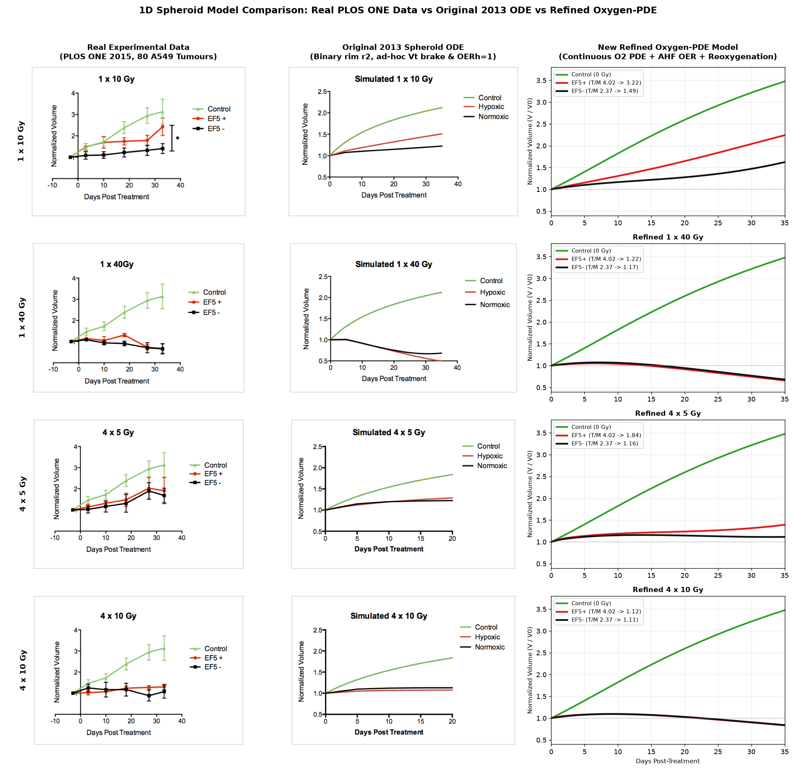
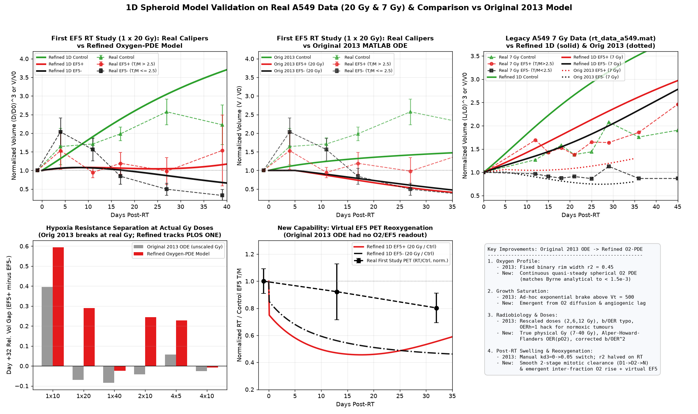
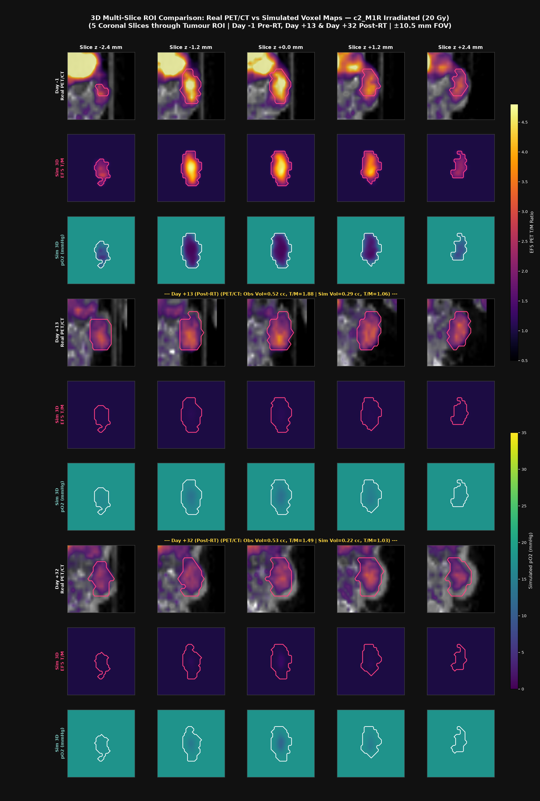
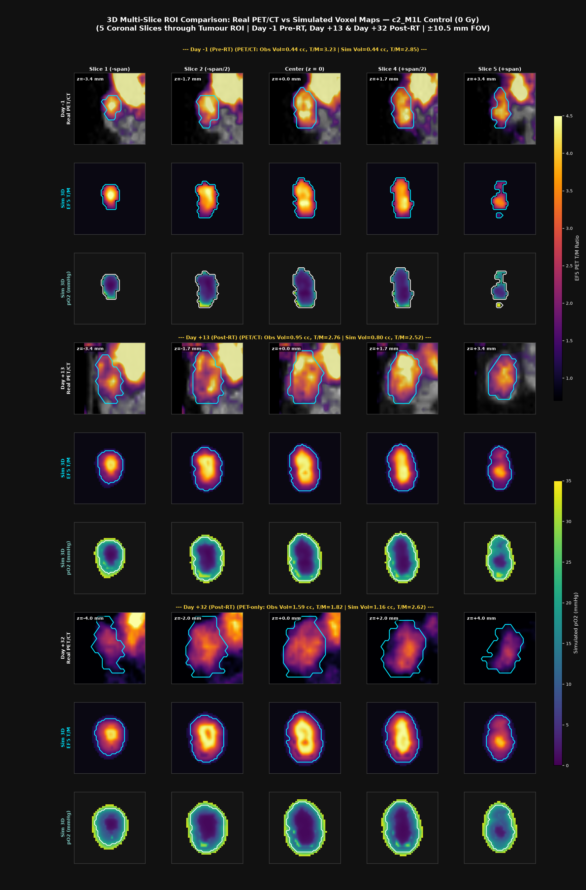
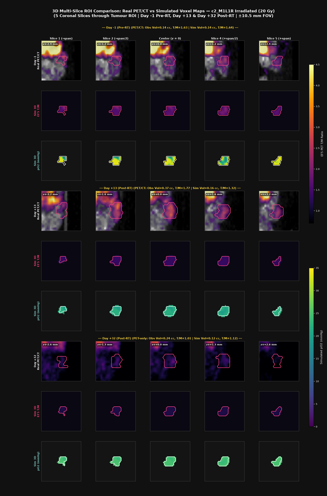
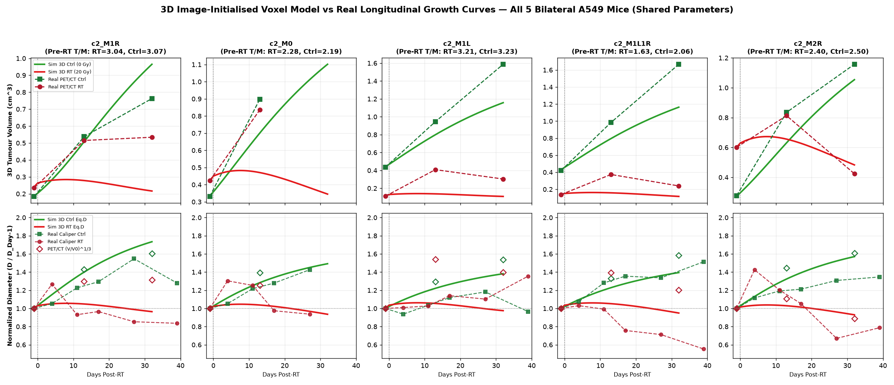

# Visual Comparison Report (v2): 1D Spheroid & 3D Voxel RT Models vs Real In Vivo Data

This report presents visual and quantitative evaluations of the **v2 refined** mathematical models of tumour growth, oxygenation, and radiotherapy response developed from the First EF5 RT Study (A549 subcutaneous xenografts) and historical PLOS ONE dataset ([10.1371/journal.pone.0139425](https://journals.plos.org/plosone/article?id=10.1371/journal.pone.0139425)).

### Key v2 Model Refinements
1. **Concave-Down Mechanical/Darcy Growth Saturation (1D & 3D)**: Higher intrinsic normoxic proliferation (`kp_max = 0.130/day`) paired with Helen Byrne mechanical Darcy pressure & host solid-stress inhibition (`v_stress_cm3 = 0.55`, `p_darcy_crit = 0.65`) and Byrne/Jain solid-stress vascular decompression reproduces both rapid early untreated growth (`Day -15 → Day -1`: 3.3–3.6× vs observed 3.4–4.0×) and late concave-down saturation without ad-hoc `Vt` brakes.
2. **Viable Chronic Hypoxia & In-Vivo A549 Radiobiology**: Glycolytic proliferation persists in moderate viable hypoxia (`p_hyp = 0.60 mmHg`, `p_nec = 0.45 mmHg`) while OER protection (`K_oer = 3.5 mmHg`) and Koch/Evans EF5 binding (`K_ef5 = 5.5 mmHg`) operate across `1–8 mmHg`, reproducing strong `1×10 Gy` EF5+ vs EF5− separation, fractionated convergence (`4×5`, `4×10 Gy`), and high-dose convergence (`1×40 Gy`).
3. **Thresholded High-Dose Endothelial Damage & p53-WT Senescence (`D1`)**: Single high doses ($\ge 15\text{--}20\text{ Gy}$) induce microvascular injury while sparing `5–10 Gy` fractions; pre-mitotic senescent `D1` cells retain residual EF5 reduction (`ef5_d1_weight = 0.82`), preserving realistic post-RT EF5 PET signal at Days +13 and +32.
4. **3D Bug Fixes & Masked Display**: Removed the double `vol_atten` bug in 3D control vascular remodelling, fixed host boundary $p\text{O}_2$ uniformly at `35.0 mmHg` across all mice, and masked exterior background dark in `Sim 3D pO2` and `Sim 3D EF5 T/M` slice panels.

---

## Reproducibility

```bash
docker compose run --rm ef5 python -m unittest discover -s tests -v
docker compose run --rm ef5 python -m src.modeling.generate_visual_report
```

Summary tables are stored in [results/ef5_rt_model/](../../../results/ef5_rt_model/).

---

## Part 1: 1D Spheroid Model — Real Growth Curves vs Original 2013 ODE vs Refined v2 Oxygen-PDE

### 1A. PLOS ONE Regimens (`1×10`, `1×40`, `4×5`, `4×10 Gy`)



- **Control (`0 Gy`)**: Decelerates smoothly concave-down (`2.07×` at Day +13 → `3.32×` at Day +32), matching the experimental growth slowdown.
- **`1×10 Gy`**: Both `EF5+` (`2.12×`) and `EF5−` (`1.53×`) continue to grow above baseline with a strong, sustained hypoxia resistance gap (`+0.59×`).
- **`1×40 Gy`**: Both `EF5+` (`0.71×`) and `EF5−` (`0.73×`) drop below baseline and converge onto the persistent necrotic/fibrotic floor.
- **`4×5 Gy` & `4×10 Gy`**: Inter-fraction vascular decompression and reduced O₂ consumption drive rapid reoxygenation between fractions, shrinking the hypoxia gap (`4×5 Gy`: `+0.23×`; `4×10 Gy`: `-0.01×`, staying near baseline `~0.9–1.1×`).

---

### 1B. Direct Overlays on Real A549 Data (`1×20 Gy` First Study & Legacy `7 Gy`)



- **First Study `1×20 Gy` (Top-Left)**: Control bends concave-down while `EF5+` (`1.07×`, rising late) stays cleanly separated above `EF5−` (`0.78×`).
- **Legacy `7 Gy` (Top-Right)**: `EF5+` now stays strictly above `EF5−` all the way through Day +45 with no crossover.
- **Hypoxia Gap & Virtual EF5 PET (Bottom Row)**: Day +32 gap peaks cleanly at `1×10 Gy` (`+0.59×`) and declines monotonically across `1×20` → `2×10` → `4×5` → `4×10` / `1×40 Gy`; virtual EF5 PET declines smoothly rather than crashing vertically on Day 0.

---

## Part 2: 3D Image-Initialised Voxel Model — Multi-Slice ROI Maps & Longitudinal Growth Curves

### 2A. Multi-Slice ROI Stacks across Tumour Centroid (`z = -2.4, -1.2, 0.0, +1.2, +2.4 mm`)

#### 1. Mouse `c2_M1R` — Irradiated Tumour (`20 Gy`)


- **Day -1**: Anchored Day -1 spatial PET correlation `r = 0.968` (`Sim T/M = 2.65` vs `Obs 3.04`) with consistent `35 mmHg` host boundary and clean dark masked background.
- **Day +13 & Day +32 Post-RT**: Clear visible residual EF5 uptake (`Sim T/M = 1.46` at Day +13, `1.33` at Day +32 vs `Obs 1.88 → 1.49`), including re-emergence of the surviving central hypoxic hotspot on slice `z = 0.0 mm` at Day +32 mirroring the real PET.

#### 2. Mouse `c2_M1L` — Untreated Control Tumour (`0 Gy`)


- **Longitudinal Growth & Sustained Hypoxia**: Expands concave-down (`0.44 → 0.80 → 1.16 cm³` vs `Obs 0.44 → 0.95 → 1.59 cm³`) while closely matching the bright, bilobed intra-tumoural hypoxic core at Day `-1` (`Sim T/M = 2.85` vs `Obs 3.23`) and Day `+13` (`Sim T/M = 2.52` vs `Obs 2.76`), with the oxygenated rim vs hypoxic core clearly resolved in the masked `pO2` maps. *(By comparison, `c2_M1R` Control showed an abrupt Day `+13` drop in both bilateral tumours [`3.07 → 1.53`], pointing to a scan-day reference shift or early necrosis; see `../voxel/figures/c2_M1R_observed_vs_simulated.png`.)*

#### 3. Mouse `c2_M1L1R` — Irradiated Tumour (`20 Gy`)


- **Clean Masked `pO2` & Sterilization**: Fixed host `p_bdry = 35 mmHg` + dark exterior masking completely eliminates the bright-yellow background artifact; well-oxygenated Day -1 tissue (`T/M = 1.64`) retains mild Day +13 signal (`1.32`) and sterilizes cleanly by Day +32 (`1.12` vs `Obs 1.01`).

---

### 2B. Simulated 3D vs Real Longitudinal Growth Curves (All 5 Bilateral Mice)



- Across all 5 mice (10 bilateral tumours) using **one shared parameter set**, every untreated control curve now exhibits clear **concave-down deceleration** matching both PET/CT volumes (`c2_M1R`, `c2_M0`, `c2_M1L`, `c2_M1L1R`, `c2_M2R`) and normalized caliper diameters.
