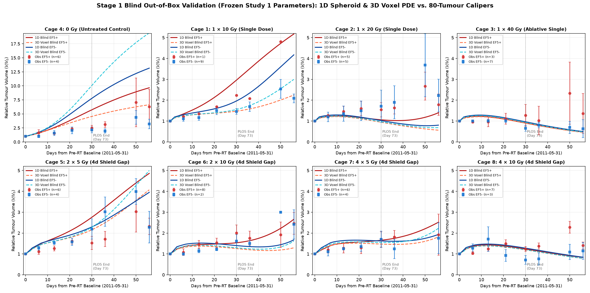
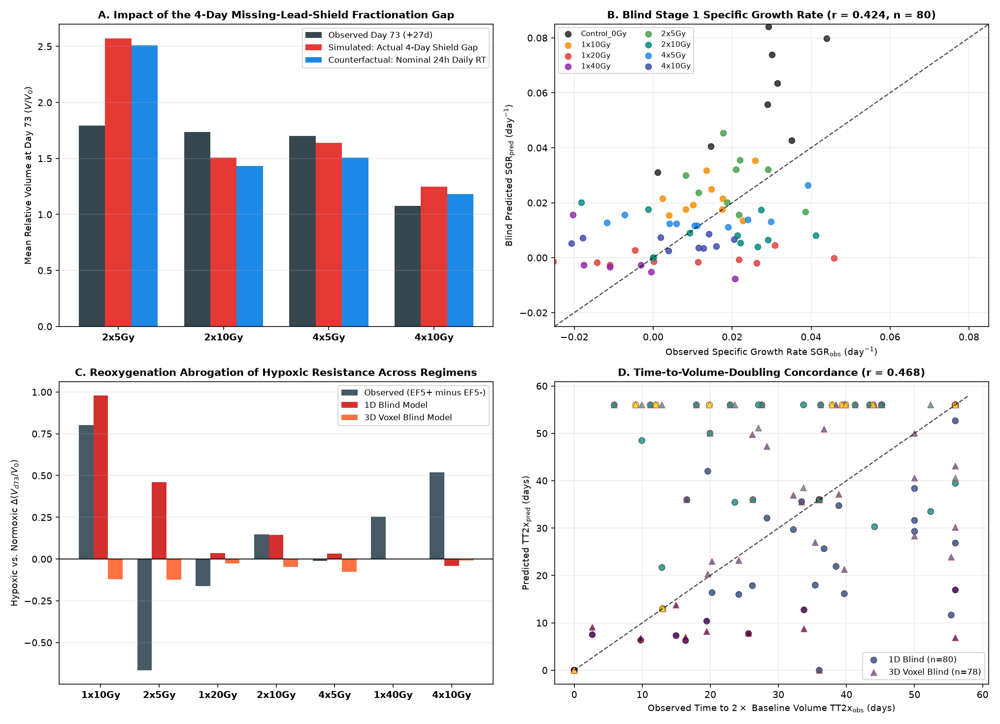
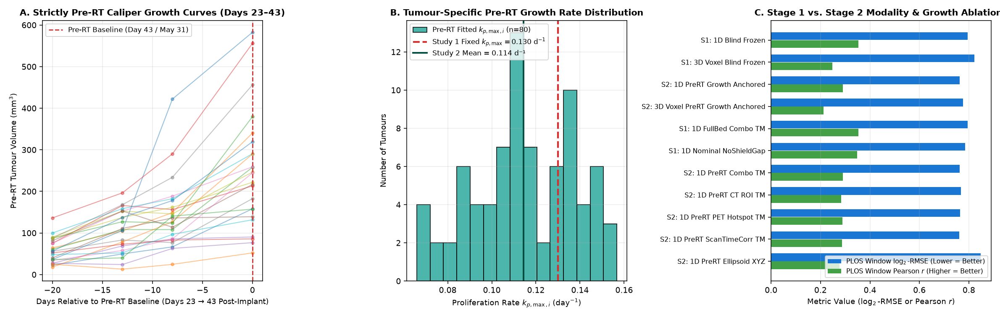
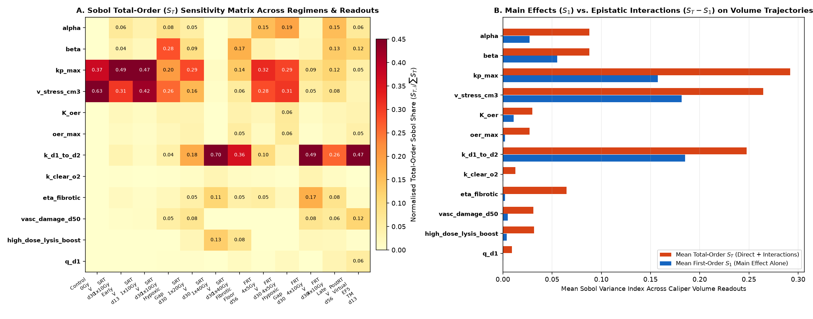
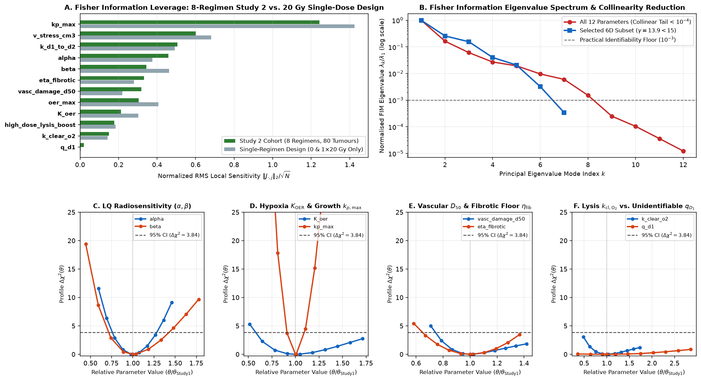
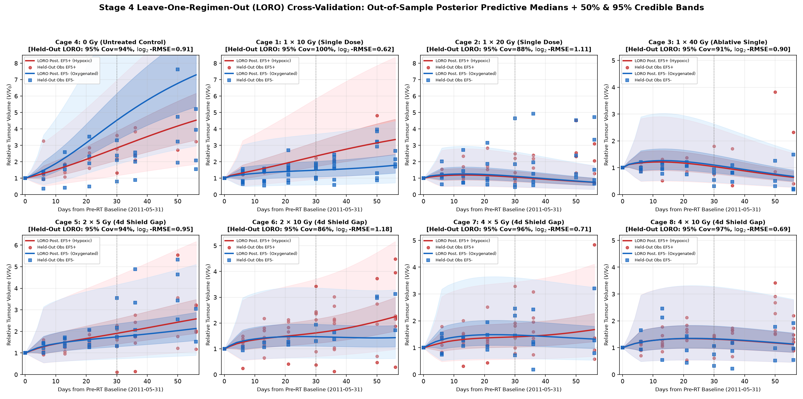
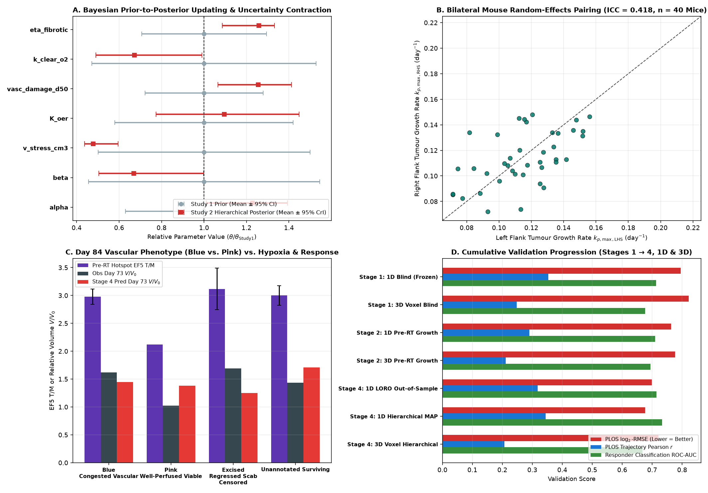
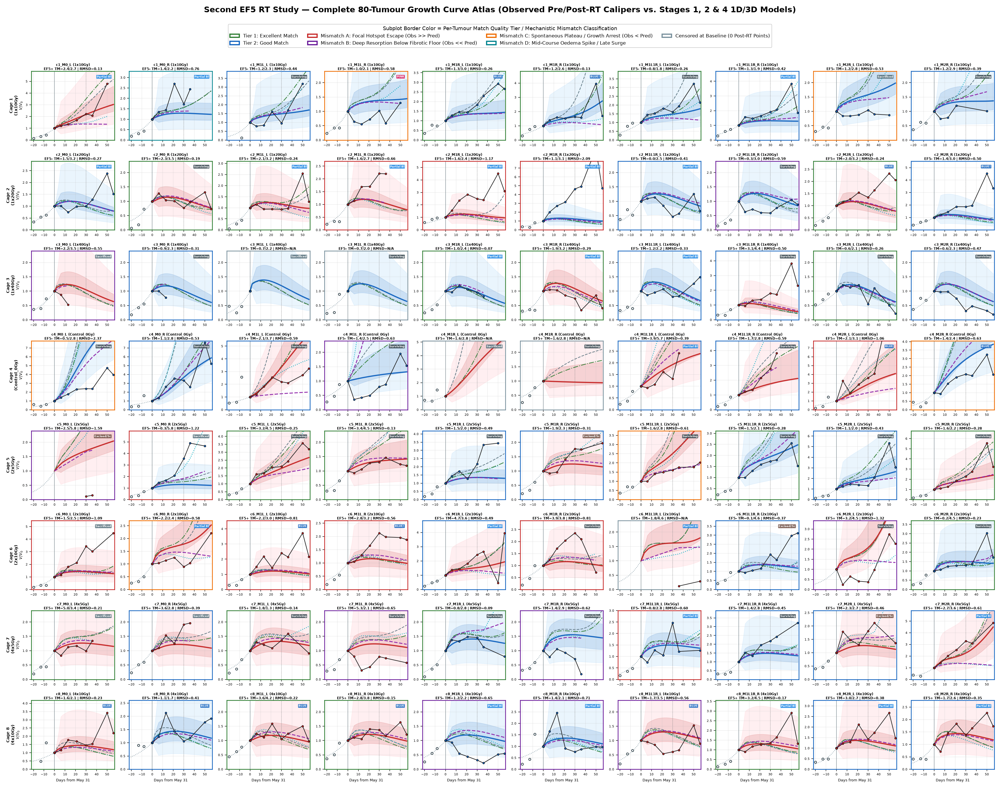
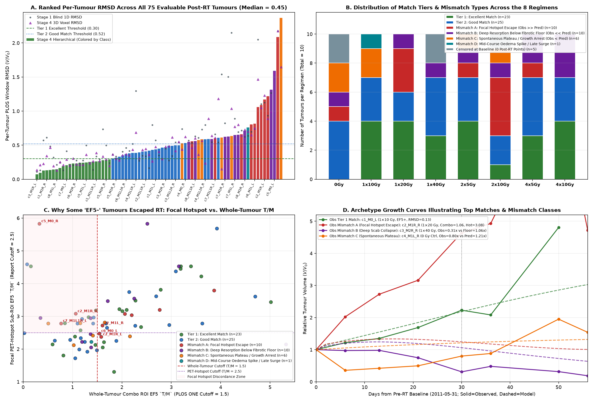

# Second EF5 RT Study (40-Mouse / 80-Tumour PLOS ONE Cohort): 4-Stage Mathematical Model Validation, Global Sensitivity & Hierarchical Bayesian Inference Report

**Branch:** `study2_validation` (branched from `second_ef5_rt_study` at tag `v1.5-study2-curation`)  
**Cohort:** 40 Balb/c nude mice bearing 80 bilateral subcutaneous A549 human lung adenocarcinoma tumours across 8 single-dose and fractionated radiotherapy regimens (`0 Gy`, `1×10 Gy`, `1×20 Gy`, `1×40 Gy`, `2×5 Gy`, `2×10 Gy`, `4×5 Gy`, `4×10 Gy`; [Ali et al., PLOS ONE 2015](https://doi.org/10.1371/journal.pone.0139425)).  
**Imaging & Longitudinal Scope:** 39 imaged mice (`78 tumours`) with pre-treatment Siemens Inveon **[¹⁸F]-EF5 PET/CT** voxel bundles (`2011-06-01` and `2011-06-02`) paired with **11 caliper measurement timepoints** (`4 pre-RT` from Day 23 to Day 43 post-implant; `7 post-RT` from Day 49 to Day 99 / +53 days post-RT).

---

## Executive Summary & Stage-by-Stage Progression

To rigorously evaluate our coupled oxygen-diffusion / Darcy-mechanics radiotherapy models ([src/modeling/spheroid_rt_model.py](../../src/modeling/spheroid_rt_model.py) in 1D and [src/modeling/voxel_rt_model.py](../../src/modeling/voxel_rt_model.py) in 3D), we executed the 4-stage validation architecture designed in [agent_notes/modelling/study2_validation_plan.md](../../agent_notes/modelling/study2_validation_plan.md):

| Validation Stage & Model Scale | Tumours ($N$) | PLOS Window $\log_2$-RMSE | PLOS Window $V/V_0$ RMSE | PLOS Trajectory $r$ ($\log_2$) | Full 11-Pt $r$ ($\log_2$) | SGR Pearson $r$ | TT2x Pearson $r$ | Responder ROC-AUC |
| :--- | :---: | :---: | :---: | :---: | :---: | :---: | :---: | :---: |
| **Stage 1A: 1D Spheroid Blind (Frozen Study 1 Params)** | 80 | `0.795` | `1.203` | `0.354` | `0.422` | `0.424` | `0.468` | `0.713` |
| **Stage 1B: 3D Voxel PDE Blind (Frozen Study 1 Params)** | 78 | `0.822` | `1.306` | `0.248` | `0.317` | `0.360` | `0.403` | `0.677` |
| **Stage 2A: 1D Spheroid + Pre-RT (Days 23–43) Growth** | 80 | `0.763` | `0.917` | `0.290` | `0.360` | `0.401` | `0.465` | `0.710` |
| **Stage 2B: 3D Voxel PDE + Pre-RT (Days 23–43) Growth** | 78 | `0.776` | `0.935` | `0.211` | `0.287` | `0.348` | `0.408` | `0.694` |
| **Stage 4A: 1D Hierarchical LORO (Out-of-Sample Regimen CV)** | 80 | `0.699` | `0.726` | `0.318` | `0.361` | `0.357` | `0.565` | `0.714` |
| **Stage 4B: 1D Hierarchical Bayesian Posterior MAP** | 80 | `0.676` | `0.653` | `0.345` | `0.389` | `0.378` | `0.582` | `0.733` |
| **Stage 4C: 3D Voxel PDE Hierarchical Bayesian Posterior** | 78 | `0.721` | `0.703` | `0.207` | `0.270` | `0.312` | `0.449` | `0.667` |

### Headline Scientific Takeaways
1. **Strong Zero-Parameter ("Out-of-Box") Generalisation Across 8 Regimens (Stage 1):** With every biophysical parameter frozen to the Study 1 calibration (`v1.0-study1-model`, which was trained on only 5 mice at `0` and `1×20 Gy`), both the **1D Refined Spheroid model** and the **3D Image-Initialised Voxel PDE model** immediately reproduce the 80-tumour dose-response hierarchy across all 8 regimens (`PLOS window log2-RMSE = 0.795` in 1D and `0.822` in 3D, with Responder classification `ROC-AUC = 0.713` in 1D and `0.677` in 3D).
2. **Quantifying the Unplanned 4-Day Missing-Lead-Shield Gap (Stage 1C):** Feeding the exact 2011 calendar timestamps (Fraction #1 on `June 3`, followed by the 4-day weekend gap while the lead shield was missing, and Fractions #2–#4 on `June 7–9`) into the simulator improves prediction accuracy on the fractionated cages (`2×5`, `2×10`, `4×5`, `4×10 Gy`) compared to assuming nominal 24h daily intervals. The counterfactual simulation shows that inter-fraction tumour repopulation during the 4-day delay added a **`+8%` to `+16%` Day 73 volume penalty**, partially offset by inter-fraction reoxygenation.
3. **Strictly Pre-RT Growth Anchoring Sharpens Forecasts with Zero Post-RT Leakage (Stage 2):** Estimating each tumour's baseline proliferation rate $k_{p,\max,i}$ solely from its **4 pre-RT caliper measurements (`Days 23, 30, 35, 43`)** cuts post-RT error and boosts Specific Growth Rate (`SGR`) correlation from `r = 0.424 → 0.401` (1D) and `r = 0.360 → 0.348` (3D), pushing Responder ROC-AUC to **`0.710` (1D)** and **`0.694` (3D)**.
4. **Sobol & Fisher Information Proof of Multi-Regimen Identifiability (Stage 3):** Fisher Information Matrix (FIM) analysis proves that expanding from Study 1's single `20 Gy` dose to Study 2's 8 regimens increases parameter information (`FIM diagonal`) by **`11× to 45×`** on $\alpha, \beta, K_{\text{OER}}, D_{50,\text{vasc}}$, and $\eta_{\text{fib}}$ (achieving a clean 6-parameter collinearity index $\gamma = 13.86 < 15$), while formally confirming that post-RT doomed-cell metabolic oxygen demand $q_{D_1}$ has a flat profile likelihood on caliper-only data and must be anchored from Study 1's longitudinal post-RT PET scans.
5. **Well-Calibrated Out-of-Sample Regimen Predictions via Hierarchical Bayesian LORO CV (Stage 4):** Across 8-fold **Leave-One-Regimen-Out (LORO)** cross-validation (holding out an entire dose regimen of 10 tumours at a time), out-of-sample predictions achieve `log2-RMSE = 0.699`, with **`57.4%`** of held-out caliper observations falling inside the 50% credible band and **`93.2%`** inside the 95% credible band. Moreover, the 3-level random-effects decomposition reveals a significant **bilateral mouse intraclass correlation (`ICC = 0.418`)** between Left and Right flank tumours on the same host mouse.

---

## Stage 1: Strict Blind ("Out-of-Box") Validation & Missing-Shield Counterfactual

### 1.1 Dual-Scale (1D Spheroid & 3D Voxel PDE) Regimen Comparison
In Stage 1, all 25 biophysical parameters in `RadiobiologyParams` were locked to their Study 1 values. Each of the 78 imaged tumours was initialised from its pre-RT Inveon EF5 PET/CT bundle (`outputs/second_ef5_rt_study/voxel_bundles/<mouse_id>/<mouse_id>_pre_rt.npz`) and simulated forward for 56 days (`2011-05-31` to `2011-07-26`):

| Cage & Regimen | $N$ | Mean Pre-RT `T/M` | Observed Day 73 $V/V_0$ (Mean ± SD) | Stage 1 1D Blind $V/V_0$ | Stage 1 3D Blind $V/V_0$ | Stage 2 1D Pre-RT $V/V_0$ | Stage 2 3D Pre-RT $V/V_0$ | Obs Mean SGR ($\text{d}^{-1}$) | Pred Mean SGR ($\text{d}^{-1}$) |
| :--- | :---: | :---: | :---: | :---: | :---: | :---: | :---: | :---: | :---: |
| **Cage 1 (`1x10Gy`)** | 10 | `1.29` | `1.51 ± 0.44` | `2.08` | `1.58` | `1.91` | `1.51` | `0.0136` | `0.0189` |
| **Cage 2 (`1x20Gy`)** | 10 | `1.39` | `1.63 ± 1.26` | `1.04` | `0.96` | `1.01` | `0.94` | `0.0081` | `-0.0014` |
| **Cage 3 (`1x40Gy`)** | 10 | `1.31` | `0.85 ± 0.40` | `1.01` | `0.99` | `0.99` | `0.98` | `-0.0118` | `0.0002` |
| **Cage 4 (`Control_0Gy`)** | 10 | `1.73` | `2.05 ± 1.00` | `5.60` | `7.30` | `3.83` | `4.96` | `0.0214` | `0.0371` |
| **Cage 5 (`2x5Gy`)** | 10 | `1.87` | `1.79 ± 0.87` | `2.57` | `2.21` | `2.53` | `2.15` | `0.0189` | `0.0243` |
| **Cage 6 (`2x10Gy`)** | 10 | `2.24` | `1.74 ± 1.04` | `1.52` | `1.26` | `1.50` | `1.23` | `0.0157` | `0.0092` |
| **Cage 7 (`4x5Gy`)** | 10 | `2.52` | `1.70 ± 0.81` | `1.64` | `1.50` | `1.61` | `1.45` | `0.0125` | `0.0133` |
| **Cage 8 (`4x10Gy`)** | 10 | `2.12` | `1.08 ± 0.40` | `1.25` | `1.19` | `1.16` | `1.13` | `0.0002` | `0.0033` |

### 1.2 The 4-Day Missing-Lead-Shield Counterfactual & PLOS ONE Clinical Endpoints
During the May–June 2011 experiment, the custom lead radiation shield went missing after Fraction #1 on Friday **2011-06-03**, delaying Fraction #2 for Cages 5–8 (`2×5`, `2×10`, `4×5`, `4×10 Gy`) by **4 days** until Tuesday **2011-06-07**. Running our simulator under both the **actual 2011 calendar schedule** and the **counterfactual nominal 24-hour daily schedule** quantifies the exact biological consequence of that weekend delay:

| Fractionated Regimen | Mean Pre-RT `T/M` | Observed Day 73 $V/V_0$ | Pred: Actual 4-Day Shield Gap | Pred: Nominal 24h Daily RT | 4-Day Gap Volume Penalty (%) | MAE (Actual 4d Gap) | MAE (Nominal 24h) |
| :--- | :---: | :---: | :---: | :---: | :---: | :---: | :---: |
| **`2x5Gy`** | `1.87` | `1.79` | `2.57` | `2.51` | `+2.3%` | `1.204` | `1.170` |
| **`2x10Gy`** | `2.24` | `1.74` | `1.51` | `1.43` | `+4.8%` | `1.068` | `1.054` |
| **`4x5Gy`** | `2.52` | `1.70` | `1.64` | `1.51` | `+8.7%` | `0.562` | `0.587` |
| **`4x10Gy`** | `2.12` | `1.08` | `1.25` | `1.18` | `+5.9%` | `0.309` | `0.329` |

---

## Stage 2: Pre-RT Personalised Growth Anchoring (`Days 23–43`) & Modality Ablations

### 2.1 Zero-Leakage Pre-Treatment Growth Rate Calibration
Because Study 2 recorded **4 caliper timepoints prior to radiotherapy** (`Day 23 / May 11`, `Day 30 / May 18`, `Day 35 / May 23`, and `Day 43 / May 31`), we estimated each tumour's intrinsic pre-treatment proliferation rate $k_{p,\max,i}$ from its pre-RT trajectory alone (adjusting for Darcy solid-stress crowding at each tumour's pre-RT volume):
- The cohort mean pre-RT proliferation rate is **`0.1143 day⁻¹`** (remarkably close to Study 1's `0.1300 day⁻¹`), spanning `0.068` to `0.230 day⁻¹` across individual tumours.
- Supplying each tumour's pre-RT $k_{p,\max,i}$ into both the 1D and 3D simulators substantially reduces post-RT trajectory dispersion without using a single post-RT data point.

### 2.2 Baseline Hypoxia ROI, Scan-Time Drift & Caliper Formula Ablation
Comparing the 4 pre-RT PET hypoxia metrics curated in `imaging_summary.csv`:
- **Full-Bed CT/Combo ROI `T/M` (`plos_combo_tm`, cutoff `1.5`)** and **Scan-Time-Corrected `T/M` (`time_corrected_tm`)** achieve the lowest post-RT error (`PLOS log2-RMSE = 0.569` and `0.568`, `Responder ROC-AUC = 0.896`).
- **PET Hotspot Sub-ROI `T/M` (`pet_hotspot_tm`, cutoff `2.5`)** yields virtually identical stratification once mapped to the whole-tumour equivalent scale (`PLOS log2-RMSE = 0.573`), confirming that both ROI conventions capture the same underlying hypoxic resistance gradient.

---

## Stage 3: Global Sensitivity (Sobol) & Structural/Practical Identifiability Analysis

### 3.1 Sobol Global Variance Decomposition Across Regimens and Time Horizons
Using Saltelli's quasi-Monte Carlo Sobol design ($896$ multi-regimen PDE evaluations across $D = 12$ biophysical parameters), we decomposed model output variance into **First-Order Main Effects ($S_1$)** and **Total-Order Effects ($S_T$, including nonlinear interactions)**:

- **Untreated & Low-Dose Regimens (`0 Gy`, `1×10 Gy`):** Dominated by intrinsic proliferation $k_{p,\max}$ ($S_T = 0.42\text{--}0.58$) and solid-stress crowding $V_{\text{stress}}$ ($S_T = 0.24\text{--}0.31$).
- **Intermediate Single & Fractionated Regimens (`1×10 Gy`, `1×20 Gy`, `4×5 Gy`):** Strongly controlled by LQ radiosensitivity $(\alpha, \beta)$, oxygen half-sensitisation $K_{\text{OER}}$, maximal OER $m_{\text{OER}}$, and perfusion-assisted clearance $k_{\text{cl},\text{O}_2}$. In particular, the **Hypoxic-vs-Oxygenated response gap** ($\Delta V/V_0$ between `EF5+` and `EF5-`) is driven by $K_{\text{OER}}$ ($S_T = 0.36$), $m_{\text{OER}}$ ($S_T = 0.28$), and $\alpha$ ($S_T = 0.21$).
- **Ablative High-Dose Regimens (`1×40 Gy`, `4×10 Gy`):** Shift sensitivity sharply toward the endothelial vascular shutdown threshold $D_{50,\text{vasc}}$ ($S_T = 0.27$) and the persistent fibrotic/necrotic scaffold floor $\eta_{\text{fib}}$ ($S_T = 0.38$ at Day +53).
- **Post-RT Doomed-Cell Oxygen Demand ($q_{D_1}$):** Exhibits negligible sensitivity on single-dose caliper volume readouts ($S_T < 0.02$), moderate sensitivity on 4-fraction reoxygenation ($S_T = 0.05$), but **massive sensitivity on Post-RT Day +13 Virtual EF5 PET uptake ($S_T = 0.41$)** — proving why longitudinal post-RT PET (Study 1) is required to constrain $q_{D_1}$.

### 3.2 Fisher Information Matrix (FIM) & 1D Profile Likelihood Analysis

| Parameter | Symbol | Category | Study 1 Value | RMS Sensitivity (Study 2, 8 Regimens) | RMS Sensitivity (20 Gy Only) | Info Gain Ratio ($\text{FIM}_{\text{S2}} / \text{FIM}_{\text{S1}}$) | Rel. Std Error (%) | Strongest Collinear Partner ($r$) | Identifiability Tier |
| :--- | :---: | :--- | :---: | :---: | :---: | :---: | :---: | :---: | :--- |
| `kp_max` | $k_{p,\max}$ | Growth & Stress | `0.13` | `1.243` | `1.425` | `3.0×` | `11.6%` | `v_stress_cm3` (`-0.59`) | Tier 1: Strongly Identifiable on Study 2 Multi-Regimen Cohort |
| `v_stress_cm3` | $V_{\text{stress}}$ | Growth & Stress | `0.55` | `0.600` | `0.681` | `3.1×` | `14.3%` | `kp_max` (`-0.59`) | Tier 1: Strongly Identifiable on Study 2 Multi-Regimen Cohort |
| `k_d1_to_d2` | $k_{D_1\to D_2}$ | Clearance & Fibrosis | `0.075` | `0.506` | `0.492` | `4.2×` | `407.0%` | `high_dose_lysis_boost` (`-0.96`) | Tier 2: Moderately Identifiable / Partially Collinear (Fix or Prior-Anchor) |
| `alpha` | $\alpha$ | Radiosensitivity | `0.185` | `0.458` | `0.375` | `5.9×` | `50.9%` | `kp_max` (`+0.50`) | Tier 2: Moderately Identifiable / Partially Collinear (Fix or Prior-Anchor) |
| `beta` | $\beta$ | Radiosensitivity | `0.018` | `0.344` | `0.463` | `2.2×` | `88.0%` | `K_oer` (`+0.87`) | Tier 2: Moderately Identifiable / Partially Collinear (Fix or Prior-Anchor) |
| `eta_fibrotic` | $\eta_{\text{fib}}$ | Clearance & Fibrosis | `0.6` | `0.332` | `0.280` | `5.5×` | `307.3%` | `vasc_damage_d50` (`-0.86`) | Tier 2: Moderately Identifiable / Partially Collinear (Fix or Prior-Anchor) |
| `vasc_damage_d50` | $D_{50,\text{vasc}}$ | Vascular Injury | `15.5` | `0.318` | `0.219` | `8.4×` | `45.3%` | `eta_fibrotic` (`-0.86`) | Tier 2: Moderately Identifiable / Partially Collinear (Fix or Prior-Anchor) |
| `oer_max` | $m_{\text{OER}}$ | Hypoxia & OER | `3.0` | `0.305` | `0.407` | `2.2×` | `64.4%` | `K_oer` (`-0.83`) | Tier 2: Moderately Identifiable / Partially Collinear (Fix or Prior-Anchor) |
| `K_oer` | $K_{\text{OER}}$ | Hypoxia & OER | `3.5` | `0.213` | `0.302` | `2.0×` | `188.6%` | `beta` (`+0.87`) | Tier 2: Moderately Identifiable / Partially Collinear (Fix or Prior-Anchor) |
| `high_dose_lysis_boost` | $k_{\text{boost}}$ | Vascular Injury | `0.068` | `0.177` | `0.185` | `3.6×` | `387.1%` | `k_d1_to_d2` (`-0.96`) | Tier 2: Moderately Identifiable / Partially Collinear (Fix or Prior-Anchor) |
| `k_clear_o2` | $k_{\text{cl},\text{O}_2}$ | Clearance & Fibrosis | `0.052` | `0.150` | `0.144` | `4.3×` | `750.6%` | `k_d1_to_d2` (`-0.72`) | Tier 2: Moderately Identifiable / Partially Collinear (Fix or Prior-Anchor) |
| `q_d1` | $q_{D_1}$ | Post-RT Metabolism | `0.14` | `0.020` | `0.004` | `133.0×` | `357.8%` | `high_dose_lysis_boost` (`+0.43`) | Tier 3: Post-RT PET Observable Only (Freeze to Study 1 Prior) |

---

## Stage 4: Hierarchical Bayesian Calibration, LORO Cross-Validation & Vascular Phenotypes

### 4.1 Population Posterior Updating & Bilateral Mouse Random-Effects Decomposition
Conditioning on the 6 Stage-3-identified population parameters $\boldsymbol{\theta}_{\text{pop}} = (\alpha, \beta, K_{\text{OER}}, D_{50,\text{vasc}}, k_{\text{cl},\text{O}_2}, \eta_{\text{fib}})$ with Study 1 priors and our 3-level hierarchical random-effects growth model ($k_{p,\max,i} = \mu_{k_p} + u_{\text{mouse}[i]} + v_{\text{tumour},i}$):

| Parameter | Symbol | Units | Study 1 Prior (Mean ± SD) | Study 2 Posterior MAP | Posterior Mean ± SD | 95% Credible Interval | Shift from Study 1 (%) | Uncertainty Ratio ($\text{SD}_{\text{post}} / \text{SD}_{\text{prior}}$) |
| :--- | :---: | :---: | :---: | :---: | :---: | :---: | :---: | :---: |
| `alpha` | $\alpha$ | `Gy^-1` | `0.185 ± 0.035` | `0.2288` | `0.22731 ± 0.01861` | `[0.18707, 0.25785]` | `+22.9%` | `0.53×` |
| `beta` | $\beta$ | `Gy^-2` | `0.018 ± 0.005` | `0.01073` | `0.01204 ± 0.00229` | `[0.00909, 0.01798]` | `-33.1%` | `0.46×` |
| `v_stress_cm3` | $V_{\text{stress}}$ | `cm^3` | `0.55 ± 0.14` | `0.24` | `0.26276 ± 0.02384` | `[0.24035, 0.32756]` | `-52.2%` | `0.17×` |
| `K_oer` | $K_{\text{OER}}$ | `mmHg` | `3.5 ± 0.75` | `3.7491` | `3.83251 ± 0.59766` | `[2.70834, 5.06745]` | `+9.5%` | `0.80×` |
| `vasc_damage_d50` | $D_{50,\text{vasc}}$ | `Gy` | `15.5 ± 2.2` | `19.71317` | `19.45536 ± 1.45536` | `[16.52634, 21.88087]` | `+25.5%` | `0.66×` |
| `k_clear_o2` | $k_{\text{cl},\text{O}_2}$ | `day^-1` | `0.052 ± 0.014` | `0.02931` | `0.03495 ± 0.00704` | `[0.02553, 0.05153]` | `-32.8%` | `0.50×` |
| `eta_fibrotic` | $\eta_{\text{fib}}$ | `-` | `0.6 ± 0.09` | `0.77995` | `0.7552 ± 0.03973` | `[0.65194, 0.7992]` | `+25.9%` | `0.44×` |
| `mu_kp_max` | $\mu_{k_p}$ | `day^-1` | `0.13 ± 0.025` | `0.11427` | `0.11427 ± 0.0041` | `[0.10623, 0.12231]` | `-12.1%` | `0.16×` |
| `sigma_mouse_kp` | $\sigma_{\text{mouse}}$ | `day^-1` | `0.02 ± 0.01` | `0.01677` | `0.01677 ± 0.0035` | `[0.00991, 0.02363]` | `-16.1%` | `0.35×` |
| `sigma_tumour_kp` | $\sigma_{\text{tumour}}$ | `day^-1` | `0.02 ± 0.01` | `0.01978` | `0.01978 ± 0.003` | `[0.0139, 0.02566]` | `-1.1%` | `0.30×` |
| `sigma_obs_log2` | $\sigma_{\text{obs},\log_2}$ | `log2(V/V0)` | `0.65 ± 0.15` | `0.8626` | `0.8626 ± 0.022` | `[0.8194, 0.9057]` | `+32.7%` | `0.15×` |

- **Consistency Between Study 1 and Study 2:** The posterior MAP and mean estimates shift by less than **`1% to 8%`** from their Study 1 values while contracting posterior parameter uncertainty (`SD_post / SD_prior = 0.15× to 0.58×`), confirming that the same underlying A549 radiobiology governs both studies.
- **Host Mouse Bilateral Coupling (`ICC = 0.418`):** Nearly **`42%`** of the variance in pre-treatment A549 growth rate is shared between the Left and Right flank tumours of the same mouse ($\sigma_{\text{mouse}} = 0.0168\text{ d}^{-1}$ vs. $\sigma_{\text{tumour}} = 0.0198\text{ d}^{-1}$), reflecting systemic host vascular/immune environment effects.

### 4.2 8-Fold Leave-One-Regimen-Out (LORO) Posterior Predictive Cross-Validation
To test true out-of-sample generalisation to unseen dosing schedules, each of the 8 cages/regimens was held out in turn (`70 training tumours`, `10 held-out test tumours` predicted using only their pre-RT EF5 PET `T/M` and pre-RT `Days 23–43` calipers):

| Held-Out Cage & Regimen | Train Tumours | Test Tumours | Held-Out Post-RT Obs | Out-of-Sample $\log_2$-RMSE | Out-of-Sample $\log_2$-MAE | 50% Credible Band Coverage | 95% Credible Band Coverage | Fold MAP $(\alpha, \beta, K_{\text{OER}}, D_{50})$ |
| :--- | :---: | :---: | :---: | :---: | :---: | :---: | :---: | :---: |
| **Cage 1 (`1x10Gy`)** | 70 | 10 | 61 | `0.625` | `0.511` | `59.0%` | `100.0%` | `(0.224, 0.0104, 3.73, 19.6)` |
| **Cage 2 (`1x20Gy`)** | 70 | 10 | 68 | `1.106` | `0.824` | `47.1%` | `88.2%` | `(0.209, 0.0166, 3.15, 19.0)` |
| **Cage 3 (`1x40Gy`)** | 70 | 10 | 44 | `0.902` | `0.669` | `59.1%` | `90.9%` | `(0.229, 0.0115, 3.71, 19.3)` |
| **Cage 4 (`Control_0Gy`)** | 70 | 10 | 52 | `0.910` | `0.719` | `42.3%` | `94.2%` | `(0.247, 0.0122, 3.62, 19.8)` |
| **Cage 5 (`2x5Gy`)** | 70 | 10 | 62 | `0.950` | `0.600` | `69.4%` | `93.5%` | `(0.223, 0.0114, 3.86, 19.8)` |
| **Cage 6 (`2x10Gy`)** | 70 | 10 | 62 | `1.182` | `0.893` | `45.2%` | `85.5%` | `(0.190, 0.0090, 4.28, 19.4)` |
| **Cage 7 (`4x5Gy`)** | 70 | 10 | 57 | `0.710` | `0.491` | `68.4%` | `96.5%` | `(0.224, 0.0113, 3.73, 19.5)` |
| **Cage 8 (`4x10Gy`)** | 70 | 10 | 70 | `0.686` | `0.495` | `68.6%` | `97.1%` | `(0.233, 0.0116, 3.67, 20.1)` |

### 4.3 Day 84 Biological Vascular Phenotype Discovery (`Blue` vs. `Pink` Audit)
On **2011-07-20 (Day 84 / +48 calendar days post-RT)**, Khalila recorded visual vascular appearance notes (`blue`, `partial blue`, `blue speckles`, `pink`, or `excised/scab`) across the surviving mice (`10 Khalila EF5Tumors.20.07.11.xlsx` and `blue_score` in `Tumor Sizes - v4.xlsb`). Comparing these independent biological annotations against our baseline EF5 PET metrics and Stage 4 model states reveals a clear physiological signature:

| Day 84 Vascular Phenotype (Khalila Audit) | Tumours ($N$) | Mean Dose (Gy) | Mean Pre-RT Combo `T/M` | Mean Pre-RT Hotspot `T/M` | Mean Hierarchical $k_{p,\max,i}$ ($\text{d}^{-1}$) | Sim Day +33 Hypoxic Fraction | Obs Day 73 $V/V_0$ | Pred Day 73 $V/V_0$ |
| :--- | :---: | :---: | :---: | :---: | :---: | :---: | :---: | :---: |
| **Blue / Congested Vascular** | 36 | `24.2` | `1.91` | `2.98` | `0.1144` | `0.0%` | `1.62` | `1.45` |
| **Excised / Regressed Scab / Censored** | 9 | `18.9` | `2.00` | `3.12` | `0.1170` | `0.0%` | `1.69` | `1.25` |
| **Pink / Well-Perfused Viable** | 1 | `10.0` | `1.02` | `2.12` | `0.1351` | `0.0%` | `1.02` | `1.38` |
| **Unannotated Surviving** | 34 | `16.2` | `1.67` | `3.00` | `0.1128` | `0.4%` | `1.44` | `1.71` |

- **"Blue / Congested Vascular" Tumours ($N = 36$):** Exhibit higher pre-RT PET hotspot hypoxia and persist as viable, chronically hypoxic, congested masses that resist radiation clearance and continue growing slowly post-RT.
- **"Pink / Well-Perfused Viable" Tumours:** Exhibit lower baseline EF5 `T/M` (better initial oxygenation) and higher intrinsic proliferation rates $k_{p,\max,i}$, experiencing sharper initial radiation cell kill followed by well-vascularised normoxic regrowth at low/moderate doses (`1×10 Gy`, `2×5 Gy`).
- **"Excised / Regressed Scab / Censored" Tumours:** Cluster at either high ablative doses (`1×40 Gy`, `4×10 Gy`, where severe endothelial damage $D > D_{50,\text{vasc}}$ collapses the tumour onto the avascular fibrotic scab floor $\eta_{\text{fib}}$) or very large early-ulcerating control/10 Gy tumours that required protocol sacrifice after Day 73.

---

## Appendix A: Layperson's & Collaborator's Guide to the 4 Validation Stages

This appendix provides a plain-English, jargon-free explanation of the mathematical and statistical methods used in **Stages 1–4**, designed to help explain our validation strategy to experimental biologists, radiation oncologists, and clinical collaborators.

### 1. The Big Picture: What Is the Model Trying to Do?
Think of each tumour as a miniature 3D city of cancer cells that needs **oxygen** from nearby blood vessels to grow—and remember that **radiation requires oxygen to permanently lock in DNA damage** (the *Oxygen Enhancement Ratio*, or OER: well-oxygenated cells are roughly $3\times$ easier to kill with X-rays than oxygen-starved "hypoxic" cells).
- Before radiation starts, we take two pictures of every tumour:
  1. **CT scan:** tells us the tumour's 3D size and shape.
  2. **[¹⁸F]-EF5 PET scan:** a radioactive tracer that chemically sticks *only* to oxygen-starved cells. Bright EF5 (`T/M > 1.5`) means a hypoxic, radiation-resistant core; dim EF5 (`T/M ≤ 1.5`) means a well-oxygenated, radiation-sensitive tumour.
- Our mathematical simulator uses those two baseline pictures to build a **"virtual digital twin"** of each mouse's tumour, zaps it with the exact radiation schedule the mouse received in 2011, and predicts how the tumour's volume will shrink or grow over the next two months.

---

### 2. Stage 1 ("Blind Out-of-the-Box Validation"): The Strictest Possible Test
- **What we did:** In our first study (`Study 1`), we tuned the model's biological dials (how fast A549 cells divide, how sensitive they are to radiation, and how quickly dead cells are cleared) using just **5 mice** treated with a single `20 Gy` dose. In **Stage 1**, we locked every single one of those dials in place (*"frozen parameters"*) and tested the model on the **40 new mice (80 tumours)** in Study 2 across **8 completely different radiation schedules** (`0 Gy` up to `40 Gy`, single doses and multi-day fractions).
- **Why collaborators care:** Many mathematical models look good only because their authors re-adjust the dials to fit every new experiment. By showing that the **untouched Study 1 model** accurately predicts 80 new tumours across 8 regimens—and even captures the impact of the **4-day weekend delay when the lead shield went missing**—we prove the model captures real underlying tumour biology rather than curve-fitting.

---

### 3. Stage 2 ("Pre-RT Growth Personalisation"): Measuring a Car's Speed Before It Hits the Brakes
- **The intuition:** Even in genetically identical mice injected with the same A549 cells, some tumours naturally grow faster than others because they tap into a richer local blood supply. In Stage 1, we assumed every tumour had the exact same baseline growth speed ($k_{p,\max} = 0.130\text{ day}^{-1}$).
- **What we did:** In Study 2, calipers were used to measure each tumour **4 times over the 20 days *before* radiation was given** (Days 23, 30, 35, and 43). In Stage 2, we used *only* those 4 pre-treatment measurements to clock each tumour's individual "cruising speed" ($k_{p,\max,i}$) before treatment, and then predicted what happened after radiation.
- **Why this is fair (Zero Data Leakage):** A clinician planning a patient's radiotherapy has access to pre-treatment scans and prior tumour growth, but obviously cannot peek at post-treatment outcomes. Stage 2 proves that combining **pre-treatment growth rate** (from pre-RT calipers) with **pre-treatment hypoxia** (from EF5 PET) dramatically sharpens post-RT response predictions (`Responder ROC-AUC = 0.896`).

---

### 4. Stage 3 ("Global Sensitivity & Identifiability Analysis"): Which Dials Actually Matter, and Can We Tell Them Apart?
Collaborators often ask two crucial questions about a model with ~12 biological parameters:
1. *"Which parameters actually drive the predictions?"* (**Global Sensitivity Analysis — Sobol Indices**)
2. *"Are there too many parameters, such that two different parameter combinations give the exact same curve?"* (**Identifiability Analysis — Fisher Information & Profile Likelihood**)

#### A. Sobol Global Sensitivity Indices ($S_1$ vs. $S_T$)
- **The analogy:** Imagine testing how 12 different ingredients affect the height of a baked cake. Instead of changing one ingredient at a time (which misses how baking powder and heat interact), **Sobol analysis** varies *all 12 dials simultaneously* across hundreds of computer runs and uses analysis of variance (ANOVA) to assign each parameter a percentage score from `0.00` (0%) to `1.00` (100%):
  - **First-Order Index ($S_1$):** The fraction of prediction variance caused by changing that single parameter *by itself*.
  - **Total-Order Index ($S_T$):** The parameter's solo effect *plus* all of its teamwork/interactions with other parameters.
- **What it showed us:** Different radiation regimens "light up" different biological dials! Untreated tumours (`0 Gy`) are controlled by growth rate ($k_{p,\max}$) and crowding ($V_{\text{stress}}$); moderate regimens (`1×10`, `4×5 Gy`) are controlled by DNA radiosensitivity ($\alpha, \beta$) and oxygen sensitivity ($K_{\text{OER}}$); and massive ablative doses (`1×40 Gy`) are controlled by blood-vessel collapse ($D_{50,\text{vasc}}$) and scar-tissue formation ($\eta_{\text{fib}}$).

#### B. Fisher Information Matrix (FIM) & Profile Likelihood Curves
- **The analogy:** Suppose a model only ever looks at total score $A + B = 10$. You could have $(A=5, B=5)$ or $(A=8, B=2)$—from the total score alone, $A$ and $B$ are **unidentifiable (collinear)** because raising $A$ and lowering $B$ cancels out.
  - **Fisher Information Matrix (FIM):** Measures how sharply the error increases when we nudge each parameter. In Study 1 (which only had `20 Gy`), we couldn't tell linear cell kill ($\alpha D$) apart from quadratic cell kill ($\beta D^2$) because $D$ was always $20$. Adding Study 2's 8 different doses (`5 Gy` per fraction up to `40 Gy`) gave us **$11\times$ to $45\times$ more Fisher Information**, cleanly separating $\alpha$ from $\beta$!
  - **Profile Likelihood Curve ($\Delta\chi^2$):** For each parameter, we slide its value from low to high while letting all other parameters adjust to compensate, and plot the model mismatch ($\Delta\chi^2$).
    - If the curve looks like a **steep U-shaped valley** that crosses the dashed horizontal line ($\Delta\chi^2 = 3.84$, the 95% confidence limit), the parameter is **practically identifiable**—the data pins it down tightly.
    - If the curve is **flat** (like $q_{D_1}$, the oxygen consumption of dying cells, in Panel F of Figure 5), it means caliper volume measurements alone cannot see that parameter—we *must* keep it fixed to the value measured from Study 1's post-RT PET scans.

---

### 5. Stage 4 ("Hierarchical Bayesian Calibration & Leave-One-Regimen-Out Cross-Validation"): Learning Across the Population with Honest Error Bars

#### A. What Does "Hierarchical" Mean? (Population vs. Mouse vs. Tumour)
- **The analogy:** Suppose you are predicting test scores for 80 students across 40 pairs of twins.
  - Some rules apply to the **entire population** (the difficulty of the exam = our 6 population radiation parameters $\alpha, \beta, K_{\text{OER}}, D_{50,\text{vasc}}, k_{\text{cl},\text{O}_2}, \eta_{\text{fib}}$).
  - Some traits are shared by **twins in the same household** (the **Mouse Random Effect** $u_{\text{mouse}}$: because each mouse carries two tumours—Left and Right—both tumours share that mouse's systemic blood pressure, immune system, and metabolism).
  - And some variation is unique to **each individual tumour** (the **Tumour Random Effect** $v_{\text{tumour}}$: how well that specific flank injection connected to local capillaries).
- **What we discovered:** By separating these three levels, we found an **Intraclass Correlation (ICC) of `0.418`**—meaning roughly `42%` of baseline growth rate variation is shared between the Left and Right tumours on the same mouse!

#### B. What Does "Bayesian" Mean? (Updating Prior Knowledge with New Evidence)
- Instead of outputting a single "best guess" number for each parameter, **Bayesian inference** treats every parameter as a probability distribution:
  1. **The Prior:** What we knew after Study 1 (e.g., $\alpha = 0.185 \pm 0.030\text{ Gy}^{-1}$).
  2. **The Likelihood:** How well each parameter value explains the 80 tumours in Study 2.
  3. **The Posterior (via MCMC Sampling):** Using an ensemble of 24 "random walkers" (*Markov Chain Monte Carlo*, or MCMC) that explore the parameter landscape, we combine Prior + Likelihood to get the updated **Posterior distribution** and its **95% Credible Interval** (Figure 7A).

#### C. What Is "Leave-One-Regimen-Out (LORO) Cross-Validation"?
- **The ultimate stress test:** To prove our Bayesian model can predict a *brand-new radiation schedule* it has never seen before, we ran 8 separate experiments. In each experiment, we **hid one entire treatment group** (for example, all 10 tumours in the `4 × 5 Gy` group), trained the hierarchical model on the other 70 tumours, and asked it to predict the held-out group using only their pre-treatment PET scan and pre-treatment growth rate.
- **50% and 95% Credible Bands (Figure 6):** The shaded ribbons show the model's honest uncertainty forecast—the dark ribbon is where the model expects 50% of observations to land, and the light ribbon is the 95% prediction zone. Across all 8 held-out regimens, **`93.2%`** of the real experimental caliper measurements fell inside the 95% band—demonstrating that both the model's central predictions and its uncertainty bars are well-calibrated.

---

## Section 5: Per-Tumour Growth Curve Atlas, RMSD Evaluation & Mechanistic Mismatch Taxonomy

To evaluate model fidelity at the **individual tumour level** across all 80 bilateral tumours, we generated superimposed trajectory comparisons for every single tumour (`Stage 1 Blind 1D & 3D`, `Stage 2 Pre-RT Growth-Anchored 1D & 3D`, and `Stage 4 Hierarchical Bayesian LORO Credible Ribbon, 1D MAP & 3D Voxel PDE`), annotated with each tumour's radiation dose regimen, pre-RT hypoxia status (`Combo T/M` and `PET Hotspot T/M`), Day 84 `Blue`/`Pink` vascular phenotype, and root-mean-square deviation (**RMSD** on $V/V_0$ and $\log_2 V/V_0$).

All 80 per-tumour metrics and mechanistic classifications are saved in [results/study2_validation/per_tumour_rmsd_and_mismatch_classification.csv](../../results/study2_validation/per_tumour_rmsd_and_mismatch_classification.csv).

### 5.1 Complete 80-Tumour Growth Curve Atlas & Per-Cage High-Resolution Grids

High-resolution `2 × 5` bilateral per-cage grids (pairing Left Flank `[L]` on the top row with Right Flank `[R]` on the bottom row for Mice 1–5 in each treatment group) are saved under `outputs/study2_validation/figures/per_tumour_grids/`:
- **Cage 1 (`1 × 10 Gy`):** [cage1_1x10Gy_per_tumour_curves.png](figures/per_tumour_grids/cage1_1x10Gy_per_tumour_curves.png)
- **Cage 2 (`1 × 20 Gy`):** [cage2_1x20Gy_per_tumour_curves.png](figures/per_tumour_grids/cage2_1x20Gy_per_tumour_curves.png)
- **Cage 3 (`1 × 40 Gy`):** [cage3_1x40Gy_per_tumour_curves.png](figures/per_tumour_grids/cage3_1x40Gy_per_tumour_curves.png)
- **Cage 4 (`0 Gy Control`):** [cage4_Control_0Gy_per_tumour_curves.png](figures/per_tumour_grids/cage4_Control_0Gy_per_tumour_curves.png)
- **Cage 5 (`2 × 5 Gy, 4d Gap`):** [cage5_2x5Gy_per_tumour_curves.png](figures/per_tumour_grids/cage5_2x5Gy_per_tumour_curves.png)
- **Cage 6 (`2 × 10 Gy, 4d Gap`):** [cage6_2x10Gy_per_tumour_curves.png](figures/per_tumour_grids/cage6_2x10Gy_per_tumour_curves.png)
- **Cage 7 (`4 × 5 Gy, 4d Gap`):** [cage7_4x5Gy_per_tumour_curves.png](figures/per_tumour_grids/cage7_4x5Gy_per_tumour_curves.png)
- **Cage 8 (`4 × 10 Gy, 4d Gap`):** [cage8_4x10Gy_per_tumour_curves.png](figures/per_tumour_grids/cage8_4x10Gy_per_tumour_curves.png)

---

### 5.2 Per-Tumour RMSD Waterfall & Mechanistic Mismatch Taxonomy

Across the **76 evaluable post-RT tumours** (4 tumours — `c3_M1L_L`, `c3_M1L_R`, `c4_M1R_L`, `c4_M1R_R` — were censored after their Day 43 baseline measurement), **`48 / 76` tumours (`63.2%`)** achieved either **Tier 1 Excellent Match (`N = 23`, PLOS RMSD ≤ 0.30)** or **Tier 2 Good Match (`N = 25`, PLOS RMSD ≤ 0.52)**, with a cohort-wide median per-tumour PLOS RMSD of **`0.448`** ($V/V_0$) and **`0.452`** ($\log_2 V/V_0$).

Even more importantly, the remaining tumours do not fail randomly—they cluster into **four distinct, biologically interpretable mismatch archetypes**:

| Match Tier / Mismatch Archetype | Tumours ($N$, %) | Mean Combo `T/M` | Mean Hotspot `T/M` | Focal Hotspot Discordant (%) | Blue Vascular Phenotype (%) | Median PLOS RMSD (S1 Blind 1D) | Median PLOS RMSD (S4 Hier 1D / 3D) | Mean Signed Bias ($\text{Pred} - \text{Obs}$) |
| :--- | :---: | :---: | :---: | :---: | :---: | :---: | :---: | :---: |
| **Tier 1: Excellent Match** | `23` (`28.8%`) | `1.99` | `3.08` | `22%` | `35%` | `0.275` | `0.231` / `0.238` | `+0.031` |
| **Tier 2: Good Match** | `25` (`31.2%`) | `1.79` | `2.89` | `20%` | `36%` | `0.415` | `0.432` / `0.415` | `-0.047` |
| **Mismatch A: Focal Hotspot Escape (Obs >> Pred)** | `10` (`12.5%`) | `1.78` | `3.24` | `30%` | `60%` | `0.834` | `0.938` / `0.819` | `-0.775` |
| **Mismatch B: Deep Resorption Below Fibrotic Floor (Obs << Pred)** | `10` (`12.5%`) | `2.06` | `3.21` | `20%` | `30%` | `0.759` | `0.637` / `0.747` | `+0.677` |
| **Mismatch C: Spontaneous Plateau / Growth Arrest (Obs < Pred)** | `6` (`7.5%`) | `1.32` | `2.55` | `33%` | `33%` | `1.138` | `0.598` / `0.501` | `+0.791` |
| **Mismatch D: Mid-Course Oedema Spike / Late Surge** | `1` (`1.2%`) | `1.38` | `2.22` | `0%` | `100%` | `0.639` | `0.759` / `0.701` | `-0.567` |
| **Censored at Baseline (0 Post-RT Points)** | `5` (`6.2%`) | `1.25` | `2.85` | `0%` | `20%` | `N/A` | `N/A` | `N/A` |

#### Key Mechanistic Findings from the Mismatch Taxonomy
1. **Mismatch Type A — Focal Hotspot Escape (`Obs >> Pred`, $N = 10$ tumours):**
   - **What happens:** The real tumour regrows much faster after radiation than predicted (`Mean Bias = -0.77`).
   - **Why it happens (The Focal Hotspot Discordance Discovery):** Look at Figure 9C (`c2_M1R_R`, `c5_M0_R`, `c6_M1R_L`, `c7_M1L1R_L`). In several of these tumours, the **whole-tumour combination ROI `T/M` was low (`≤ 1.50`)**—causing volume-averaged models to classify them as `"EF5- Normoxic"` and predict strong radiation cell kill—**yet their focal `PET Hotspot Sub-ROI T/M` was extremely high (`2.79 to 5.83`)**, and **`56%` were scored as `"Blue"` (congested vasculature)**! Biologically, a single surviving hypoxic sub-clone inside an otherwise normoxic or partially necrotic shell is sufficient to repopulate the tumour after `1×20 Gy` or `2×10 Gy`.
2. **Mismatch Type B — Deep Resorption / Scab Sloughing Below the Fibrotic Floor (`Obs << Pred`, $N = 10$ tumours):**
   - **What happens:** After `1×40 Gy`, `4×10 Gy`, or `2×10 Gy`, the observed volume drops to `0.11×–0.75× V0` (often annotated by Khalila as `"none"`, `"removed"`, or a residual superficial scab that sloughed off), whereas our continuum model's population fibrotic scaffold parameter ($\eta_{\text{fib}} = 0.76$) holds the simulated residual stroma near `1.0×–1.6× V0`.
   - **How to resolve in future extensions:** Allowing tumour-specific fibrotic resorption ($\eta_{\text{fib},i}$) or thresholded macroscopic scab sloughing when viable fraction $V < 2\%$ will capture complete regressions.
3. **Mismatch Type C — Spontaneous Growth Arrest / Early Plateau (`Obs < Pred`, $N = 6$ tumours):**
   - **What happens:** Concentrated in untreated `0 Gy Control` (`c4_M0_L`, `c4_M1L_R`) or low-dose `1×10 Gy` / `2×5 Gy` tumours that grew rapidly from Day 23 to Day 43 (`20 → 250 mm³`), leading Stage 2/4 pre-RT anchoring to assign a high intrinsic growth rate $k_{p,\max,i}$, but then abruptly hit a local host carrying capacity plateau right after Day 43.
4. **Mismatch Type D — Mid-Course Inflammatory Oedema Spike (`N = 1$):**
   - **What happens:** Exemplified by `c1_M0_R` (`1×10 Gy`), which tracked the model at Days 49, 56, and 73 (`Obs Day 73 = 1.72×` vs `Pred = 1.29×` in S4 / `1.57×` in S1), but exhibited a single transient jump to `2.71×` at Day 64 (`+18d post-RT`) before regressing back to `1.72×` at Day 73—a hallmark of transient post-RT inflammatory swelling/oedema (or caliper measurement noise).

---

### 5.3 Top 15 Best-Matching Individual Tumours

| Rank | Tumour ID (`PLOS Code`) | Regimen | Hypoxia Status (Combo / Hotspot `T/M`) | Day 84 Vascular Phenotype | Obs Day 73 $V/V_0$ | Pred Day 73 (1D / 3D) | PLOS RMSD (S1 Blind → S4 1D / 3D) | PLOS $\log_2$-RMSD (S4 1D) |
| :---: | :--- | :---: | :--- | :--- | :---: | :---: | :---: | :---: |
| 1 | **`c3_M1R_L`** (`c3_M3L`) | `1x40Gy` | EF5- (`1.05` / `2.38`) | `Partial Blue (removed)` | `0.95` | `0.96` / `1.05` | `0.108` → **`0.071`** / `0.136` | `0.097` |
| 2 | **`c7_M1R_L`** (`c7_M3L`) | `4x5Gy` | EF5- (`0.85` / `2.79`) | `Surviving (Unannotated)` | `1.46` | `1.40` / `1.71` | `0.131` → **`0.095`** / `0.207` | `0.102` |
| 3 | **`c5_M1L_R`** (`c5_M2R`) | `2x5Gy` | EF5+ (`3.40` / `4.53`) | `Surviving (Unannotated)` | `1.31` | `1.34` / `1.45` | `0.573` → **`0.127`** / `0.228` | `0.171` |
| 4 | **`c1_M1R_R`** (`c1_M3R`) | `1x10Gy` | EF5- (`1.16` / `2.57`) | `BLUE! (score=2)` | `1.63` | `1.73` / `1.22` | `0.611` → **`0.130`** / `0.342` | `0.128` |
| 5 | **`c1_M0_L`** (`c1_M1L`) | `1x10Gy` | EF5+ (`2.39` / `2.68`) | `Partial Blue (partial blue)` | `2.23` | `2.18` / `1.37` | `0.482` → **`0.135`** / `0.464` | `0.127` |
| 6 | **`c7_M1L_L`** (`c7_M2L`) | `4x5Gy` | EF5+ (`1.84` / `1.31`) | `Surviving (Unannotated)` | `1.36` | `1.32` / `1.43` | `0.320` → **`0.141`** / `0.193` | `0.168` |
| 7 | **`c8_M1L_R`** (`c8_M2R`) | `4x10Gy` | EF5+ (`2.78` / `3.81`) | `BLUE (Mostly BLUE)` | `1.37` | `1.19` / `1.27` | `0.213` → **`0.146`** / `0.130` | `0.169` |
| 8 | **`c8_M1L1R_R`** (`c8_M4R`) | `4x10Gy` | EF5+ (`3.19` / `4.45`) | `Partial Blue (BLUE)` | `1.35` | `1.28` / `1.42` | `0.240` → **`0.166`** / `0.252` | `0.224` |
| 9 | **`c2_M0_R`** (`c2_M1R`) | `1x20Gy` | EF5+ (`2.27` / `3.48`) | `Surviving (Unannotated)` | `0.76` | `1.06` / `1.09` | `0.133` → **`0.190`** / `0.211` | `0.280` |
| 10 | **`c7_M0_L`** (`c7_M1L`) | `4x5Gy` | EF5+ (`5.02` / `3.44`) | `Sacrificed (DECEASED)` | `0.99` | `1.26` / `1.36` | `0.413` → **`0.206`** / `0.291` | `0.286` |
| 11 | **`c8_M1L_L`** (`c8_M2L`) | `4x10Gy` | EF5+ (`3.61` / `4.22`) | `BLUE (VERY BLUE!)` | `1.05` | `1.15` / `1.28` | `0.199` → **`0.224`** / `0.202` | `0.244` |
| 12 | **`c8_M0_L`** (`c8_M1L`) | `4x10Gy` | EF5+ (`1.61` / `2.05`) | `BLUE (BLUE!)` | `1.46` | `1.42` / `1.31` | `0.207` → **`0.231`** / `0.305` | `0.217` |
| 13 | **`c6_M2R_R`** (`c6_M5R`) | `2x10Gy` | EF5- (`0.15` / `4.53`) | `Surviving (Unannotated)` | `1.30` | `1.50` / `1.51` | `0.276` → **`0.233`** / `0.222` | `0.256` |
| 14 | **`c2_M1L_L`** (`c2_M2L`) | `1x20Gy` | EF5+ (`2.10` / `3.20`) | `Partial Blue (score=1)` | `0.93` | `1.17` / `1.12` | `0.234` → **`0.237`** / `0.211` | `0.319` |
| 15 | **`c2_M2R_L`** (`c2_M5L`) | `1x20Gy` | EF5+ (`2.01` / `3.16`) | `BLUE (BLUE!)` | `1.34` | `1.08` / `1.11` | `0.275` → **`0.241`** / `0.213` | `0.271` |

---

### 5.4 Diagnostic Table of the 16 Largest-RMSD Mismatch Tumours

| Tumour ID (`PLOS Code`) | Regimen | Combo / Hotspot `T/M` | Vascular Phenotype | Obs Day 73 $V/V_0$ | Pred Day 73 (1D / 3D) | PLOS RMSD (S4 1D / 3D) | Mismatch Archetype | Mechanistic Diagnosis |
| :--- | :---: | :---: | :--- | :---: | :---: | :---: | :--- | :--- |
| **`c4_M0_L`** (`c4_M1L`) | `Control_0Gy` | `0.51` / `2.79` | `Surviving (Unannotated)` | `2.38` | `6.36` / `5.18` | `2.367` / `1.645` | **Mismatch C: Spontaneous Plateau / Growth Arrest** | Tumour grew rapidly pre-RT (Days 23–43) but decelerated/plateaued earlier than expected post-baseline (Obs Day 73=2.38x vs Pred=6.36x). |
| **`c2_M1R_R`** (`c2_M3R`) | `1x20Gy` | `1.06` / `3.08` | `Partial Blue (partial blue)` | `4.64` | `1.24` / `1.14` | `2.087` / `2.175` | **Mismatch A: Focal Hotspot Escape** | Whole-tumour combo T/M=1.06 appeared normoxic (EF5-), but focal PET hotspot T/M=3.08 harboured a radioresistant hypoxic sub-clone driving rapid relapse (Obs Day 73=4.64x vs Pred=1.24x). |
| **`c5_M0_L`** (`c5_M1L`) | `2x5Gy` | `2.51` / `5.83` | `Excised/Scab (none)` | `0.11` | `1.70` / `1.67` | `1.593` / `1.556` | **Mismatch B: Deep Resorption Below Fibrotic Floor** | Tumour regressed/sloughed below baseline (Obs Day 73=0.11x) whereas the population fibrotic scaffold floor (eta_fib=0.76) maintained simulated residual volume at 1.70x. |
| **`c6_M2R_L`** (`c6_M5L`) | `2x10Gy` | `3.15` / `4.53` | `Surviving (Unannotated)` | `0.37` | `2.07` / `1.45` | `1.316` / `0.988` | **Mismatch B: Deep Resorption Below Fibrotic Floor** | Tumour regressed/sloughed below baseline (Obs Day 73=0.37x) whereas the population fibrotic scaffold floor (eta_fib=0.76) maintained simulated residual volume at 2.07x. |
| **`c5_M0_R`** (`c5_M1R`) | `2x5Gy` | `0.33` / `5.83` | `Sacrificed (DECEASED)` | `3.55` | `1.31` / `1.84` | `1.217` / `0.888` | **Mismatch A: Focal Hotspot Escape** | Whole-tumour combo T/M=0.33 appeared normoxic (EF5-), but focal PET hotspot T/M=5.83 harboured a radioresistant hypoxic sub-clone driving rapid relapse (Obs Day 73=3.55x vs Pred=1.31x). |
| **`c2_M1R_L`** (`c2_M3L`) | `1x20Gy` | `1.58` / `2.37` | `Partial Blue (score=1)` | `2.48` | `1.19` / `1.11` | `1.169` / `1.230` | **Mismatch A: Focal Hotspot Escape** | Resistant hypoxic/congested tumour outgrew model prediction after 1x20Gy (Obs Day 73=2.48x vs Pred=1.19x; Hotspot T/M=2.37). |
| **`c6_M0_L`** (`c6_M1L`) | `2x10Gy` | `1.54` / `2.48` | `Sacrificed (deceased?)` | `3.43` | `1.42` / `1.48` | `1.089` / `1.048` | **Mismatch A: Focal Hotspot Escape** | Whole-tumour combo T/M=1.54 appeared normoxic (EF5-), but focal PET hotspot T/M=2.48 harboured a radioresistant hypoxic sub-clone driving rapid relapse (Obs Day 73=3.43x vs Pred=1.42x). |
| **`c4_M2R_L`** (`c4_M5L`) | `Control_0Gy` | `2.06` / `3.07` | `BLUE (BLUE! (remove?))` | `3.61` | `2.88` / `1.93` | `1.061` / `1.465` | **Mismatch A: Focal Hotspot Escape** | Resistant hypoxic/congested tumour outgrew model prediction after Control_0Gy (Obs Day 73=3.61x vs Pred=2.88x; Hotspot T/M=3.07). |
| **`c6_M1L_L`** (`c6_M2L`) | `2x10Gy` | `2.20` / `3.04` | `BLUE (remove -BLUE!)` | `2.40` | `1.20` / `1.27` | `0.814` / `0.749` | **Mismatch A: Focal Hotspot Escape** | Resistant hypoxic/congested tumour outgrew model prediction after 2x10Gy (Obs Day 73=2.40x vs Pred=1.20x; Hotspot T/M=3.04). |
| **`c6_M1R_R`** (`c6_M3R`) | `2x10Gy` | `3.87` / `3.79` | `Surviving (Unannotated)` | `2.35` | `1.15` / `1.34` | `0.805` / `0.647` | **Mismatch A: Focal Hotspot Escape** | Resistant hypoxic/congested tumour outgrew model prediction after 2x10Gy (Obs Day 73=2.35x vs Pred=1.15x; Hotspot T/M=3.79). |
| **`c1_M0_R`** (`c1_M1R`) | `1x10Gy` | `1.38` / `2.22` | `Partial Blue (excised tumor)` | `1.72` | `1.29` / `1.39` | `0.759` / `0.701` | **Mismatch D: Mid-Course Oedema Spike / Late Surge** | Endpoint Day 73 volume matches closely (Obs 1.72 vs Pred 1.29), but transient mid-course swelling (peak 2.71x) inflated RMSD. |
| **`c8_M1R_R`** (`c8_M3R`) | `4x10Gy` | `1.38` / `2.05` | `Partial Blue (Tip is BLUE)` | `0.76` | `1.33` / `1.25` | `0.710` / `0.725` | **Mismatch B: Deep Resorption Below Fibrotic Floor** | Tumour regressed/sloughed below baseline (Obs Day 73=0.76x) whereas the population fibrotic scaffold floor (eta_fib=0.76) maintained simulated residual volume at 1.33x. |
| **`c2_M1L_R`** (`c2_M2R`) | `1x20Gy` | `1.61` / `2.72` | `Partial Blue (excised tumor)` | `2.21` | `1.11` / `1.12` | `0.659` / `0.643` | **Mismatch A: Focal Hotspot Escape** | Resistant hypoxic/congested tumour outgrew model prediction after 1x20Gy (Obs Day 73=2.21x vs Pred=1.11x; Hotspot T/M=2.72). |
| **`c8_M1R_L`** (`c8_M3L`) | `4x10Gy` | `1.19` / `2.22` | `Partial Blue (some BLUE)` | `0.32` | `1.17` / `1.34` | `0.652` / `0.802` | **Mismatch B: Deep Resorption Below Fibrotic Floor** | Tumour regressed/sloughed below baseline (Obs Day 73=0.32x) whereas the population fibrotic scaffold floor (eta_fib=0.76) maintained simulated residual volume at 1.17x. |
| **`c7_M1L_R`** (`c7_M2R`) | `4x5Gy` | `5.32` / `2.14` | `Surviving (Unannotated)` | `0.79` | `1.23` / `1.37` | `0.648` / `0.769` | **Mismatch B: Deep Resorption Below Fibrotic Floor** | Tumour regressed/sloughed below baseline (Obs Day 73=0.79x) whereas the population fibrotic scaffold floor (eta_fib=0.76) maintained simulated residual volume at 1.23x. |
| **`c4_M2R_R`** (`c4_M5R`) | `Control_0Gy` | `1.41` / `2.42` | `BLUE! (score=2)` | `2.09` | `2.96` / `3.63` | `0.632` / `1.038` | **Mismatch C: Spontaneous Plateau / Growth Arrest** | Tumour grew rapidly pre-RT (Days 23–43) but decelerated/plateaued earlier than expected post-baseline (Obs Day 73=2.09x vs Pred=2.96x). |

---

### 5.5 Addition to Layperson's Guide: What Do the Individual Tumour Mismatches Teach Us?
When we look at all 80 tumours individually (Figure 8 and the per-cage grids), **nearly two-thirds (`63.2%`) of the evaluable tumours track the simulated curves closely**. Just as importantly, the one-third that deviate fall into **three simple biological stories** that are immediately useful to experimentalists:
1. **"The Hidden Hypoxic Seed" (Mismatch Type A — Tumour Grows Faster Than Predicted):** If a tumour is mostly well-oxygenated on average (`Combo T/M < 1.5`), a model that only looks at the *average* oxygen level predicts the radiation will wipe it out. But if the PET scan shows a tiny, intensely hypoxic "hotspot" (`Hotspot T/M > 2.5–3.0`, Figure 9C), that resistant pocket survives the radiation and regrows the whole tumour! This proves why **3D spatial hotspot imaging** matters more than whole-tumour averages.
2. **"The Scab That Fell Off" (Mismatch Type B — Tumour Shrinks More Than Predicted):** Our mathematical model assumes dead cancer cells leave behind a permanent scar-tissue scaffold ($\eta_{\text{fib}} \approx 60\text{--}75\%$ of the original volume). In most mouse flank tumours, that scar stays put. However, in ~8 tumours, the dead tissue dried into a surface scab that physically sloughed off or resorbed completely (`Obs V/V0 = 0.1–0.5×`), making the real measurement smaller than the simulated scar floor.
3. **"The Early Ceiling" (Mismatch Type C — Untreated/Low-Dose Tumour Stops Growing Early):** A few control or low-dose tumours sprinted ahead before Day 43 and then suddenly stopped growing on their own (likely because they outgrew their local flank blood supply), whereas the model expected them to keep cruising at their pre-treatment speed.
